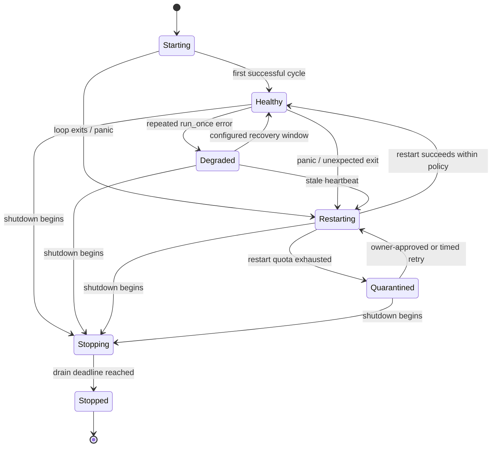
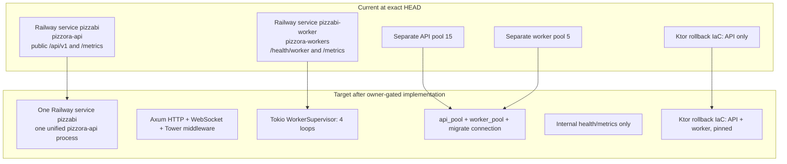
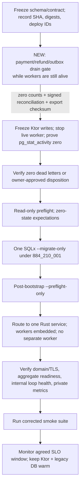
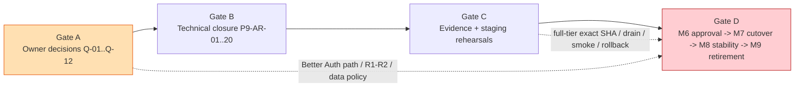

# Phase 9 Architecture and Blocker Resolution Report

## 1. Document control and authority

| Field | Value |
|---|---|
| Document purpose | Resolve Phase 9 architecture and blocker findings into one implementation-ready, read-only report for owner review. |
| Coordination role | Phase 9 Architecture Coordinator. |
| Exact local HEAD | `9a9cf3810d212c44977ed7d39cb5feb0b19862f1` |
| Branch | `ui-ux-changes` |
| `origin` | `git@github.com:imanpr33trai/pizzabi.git` |
| `origin/ui-ux-changes` | `46d697f384ce2c9e2e2d993b18b39afc63cdf8f3` — **5 commits ahead**, 0 behind local HEAD. |
| Phase 8 checkpoint | `5c21fa4` is an ancestor of exact HEAD. |
| Authority hierarchy | Owner decisions > `docs/PHASE9_KTOR_RETIREMENT_IMPLEMENTATION_PLAN.md` > `docs/PHASE9_SCOPE_DECISION.md` > readiness/QA artifacts > specialist findings. |
| Canonical plan boundary | `public/implementation_plan.md` remains canonical through Phase 8 and was not modified. |
| Change authority | This report creates **only** `docs/PHASE9_ARCHITECTURE_AND_BLOCKER_RESOLUTION.md`. It does not authorize implementation, production change, deployment, migration, retirement, or canonical-plan rewrite. |
| Specialist model | All seven specialists and all follow-ups were run with verified model `opencode/big-pickle` via `opencode run --model opencode/big-pickle --agent <agent> --prompt ...`. |
| Evidence labels | `[VERIFIED AT HEAD]` read-only inspection at exact HEAD; `[PRIOR EVIDENCE]` artifact inspected but not re-executed or not bound to exact HEAD; `[UNVERIFIED]` no executed proof or owner decision; `[OWNER DECISION]` cannot be resolved from repository evidence. |

Documents inspected read-only:

- `docs/PHASE9_KTOR_RETIREMENT_IMPLEMENTATION_PLAN.md`
- `docs/PHASE9_READINESS_ASSESSMENT.md`
- `docs/PHASE9_SCOPE_DECISION.md`
- `docs/PHASE8_REVIEWED_CONTRACT_RESOLUTIONS.md`
- `docs/PHASE8_IMPLEMENTATION_PROGRESS_REPORT.md`
- `qa-artifacts/phase8/review/W9_FINAL_INDEPENDENT_REVIEW.md`
- `infra/RUNBOOK.md`
- `public/implementation_plan.md`
- Source/config under `rust/`, `backend/`, `app/`, `shared/`, `.railway/`, `infra/`, and `.github/workflows/`.

No source, test, schema, migration, Android, CI, Railway, production, or secret state was changed. No tests, builds, emulators, migrations, deploys, backups, restores, or Git writes were performed.

---

## 2. Executive summary — resolution

The Phase 9 inventory is substantially reliable, but the architecture is **not executable as written** and several decisions are exclusively owner-owned. The coordinator therefore resolves the findings into an implementation-ready target design and a single blocker register, while keeping the final verdict blocked.

### 2.1 Architecture resolution register

| ID | Resolution | Class | Status |
|---|---|---|---|
| `P9-AR-01` | Rust is the sole authoritative backend; Ktor remains only as a rollback/frozen reference until separate retirement approval. | Owner-bound | Accepted; production actions gated. |
| `P9-AR-02` | Staging-first migration; staging never auto-promotes to production cutover or Ktor retirement. | Owner-bound | Accepted. |
| `P9-AR-03` | Fresh Rust-owned PostgreSQL is authoritative; SQLx `0001..0011` replaces Flyway adoption for the new DB. | Owner-bound | Accepted; execution `[UNVERIFIED]`. |
| `P9-AR-04` | Plan phrase “one SQLx pool with split budgets” is corrected to **one process with separately bounded `api_pool` and `worker_pool` plus a short-lived migration connection**. | Technical | Resolved; implementation required. |
| `P9-AR-05` | The unified production binary is the existing `pizzora-api` binary extended with worker supervision; no new binary is justified. | Technical | Resolved; implementation required. |
| `P9-AR-06` | Worker supervision becomes a real `WorkerSupervisor` with states, heartbeat, backoff, quarantine, and generation-aware lease fencing. | Technical + policy | Technical design resolved; thresholds owner/ops-owned. |
| `P9-AR-07` | Health contract becomes public aggregate readiness plus detailed internal worker health; loops start `STARTING`, never implicitly `HEALTHY`. | Technical + policy | Design resolved; `DEGRADED` HTTP semantics owner-owned. |
| `P9-AR-08` | Startup/shutdown is single-entry: one migration runner, one Redis subscriber, one-shot bootstrap only, ordered drain, no persistent `BOOTSTRAP_OWNER_*`. | Technical | Resolved; implementation required. |
| `P9-AR-09` | Contract redesign uses the verified 103-operation route set and a signed, generated OpenAPI artifact with schemas/security/responses; no compatibility layer. | Technical | Resolved; matrix signing required. |
| `P9-AR-10` | Android is a coordinated direct breaking replacement; domain/base-URL strategy and release-quality fix-or-waiver remain owner decisions. | Technical + owner | Design resolved; decisions open. |
| `P9-AR-11` | Better Auth Path A vs Path B is presented path-neutrally; the coordinator does not select either. No custom auth path may be silently relabeled as Better Auth. | Owner | Blocking. |
| `P9-AR-12` | Protected identity/session/provider, payment/refund, signing/secret, outbox/audit, backup/log, and operational data are not deleted without explicit decision. | Owner | Blocking. |
| `P9-AR-13` | A pre-freeze payment/refund/outbox drain and evidence-export gate is inserted before writer stop, worker stop, fresh-DB bootstrap, or purge/scrub. | Technical | Resolved; not implemented. |
| `P9-AR-14` | One Railway service is the target; Ktor rollback must include API **and** worker; all images pinned by digest; mutable `main` staging template corrected. | Technical | Resolved; live proof required. |
| `P9-AR-15` | One private metrics registry replaces public API/worker `/metrics`; public access is blocked at the edge and proven by request test. | Technical | Resolved; deployment proof required. |
| `P9-AR-16` | CORS allowlist or signed acceptance, SMTP fail-fast plus delivery proof, one-shot bootstrap, and variable-name-only inventory are required before cutover. | Technical + owner | Resolved; decisions/proof required. |
| `P9-AR-17` | Full-tier evidence must be bound to the exact candidate SHA; feature-branch tier skips and origin drift do not satisfy release gates. | Evidence | Resolved; execution required. |
| `P9-AR-18` | Every gate artifact carries SHA, command/workflow URL, UTC timestamp, environment, exit code, artifact path/checksum, and named approver where applicable. | Evidence | Resolved; execution required. |
| `P9-AR-19` | UniFFI defects are fix-or-waiver; no native activation claim is permitted without wiring proof. Inventory/recipes remain cutover responsibilities only. | Technical + owner | Resolved; decision open. |
| `P9-AR-20` | Gates A–D organize owner decision closure, technical closure, evidence closure, and authorized cutover/retirement. No gate can be bypassed by CI success. | Governance | Resolved. |

### 2.2 Single verdict basis

The blocking set is dominated by unresolved owner decisions (`Q-03`, `Q-04`, `Q-05`, and the remaining `Q-01`, `Q-02`, `Q-06`–`Q-12`), plus critical technical/evidence gaps: payment/refund drain proof, live topology reconciliation, supervisor/fencing, exact-HEAD full-tier execution, smoke/rollback/backup proof, and pinned deploy provenance. The architecture itself is resolved enough to implement once Gate A is signed; Phase 9 is not authorized now.

---

## 3. Binding Phase 9 decisions — resolution

| Decision | Owner decision | Resolution in this report |
|---|---|---|
| `D9-01` | Rust sole backend; Ktor fully retired eventually. | `P9-AR-01`. Ktor retained only as frozen rollback source during validation/stability. Retirement requires `Q-10`. |
| `D9-02` | Staging first; staging success is not production authorization. | `P9-AR-02`; M6 remains a hard manual gate. |
| `D9-03` | Historical application rows need not be preserved; protected data may not be assumed disposable. | `P9-AR-12`; `Q-05`/`Q-11` remain open. |
| `D9-04` | Fresh Rust-owned PostgreSQL; SQLx authoritative. | `P9-AR-03`; Flyway V1–V3 retained only as historical oracle/rollback evidence. |
| `D9-05` | Replace Ktor Railway service with one Rust service. | `P9-AR-14`; current two-service topology is an input, not target. |
| `D9-06` | Every Ktor worker responsibility moves to Rust. | `P9-AR-05`/`P9-AR-06`; responsibility matrix closed by route/worker inventory. |
| `D9-07` | One Rust service runs API + workers; separate worker requires critical reason and approval. | `P9-AR-05`; `Q-09` remains open for any exception. |
| `D9-08` | Axum, Tokio, Tower; avoid framework replacement. | Preserved; unified process extends existing Axum/Tower stack. |
| `D9-09` | Redesign contracts, not legacy reproduction. | `P9-AR-09`; 103 operations are inventory, not a mandate to clone Ktor wire behavior. |
| `D9-10` | Direct breaking replacement; no compatibility layer. | `P9-AR-09`/`P9-AR-10`; no shims, aliases, dual serializers, or fallback routers. |
| `D9-11` | Better Auth mandatory; no competing custom authority. | `P9-AR-11`; `Q-04` is blocking. |
| `D9-12` | Do not delete Better Auth identity/session/provider data without explicit decision. | `P9-AR-12`; applies regardless of Path A/B outcome. |
| `D9-13` | Inventory/recipes outside Phase 9 feature scope. | Existing Rust routes remain cutover responsibilities only; no new feature work. |

### Corrected source facts

- `MIGRATION_ADVISORY_LOCK_KEY = 884_210_001` at `rust/crates/pizzora-db/src/migrator.rs:12`.
- `EVENT_SEQUENCER_LOCK_KEY = 748_291_041` at `rust/crates/pizzora-workers/src/sequencer.rs:12`.
- `docs/PHASE9_KTOR_RETIREMENT_IMPLEMENTATION_PLAN.md:344` incorrectly attributes `884_210_001` to the sequencer; this report supersedes that line for execution design.

---

## 4. Scope, non-goals, and change boundary — resolution

### 4.1 In scope for this report

- Read-only verification of exact HEAD, remotes, checkpoint, worktrees, and preserved changes.
- Integration of seven specialist reports and challenge follow-ups.
- Resolution of architecture design contradictions into `P9-AR-*`.
- One unified blocker register `P9-B-01..36`.
- Stable acceptance/test/risk preservation and centrally assigned new test IDs.
- Gates A–D, next sequence, and one final verdict.

### 4.2 Prohibited and not performed

- No implementation, build, test, emulator, migration, deployment, rollback, backup/restore, Railway operation, secret access, or state change.
- No edit to `public/implementation_plan.md`, source, tests, schemas, migrations, Android, CI, Railway, or production artifacts.
- No commit, push, merge, branch switch, worktree disturbance, or destructive Git operation.
- No selection of Better Auth Path A or Path B.
- No new inventory/recipe feature scope.

### 4.3 Starting working-tree state preserved

```text
 M .opencode/opencode.jsonc
?? docs/PHASE9_KTOR_RETIREMENT_IMPLEMENTATION_PLAN.md
?? docs/PHASE9_READINESS_ASSESSMENT.md
?? docs/PHASE9_SCOPE_DECISION.md
```

The only permitted addition by this task is `docs/PHASE9_ARCHITECTURE_AND_BLOCKER_RESOLUTION.md`.

---

## 5. Baseline verification — resolution

| Item | Result | Evidence class |
|---|---|---|
| Local HEAD | `9a9cf3810d212c44977ed7d39cb5feb0b19862f1` | `[VERIFIED AT HEAD]` |
| Branch | `ui-ux-changes` | `[VERIFIED AT HEAD]` |
| Checkpoint | `5c21fa4` is ancestor | `[VERIFIED AT HEAD]` |
| Remote | `origin git@github.com:imanpr33trai/pizzabi.git` | `[VERIFIED AT HEAD]` |
| `origin/ui-ux-changes` | `46d697f384ce2c9e2e2d993b18b39afc63cdf8f3`; ahead 5, behind 0 | `[VERIFIED AT HEAD]` |
| Extra origin commits | `ab5f9cb`, `fe45f56`, `7fe817c`, `b595f75`, `46d697f` | `[VERIFIED AT HEAD]` |
| Origin diff scope | `.github/workflows/temp-phase8-validation.yml`, `app/build.gradle.kts`, `app/lint.xml`, `gradle/libs.versions.toml`, `gradle/verification-metadata.xml`; DevOps verdict unchanged | `[VERIFIED AT HEAD]` |
| Worktrees inspected | main `/workspace/pizzabi`; `glad-trout` detached `46d697f`; `steel-bell` on `main` `415c17b`; `vivid-gate` on `mattpocock` `6544440`; prunable `/home/remote/.local/share/opencode/worktree/ea3529/mattpocock` `4752c67` | `[VERIFIED AT HEAD]` |
| Starting status | Four entries listed in Section 4.3 | `[VERIFIED AT HEAD]` |

Baseline consequence: evidence at `9a9cf38` does **not** prove `46d697f`, and evidence at `46d697f` does **not** prove `9a9cf38`. `P9-T-01` and `P9-T-17` must name the exact candidate SHA and ahead/behind state.

---

## 6. Evidence hierarchy and Phase 8 baseline — resolution

### 6.1 Labels

| Label | Meaning |
|---|---|
| `[VERIFIED AT HEAD]` | Directly read from exact HEAD `9a9cf38` during this read-only task. |
| `[PRIOR EVIDENCE]` | Inspected artifact or historical count; not re-executed and not automatically bindable to a Phase 9 candidate SHA. |
| `[UNVERIFIED]` | No executed proof, no live-system proof, or no owner decision. |
| `[OWNER DECISION]` | Repository evidence cannot resolve; owner signature required. |

### 6.2 Preserved Phase 8 baseline

| Evidence | Recorded value | Status |
|---|---|---|
| Android unit/Robolectric XML | 230 tests | `[PRIOR EVIDENCE]` |
| Kotlin backend XML | 86 tests | `[PRIOR EVIDENCE]` |
| Shared contracts XML | 40 tests | `[PRIOR EVIDENCE]` |
| Rust workspace tests | 67 passed, 21 ignored | `[PRIOR EVIDENCE]` |
| Pricing parity vectors | 33 vectors | `[PRIOR EVIDENCE]` |
| Phase 8 live PostgreSQL and migration CLI logs | Logs inspected; weak SHA/command/timestamp/env/exit provenance | `[PRIOR EVIDENCE]` |

These numbers are retained for context only. They must be regenerated at the exact candidate SHA with full provenance before any Phase 9 gate may claim a pass.

---

## 7. Current Ktor backend inventory — resolution

| Item | Count / finding | Evidence |
|---|---:|---|
| Ktor route files | 22 `*Routes.kt` files | `[VERIFIED AT HEAD]` |
| Ktor source handlers | 104 = 99 REST + 1 WebSocket + 4 application ops | `[VERIFIED AT HEAD]` |
| Distinct Ktor method/path operations | 103 | `[VERIFIED AT HEAD]` |
| WebSocket ambiguity | `GET /ws/v1/events` has HTTP-426 guard plus WebSocket upgrade handler | `[VERIFIED AT HEAD]` |
| Ktor worker endpoints | 2: `GET /health/worker`, `GET /metrics` | `[VERIFIED AT HEAD]` |
| Ktor OpenAPI | 54 path blocks, 65 method blocks, at least 38 source operations absent | `[VERIFIED AT HEAD]` |
| Ktor worker topology | Worker exists as separate process; rollback IaC contains API only | `[VERIFIED AT HEAD]` |

Resolution: the Ktor inventory is complete enough for transfer mapping. The 104-to-103 reconciliation is understood and must be recorded in the signed contract matrix; the WebSocket guard/upgrade pair is one wire operation.

---

## 8. Current Rust backend inventory — resolution

| Item | Count / finding | Evidence |
|---|---:|---|
| Workspace crates | 8: `core`, `uniffi`, `config`, `db`, `auth`, `payments`, `workers`, `api` | `[VERIFIED AT HEAD]` |
| API router registrations | 82 `.route(...)` calls | `[VERIFIED AT HEAD]` |
| API method handlers | 103: 38 GET, 40 POST, 4 PUT, 14 PATCH, 7 DELETE | `[VERIFIED AT HEAD]` |
| API worker loops | None; API starts Redis Pub/Sub subscriber only | `[VERIFIED AT HEAD]` |
| Worker endpoints | 2 on separate health/metrics server | `[VERIFIED AT HEAD]` |
| API `/metrics` | Public route exists | `[VERIFIED AT HEAD]` |
| Bootstrap | Persistent `BOOTSTRAP_OWNER_*` runs on every API start and can overwrite owner fields | `[VERIFIED AT HEAD]` |
| Loop supervision | Four `tokio::spawn` calls; handles awaited only during shutdown; no restart watcher | `[VERIFIED AT HEAD]` |
| Dispatcher concurrency | Hardcoded `4` | `[VERIFIED AT HEAD]` |
| Loop health | Booleans start `true` before first cycle | `[VERIFIED AT HEAD]` |
| Auth | Custom HS256 JWT authority (`issuer=pizzora-api`), `access_token`/`refresh_token`; no Better Auth references | `[VERIFIED AT HEAD]` |
| SQLx profile | `0001..0011`, 51 required tables, 25 required indexes | `[VERIFIED AT HEAD]` |

Resolution: Rust already owns the complete API surface and reusable worker loops. The missing work is consolidation, supervision, health, fencing, auth authority, deployment topology, and proof.

---

## 9. API contract redesign and parity inventory — resolution

### 9.1 Corrected OpenAPI drift

| Item | Corrected result |
|---|---:|
| Rust router operations | 103 |
| OpenAPI path keys | 66 |
| Documented operations | 79 |
| Router operations missing from OpenAPI | 24 |
| Extra documented operations | 0 |
| Documented operation content | `summary` and `tags` only; no schemas, parameters, security requirements, responses, or error bodies |
| Top-level `security` block | Absent |
| Ktor documented operations absent | At least 38 |

The earlier “40 operations / 63 missing” figure is not reproducible at exact HEAD and is superseded by the corrected numbers above.

### 9.2 Signed contract matrix requirements

The contract matrix must cover all 103 distinct operations and the WebSocket guard/upgrade ambiguity. Every row must bind:

1. Stable contract row number.
2. Final method and path.
3. Rust handler/service owner.
4. Request and response schema with integer-paise and snake_case primitives.
5. Success status and nested error envelope: `error.code`, `error.message`, `error.details`, `correlation_id`, `timestamp`.
6. Auth requirement: public, JWT, permission, WebSocket ticket/Bearer, or Razorpay signature.
7. Side effects: outbox, audit, payment, stock/slot, image object, or session change.
8. Android call site or explicit no-consumer declaration.
9. Test IDs from preserved `P9-T-01..19` plus added IDs.
10. Owner sign-off and OpenAPI revision `P9-<matrix-revision>`.

### 9.3 No compatibility layer

Per `D9-10`, redirects, aliases, legacy field names, dual serializers, fallback routers, and parallel v1/v2 operation sets are prohibited. If behavior cannot remain byte-compatible under the signed matrix, the base URL/version and APK rollout must change together (`Q-02`).

---

## 10. Background worker responsibility transfer — resolution

Four responsibilities transfer into the unified Rust process:

| Loop | Current owner | Required unified owner | Critical gap |
|---|---|---|---|
| Event sequencer | `pizzora-workers` standalone | `WorkerSupervisor` in unified binary | Advisory lock is `748_291_041`, distinct from migration lock. |
| Outbox dispatcher | `pizzora-workers` standalone | `WorkerSupervisor` with `worker_pool` | Claims have no owner/generation; email is at-least-once. |
| Expiry sweep | `pizzora-workers` standalone | `WorkerSupervisor` | Purge currently includes `DEAD_LETTER`; envelope scrub destroys payload evidence. |
| Reconciler | `pizzora-workers` standalone | `WorkerSupervisor` | Must participate in health/quarantine and shutdown drain. |

### Supervisor state resolution



Diagram 1/5: Worker supervisor state contract. Technical states are resolved; thresholds, required/optional loop policy, and `DEGRADED` HTTP status are owner/ops decisions.

### Supervisor minimum contract

| Element | Technical requirement | Owner/ops decision |
|---|---|---|
| States | `Starting`, `Healthy`, `Degraded`, `Restarting`, `Quarantined`, `Stopping`, `Stopped`; initialize `Starting`. | Which states make readiness not-ready. |
| Heartbeat | Per-loop last-success timestamp; stale detector; internal health/metrics exposure. | Stale threshold and grace window. |
| Restart | Continuous `JoinHandle` watch; backoff, restart count, last error; no restart during shutdown. | Base/cap/jitter, max restarts, reset/quarantine duration. |
| Lease fencing | Add owner UUID + generation; claim/renew/mark only for current generation. | Lease duration, renewal cadence, duplicate-delivery acceptance. |
| Health | Supervisor snapshot feeds public aggregate and detailed internal health. | Required vs optional loops; `DEGRADED` status code. |
| Shutdown | Stop traffic → draining → cancel subscriber/supervisor → await loops → close `worker_pool` → close `api_pool`. | Timeout and forced-exit behavior. |

---

## 11. Database and migration strategy — resolution

### 11.1 Authoritative profile

- The new production DB is empty and Rust-owned.
- SQLx `0001..0011` is authoritative.
- “51 tables / 25 indexes” means **required names are present**, not proof that the catalog contains no other objects.
- Flyway V1–V3 are historical/rollback evidence only; no Flyway adoption on the fresh DB.
- Runtime must use `RUN_MIGRATIONS_ON_STARTUP=false` and verify invariants read-only.

### 11.2 Corrected migration sequence

The coordinator independently verified that `--preflight-only` on an empty DB exits with `UnsafeDatabaseState("neither flyway_schema_history nor _sqlx_migrations exists; database is not ready for cutover")`. Therefore the safe sequence is:

1. Zero-state check on the fresh DB.
2. Exactly one `--migrate-only` invocation under `884_210_001`.
3. Post-bootstrap `--preflight-only` verification.
4. Runtime start with migrations disabled and read-only invariant verification.
5. One-shot owner bootstrap only; no persistent `BOOTSTRAP_OWNER_*`.

The plan’s Step 4-before-Step 5 wording is non-executable as written and is corrected here.

### 11.3 Lock correction

| Lock | Value | Source |
|---|---:|---|
| Migration advisory lock | `884_210_001` | `rust/crates/pizzora-db/src/migrator.rs:12` |
| Event sequencer advisory lock | `748_291_041` | `rust/crates/pizzora-workers/src/sequencer.rs:12` |

### 11.4 Outbox retention conflict

| Source behavior | Evidence | Resolution |
|---|---|---|
| Purge deletes `DISPATCHED` and `DEAD_LETTER` rows | `rust/crates/pizzora-db/src/outbox.rs:326-345` | Export all `DEAD_LETTER` rows and all rows containing `sealed_envelope` before any purge/scrub cycle. |
| Envelope scrub nulls `sealed_envelope` for `DISPATCHED`/`DEAD_LETTER` | `rust/crates/pizzora-auth/src/outbox_crypto.rs:231-240` | Treat scrub as destructive; require checksum-bearing evidence artifact. |
| Expiry sweep invokes purge/scrub every cycle | `rust/crates/pizzora-workers/src/expiry_sweep.rs:43-46,258-271` | Sweep must not run before the pre-cutover export gate. |

### 11.5 Pool budget resolution

Semaphores alone are insufficient. The dispatcher already limits concurrency at the call site, but SQLx `max_connections` is the only mechanism that reserves physical PostgreSQL connections. With one shared pool, API saturation can starve worker lease/renewal paths. The executable target is `api_pool`, `worker_pool`, and a short-lived migration connection with distinct labels and budgets.

---

## 12. Better Auth integration boundary — resolution

### 12.1 Verified current state

| Finding | Status |
|---|---|
| No Better Auth references in repo | `[VERIFIED AT HEAD]` |
| Two custom auth control planes: Ktor and Rust | `[VERIFIED AT HEAD]` |
| Rust JWTs are HS256, issuer `pizzora-api`, with `access_token`/`refresh_token` | `[VERIFIED AT HEAD]` |
| Current auth hardening is coherent but custom | `[VERIFIED AT HEAD]` |
| Claim that Better Auth is preserved | `[UNVERIFIED]` / NO-GO |

### 12.2 Official-document findings retrieved 2026-11-28

- Better Auth documentation is TypeScript-centric.
- JWT plugin/JWKS is a supported pattern.
- Resource-server introspection is described in OAuth-provider contexts, not as a generic native client SDK.
- Expo/mobile docs are JavaScript/Expo-oriented, not native Kotlin proof.
- No native Rust SDK is assumed.

### 12.3 Path-neutral decision presentation

| Path | Meaning | Required owner evidence |
|---|---|---|
| Path A | External Better Auth deployment exists. | Base URL, issuer, token/refresh/logout/revocation endpoints, JWKS or introspection, algorithms, `kid` rotation, audience, token type claims, mobile callback scheme, redirects, webhook/verification secret, SMTP provider/templates, owner bootstrap API, role mapping, signing keys, identity data boundary, Android flow proof. |
| Path B | No external deployment exists. | Signed separate identity-migration project, or explicit amendment of `D9-11`. Phase 9 must not silently promote current custom auth and call it Better Auth. |

The coordinator does **not** select Path A or Path B. `P9-B-01` and `P9-B-13` remain blocking until `Q-04` is signed.

### 12.4 Rollback auth authority

Rollback must not restore a second active token issuer. The rollback-authority statement must be consistent with the signed `Q-04` outcome and prove that only one backend creates sessions/tokens in any active topology.

---

## 13. Security, secrets, and configuration — resolution

| Control | Current gap | Required resolution | ID |
|---|---|---|---|
| Bootstrap | Persistent `BOOTSTRAP_OWNER_*` can overwrite owner on every start. | Remove automatic path; retain one-shot `--bootstrap-owner`; prove no overwrite on restart. | `P9-AR-08`, `P9-B-30` |
| CORS | `Any` origin with `Authorization`. | Allowlist or signed residual-risk acceptance. | `P9-AR-16`, `P9-B-12` |
| SMTP | Missing/misconfigured SMTP does not fail fast in production config. | Fail-fast plus staging delivery proof. | `P9-AR-16`, `P9-B-12` |
| Derived keys/secrets | No deletion assumed; rotation boundary unresolved. | Inventory names only; preserve and control rotation. | `P9-AR-12` |
| Webhook | Signature verification/idempotence exists; pre-cutover ambiguity still needs reconciliation. | Drain gate plus webhook idempotence proof. | `P9-AR-13`, `P9-B-14` |
| Runtime config | `RUN_MIGRATIONS_ON_STARTUP` default is non-production-safe outside production. | Explicit `false` in steady-state runtime. | `P9-AR-08` |
| Secret evidence | Logs/docs must not contain values. | Variable names only plus named approver. | `P9-AR-18` |

---

## 14. Android client and UniFFI integration — resolution

### 14.1 Android migration

| Surface | Resolution |
|---|---|
| Base URL | Release default `https://api.pizzora.app`; debug `http://10.0.2.2:8080`; no runtime switch. Preserve hostname only if all consumed operations remain wire-compatible; otherwise coordinated APK/domain change under `Q-02`. |
| Manual client coupling | `PizzoraApiClient.kt` hardcodes paths, verbs, snake_case queries, `Idempotency-Key`, nested envelope, and 401 refresh. Generate/template from signed matrix; no fallback. |
| Session safety | Preserve Keystore AES-GCM storage, epoch cancellation, logout-in-progress guard, user-ID mismatch handling, and token-cache invalidation. |
| Status semantics | Preserve 401 single-flight refresh, 422 cart fallback, 403/404 reorder messages, 201/204 CRUD, 202 resend/forgot/refund, 426 + upgrade for WS. |
| Token casing | Contract emits `access_token`/`refresh_token`; smoke harness is wrong and must be fixed, not the contract. |
| Evidence | APK SHA-256, versionName/versionCode, base URL, build command, exact SHA, runtime XML/screens, redaction proof. |

### 14.2 UniFFI and release quality

| Gap | Resolution |
|---|---|
| Six unwrapped exports and bridge gaps | Fix and prove, or waive under `Q-07`; no native activation claim without wiring proof. |
| Conditional defects | Price-extras helper, debug-name issue codes, reorder fallback divergence, ordering/default fail-open issues must be fixed if native path is claimed. |
| Menu price clipping at 2.0× font | Fix or waive under `Q-08`. |
| Version metadata mismatch | Fix before any new APK release claim. |
| Inventory/recipes | Out of feature scope; existing routes are cutover responsibilities only; Rust parity/resolution gaps remain open. |

---

## 15. Target architecture — resolution

### 15.1 Chosen executable shape

Extend `pizzora-api` as the single production binary. A new binary would duplicate startup/state/wiring already present in `pizzora-api` without a source-supported benefit. Worker loops remain reusable library objects in `pizzora-workers`.

### 15.2 Current vs target topology



Diagram 2/5: Current two-service topology to owner-gated single-service topology.

### 15.3 Unified startup/shutdown

```mermaid
sequenceDiagram
    participant Ops as Operator/Deploy
    participant Main as Unified pizzora-api
    participant DB as PostgreSQL
    participant Redis as Redis
    participant Sup as WorkerSupervisor
    participant HTTP as Axum/Tower

    Ops->>Main: start with RUN_MIGRATIONS_ON_STARTUP=false
    Main->>Main: parse CLI + load config
    Main->>DB: build api_pool and worker_pool
    Main->>DB: read-only invariant verification
    Main->>Redis: connect once
    Main->>Sup: create supervisor, loops STARTING
    Main->>HTTP: bind public + internal listeners
    HTTP-->>Ops: live ready; aggregate ready after required loops
    Note over Main,Sup: One Redis subscriber; one metrics registry
    Ops->>Main: SIGTERM
    Main->>HTTP: mark draining, stop traffic
    Main->>Sup: cancel supervisor, await loops under deadline
    Main->>Redis: cancel and await subscriber
    Main->>DB: close worker_pool then api_pool
    Main-->>Ops: exit with cleanup status
```

Diagram 3/5: Unified process lifecycle. The migration step is a separate pre-deploy invocation, not a runtime step.

### 15.4 Exact file/module change list

| File/module | Required change |
|---|---|
| `rust/Cargo.toml` | Add `pizzora-workers` workspace dependency. |
| `rust/crates/pizzora-api/Cargo.toml` | Add `pizzora-workers.workspace = true`. |
| `rust/crates/pizzora-api/src/lib.rs` | Replace standalone declaration with unified-runtime contract; export internal health/metrics module. |
| `rust/crates/pizzora-api/src/main.rs` | Unified startup/shutdown; remove persistent auto-bootstrap; create both pools; one subscriber; supervisor; internal listener. |
| `rust/crates/pizzora-api/src/state.rs` | Keep/clarify existing pool as API-only. |
| `rust/crates/pizzora-api/src/router.rs` | Remove public `/metrics`; keep public router/middleware and 103 operations. |
| `rust/crates/pizzora-api/src/health.rs` | Accept supervisor aggregate status; detailed state remains internal. |
| `rust/crates/pizzora-api/src/dto.rs` | Add required health states/transitions. |
| `rust/crates/pizzora-api/src/services/realtime.rs` | Return and await Pub/Sub subscriber handle. |
| `rust/crates/pizzora-api/src/metrics.rs` | Merge labels into one registry with `service`, `pool`, `loop`. |
| `rust/crates/pizzora-api/src/error.rs` | Preserve nested error envelope as normative. |
| `rust/crates/pizzora-workers/src/runtime.rs` | Replace spawn-only logic with `WorkerSupervisor`; configurable dispatcher concurrency. |
| `rust/crates/pizzora-workers/src/metrics.rs` | Stateful per-loop metrics; remove default-true health. |
| `rust/crates/pizzora-workers/src/http.rs` | Internal health/metrics router consuming supervisor snapshot. |
| `rust/crates/pizzora-config/src/lib.rs` | Add worker pool, supervisor, internal port, dispatcher concurrency, and health-threshold config with production validation. |
| `rust/crates/pizzora-db/src/pool.rs` | Explicit pool-options builder for differing API/worker limits. |
| `rust/crates/pizzora-db/src/migrations/0012_worker_lease_fencing.sql` | Add lease owner/generation columns under approved fresh-DB schema change. |
| `rust/crates/pizzora-db/src/outbox.rs` | Fenced claim/renew/mark; retain `DEAD_LETTER` evidence until approved export. |
| `infra/Dockerfile.rust` | Build/copy unified production binary only; standalone worker only as non-deployed test tooling. |
| `.railway/railway.ts` | One steady-state service; no `pizzabi-worker`; private metrics access; pinned digest. |
| `.railway/railway.template.ts` | Replace mutable `main` sources with pinned commit/digest. |
| `.railway/railway.ktor-rollback.ts` | Complete Ktor API + worker rollback with pinned images and worker-stop ordering. |
| `infra/docker-compose.prod.yml`, `infra/docker-compose.rust-staging.yml` | Collapse to one unified service; set both pool variables; private metrics target. |
| `infra/monitoring/prometheus.yml`, `infra/monitoring/alerts.yml` | One scrape target with labels; worker/loop/pool/backlog alerts. |
| `infra/RUNBOOK.md` | Reconcile SQLx `1..11`, one runner, single service, health, bootstrap, pool formula, drain gate, rollback order, data policy. |
| `infra/scripts/verify-production-cutover.sh` | Correct `access_token`/`refresh_token` and nested `error` envelope; cover all required paths. |

This is an implementation change list only. No change was made by this report.

---

## 16. Railway topology, domains, health, and rollback exposure — resolution

| Topic | Current | Target / required proof |
|---|---|---|
| Steady-state services | `pizzabi` + `pizzabi-worker` | One Rust service only; no duplicate worker. |
| Health | Public API readiness static PG/Redis/storage; worker health separate and initially false-healthy before first cycle | Public aggregate readiness + internal per-loop health; required loop death/stale heartbeat/quarantine makes not-ready. |
| Domain | Presumed `https://api.pizzora.app` | Preserve unless `Q-02` approves new APK/domain. |
| Metrics | Public API `/metrics`; separate worker `/metrics` | Private scrape only; public blocked at edge. |
| Staging template | Uses mutable `main` sources | Pinned commit/digest; isolated DB/Redis/secrets. |
| Ktor rollback | API only, despite worker-stop comment | API + worker; pinned digests; migrations disabled; rehearsed. |
| Live evidence | `[UNVERIFIED]` | `railway status`, `railway config plan`, deploy IDs, env identifiers, zero active worker transactions proof. |

### Mandatory live topology reconciliation

Before staging and again before cutover:

1. Capture `railway status` / `railway config plan` output bound to exact SHA, timestamp, environment, service IDs, deploy IDs.
2. Determine which worker is actually live: Rust `pizzabi-worker` or a Ktor worker. The plan’s “stop Ktor worker” instruction cannot execute until this is known.
3. Determine live DB authority: Flyway V1–V3 with `AdoptExistingFlywayV1ToV3` vs fresh SQLx `1..11`; these are mutually exclusive.
4. Prove zero active worker transactions via `pg_stat_activity` before embedded loops start.
5. Correct IaC to one-service target and complete Ktor rollback topology with pinned digests.

---

## 17. Observability and metrics protection — resolution

| Signal | Required implementation/proof |
|---|---|
| Metrics registry | One registry with `service`, `pool`, and `loop` labels; remove duplicate unlabeled gauges. |
| Public `/metrics` | 403/404 from public internet; evidence with command, timestamp, SHA, environment. |
| Private scrape | 200 from allowed scraper; exact path/auth/proxy model documented. |
| Liveness | Process accepting traffic; no dependency checks. |
| Readiness | Dependencies plus aggregate worker state; per-loop detail internal only. |
| Worker health | Per-loop state, heartbeat age, restart count, last error, DB status, backlog, dead-letter count. |
| Dashboards/alerts | 5xx, latency, readiness, loop heartbeats, outbox backlog, dead letters, pool saturation, failed refunds/reconciliation. |
| Stability evidence | SLO snapshots, alert history, incident log retained for agreed window. |

No Railway deployment of Prometheus, Alertmanager, Grafana, or an edge block was found. Public `/metrics` is a P1 blocker until proven blocked (`P9-B-22`).

---

## 18. CI/CD and release strategy — resolution

### 18.1 Required full-tier jobs at exact SHA

The release gate requires a run where these jobs are present and green, not skipped by feature-branch tiering:

- `preflight`
- `rust-quality` including fmt, clippy, check, and `pizzora-core` purity
- `kotlin-contracts-and-backend`
- `android-prep`
- `test-rust-parity`
- `test-rust-unit`
- `test-rust-integration` with PostgreSQL 18 and Redis 7
- `test-android`
- `test-android-instrumented`
- Required Docker validation/publish-mode jobs per release policy
- Corrected smoke, rollback, and backup/restore rehearsal evidence outside CI but bound to the same SHA/digest

### 18.2 Feature-push skip hazard

Ordinary feature-branch pushes skip parity, Rust integration, Android prep/unit/instrumented, and Docker tiers. A green feature-push run is not evidence for `P9-T-17`. The exact candidate SHA, run URL, job list, conclusions, and artifacts must be recorded.

### 18.3 Pinned artifact provenance

Mutable `:latest` and apply-time builds invalidate rollback determinism. Rust and Ktor images must be pinned by digest, propagated into Railway/Compose/runbook, and recorded with SHA, command, timestamp, environment, and exit code. Origin’s temporary full-stack workflow adds read-only production health GETs and Android/Gradle validation but does not fix topology, digest pinning, rollback completeness, metrics blocking, smoke defects, or Phase 9 evidence gaps.

---

## 19. Staging migration rehearsal — resolution

Staging must be isolated: separate project/environment, DB, Redis, secrets, Razorpay sandbox, SMTP sink, pinned artifact, no production writes.

Rehearsal sequence:

1. Prove candidate SHA and digest.
2. Provision empty isolated PostgreSQL.
3. Zero-state check → one `--migrate-only` → post-bootstrap `--preflight-only`.
4. Start unified service with `RUN_MIGRATIONS_ON_STARTUP=false`.
5. Prove one process, one supervisor, one subscriber, two labeled pools, no duplicate worker.
6. Run corrected smoke: auth envelope/token casing, cart/order reads, safe checkout, webhook rejection/verification, KDS WebSocket, owner safe operations, notifications, worker/internal health.
7. Prove private metrics and public block.
8. Execute supervisor fault injection and lease-fencing test.
9. Execute backup + isolated restore drill with checksum and required-name parity.
10. Execute rollback drill with Ktor API + worker and zero active Rust worker transactions.
11. Record zero unresolved P0/P1 before any M6 approval request.

All commands must be logged with full provenance.

---

## 20. Production cutover plan — conditional only — resolution

This section defines the sequence only after explicit written approval. It is not authorization.

### 20.1 Pre-cutover gates G-01..G-12

| Gate | Requirement | Current status |
|---|---|---|
| `G-01` | Written approval naming project, services, window, owner, rollback path, stability window. | `[UNVERIFIED]` |
| `G-02` | Staging rehearsal passed; zero P0/P1. | `[UNVERIFIED]` |
| `G-03` | Fresh production DB provisioned and isolated. | `[UNVERIFIED]` |
| `G-04` | Pinned Rust digest and Ktor rollback digest recorded. | `[UNVERIFIED]` |
| `G-05` | Variable inventory verified; no secret values. | `[UNVERIFIED]` |
| `G-06` | Better Auth proof passed. | `[UNVERIFIED]` |
| `G-07` | Corrected smoke passed in staging and ready for production. | `[UNVERIFIED]` |
| `G-08` | Private metrics/observability in place; public `/metrics` blocked. | `[UNVERIFIED]` |
| `G-09` | Worker drain and dead-letter procedure rehearsed. | `[UNVERIFIED]` |
| `G-10` | Rollback topology complete with Ktor API + worker. | `[UNVERIFIED]` |
| `G-11` | Owner accepts rollback data policy. | `[UNVERIFIED]` |
| `G-12` | Android/domain contract decision finalized. | `[UNVERIFIED]` |

### 20.2 Corrected cutover sequence with drain gate



Diagram 4/5: Owner-gated cutover sequence. The drain gate is inserted before writer/worker stop.

### 20.3 Exact drain gate predicates

All predicates must pass and be recorded before writer/worker stop:

1. `SELECT count(*) FROM outbox_events WHERE event_type IN ('PAYMENT_GATEWAY_ORDER_REQUESTED','REFUND_REQUESTED') AND dispatch_status IN ('PENDING','PROCESSING') = 0`.
2. `SELECT count(*) FROM payment_attempts WHERE status = 'INITIATING' = 0`.
3. Signed Razorpay reconciliation report covering every ambiguous `payment_attempts` / `refunds` row; no unresolved capture or refund.
4. Export before destruction: all `DEAD_LETTER` outbox rows and all rows containing `sealed_envelope`, including encrypted payloads and key IDs, to owner-retained artifact with checksum.
5. Post-stop proof: after workers stop, `pg_stat_activity` shows zero worker transactions.

Failure of predicates 1–4 is a hard stop before Step 3.

### 20.4 Stop conditions

Stop/rollback on sustained 5xx, readiness failure, auth/session failure, cart ownership regression, checkout/payment/refund inconsistency, duplicate dispatch/refund, unbounded outbox backlog, dead-letter spike, schema drift, loss of critical logs/metrics, or failure of public metrics blocking.

---

## 21. Rollback strategy — resolution

| Requirement | Resolution |
|---|---|
| Direction | Service/route replacement to pinned Ktor API + Ktor worker against frozen legacy DB; not DB restore by default. |
| Stop order | Stop embedded Rust worker loops first; prove zero active Rust worker transactions; then drain/stop Rust API. |
| Restore | Restore pinned Ktor API and worker with migrations disabled and no Flyway preDeploy. |
| Verification | Ktor readiness, metrics, login/catalog/checkout-safe path, WebSocket, single-worker operation. |
| Auth | No second active token issuer; statement must match signed `Q-04`. |
| Data policy | R1 or R2 must be signed under `Q-03`; current plan effectively assumes R1 without signature. |
| DB restore | Only if corruption is proven and owner-approved. |
| Evidence | Trigger, decision owner, deploy IDs, health/smoke evidence, data-disposition notes. |

### R1 vs R2

| Policy | Meaning | Consequence |
|---|---|---|
| R1 — irreversible cutover | Fresh-DB post-cutover writes are not replayed to legacy DB. Rollback is stop-loss only; recovery is manual and outside Phase 9. | Owner signs `G-11`; remove “rollback assets warm” safety framing implying reversibility. |
| R2 — reversible cutover | Fund change-capture/reconciliation or shared identity/payment store so rollback returns to consistent state. | New funded project with scope/milestones/evidence before M6; current graph has no such workstream. |

The coordinator does not select R1 or R2.

---

## 22. Ktor retirement and archive criteria — resolution

Ktor retirement remains a separate final milestone and requires:

1. Clean agreed stability window under `Q-06`.
2. Explicit written approval naming scope/date/window under `Q-10`.
3. Confirmation rollback assets are no longer needed.
4. Data disposition decision for legacy DB, identity/provider data, payment/audit evidence, backups, and logs.
5. Preservation of Flyway V1–V3, backups, audit/cutover evidence, and decision records.
6. Replacement of any CI gate depending on Kotlin fixture generation before removing the generator.
7. Archive/removal only after approval of `backend/`, `infra/Dockerfile.backend`, `.github/workflows/publish-backend.yml`, `.railway/railway.ktor-rollback.ts`, and `infra/docker-compose.ktor-rollback.yml`.

Retirement must not be bundled with cutover. No retirement approval exists at exact HEAD.

---

## 23. Evidence and acceptance provenance — resolution

### 23.1 Required evidence package per gate

Every gate artifact must contain:

- Exact commit SHA and branch.
- `origin/<branch>` SHA and ahead/behind at capture.
- Full command line or workflow run URL.
- UTC timestamp with timezone.
- Exit code or explicit pass/fail.
- Environment/project/service identifiers.
- Tool versions and DB/Redis image tags where applicable.
- Pinned artifact digest where deployment is involved.
- Log artifact path and checksum.
- Named approver for sign-off gates.
- Evidence label: `[VERIFIED AT HEAD]`, `[PRIOR EVIDENCE]`, or `[UNVERIFIED]`.

### 23.2 Current evidence status

| Evidence class | Status |
|---|---|
| Git baseline | `[VERIFIED AT HEAD]` at `9a9cf38`; origin drift proven. |
| Phase 8 XML counts | `[PRIOR EVIDENCE]` only. |
| Live PostgreSQL at exact HEAD | `[UNVERIFIED]` |
| Full-tier CI at exact HEAD | `[UNVERIFIED]` |
| Better Auth integration | `[UNVERIFIED]` |
| Backup/restore execution | `[UNVERIFIED]` |
| Pinned digests in deployment | `[UNVERIFIED]` |
| Smoke execution | `[UNVERIFIED]`; harness currently defective. |
| Rollback drill | `[UNVERIFIED]` |
| Railway live topology | `[UNVERIFIED]` |
| Ktor retirement approval | `[UNVERIFIED]` |

### 23.3 CI commands that must be re-executed at exact candidate SHA

```text
cd rust
cargo fmt --all -- --check
cargo clippy --workspace --all-targets --all-features --locked -- -D warnings
cargo check --workspace --all-features --locked
cargo test -p pizzora-core --all-features --locked
cargo test -p pizzora-api --lib --all-features --locked
cargo test --workspace --all-features --locked
cargo test --workspace --all-features --locked -- --ignored --test-threads=1

cd ..
./gradlew -PbackendOnly=true :shared:contracts:test :backend:test --no-daemon
./gradlew :app:generateUniFfiKotlinBindings :app:testDebugUnitTest -PpizzoraRequireRust=true --no-daemon
bash .github/scripts/run-android-instrumentation.sh
```

Live integration requires `PIZZORA_ENV=development`, `DATABASE_URL`, `TEST_POSTGRES_URL`, `REDIS_URL`, PostgreSQL 18-compatible service, Redis 7, and single-threaded ignored execution. Ignored live tests exist in API, workers, payments, and DB crates; the plan’s “21” count is `[PRIOR EVIDENCE]` and must be recounted at execution.

No result in this report is a claim that those commands were run.

---

## 24. Milestone plan and dependency graph — resolution

### 24.1 Gates A–D

| Gate | Name | Exit criterion | Current state |
|---|---|---|---|
| Gate A | Owner decision closure | `Q-01..Q-12` signed; Better Auth path recorded or amendment; R1/R2 selected; protected data disposition and reset acceptance signed; cutover/retirement approvals separated. | **Closed** — not satisfied. |
| Gate B | Technical architecture closure | `P9-AR-01..20` accepted; unified binary/pools/supervisor/fencing/health/startup contracts implemented; contract matrix signed; OpenAPI schemas/security/responses complete; runbook/IaC reconciled; critical fixes complete. | **Not started**. |
| Gate C | Evidence and rehearsal closure | Exact-SHA full tier, live PG/Redis ignored tests, migration zero-state proof, drain/export proof, smoke, rollback, backup/restore, metrics access, staging zero-P0/P1, pinned digests. | **Not started**. |
| Gate D | Authorized cutover and retirement | M6 written approval, M7 cutover, M8 stability window, M9 separate retirement approval; no bypass. | **Blocked by Gates A–C**. |

### 24.2 Dependency graph



Diagram 5/5: Owner gates precede technical closure; evidence precedes any production authorization. CI success alone never satisfies Gate D.

### 24.3 Milestones

| Milestone | Scope | Gate |
|---|---|---|
| M0 | Authorization boundary and baseline | Gate A partial |
| M1 | Route/contract redesign | Gate B |
| M2 | Architecture closure, DB authority, Better Auth proof, worker transfer | Gates A/B |
| M3 | Remediation: smoke, metrics, CORS/SMTP, UniFFI, Android release quality, runbook | Gate B |
| M4 | Full-tier CI at exact SHA | Gate C |
| M5 | Staging rehearsal | Gate C |
| M6 | Written production approval | Gate D |
| M7 | Production cutover | Gate D |
| M8 | Stability window | Gate D |
| M9 | Ktor retirement | Gate D |

---

## 25. Stable acceptance criteria IDs — resolution

Existing IDs are preserved unchanged. Status reflects this report.

| ID | Criterion | Status after resolution |
|---|---|---|
| `P9-AC-01` | Authorization boundary | `[VERIFIED]` for planning; production still `[UNVERIFIED]`. |
| `P9-AC-02` | Route inventory | Source mapping `[VERIFIED AT HEAD]`; signed matrix `[UNVERIFIED]`. |
| `P9-AC-03` | Contract redesign | `[UNVERIFIED]`; OpenAPI schema/security/response gap open. |
| `P9-AC-04` | Worker transfer | `[UNVERIFIED]`; supervisor/fencing/topology open. |
| `P9-AC-05` | Fresh DB authority | `[UNVERIFIED]`; required names `1..11`, 51/25 defined; execution absent. |
| `P9-AC-06` | Data disposition | `[UNVERIFIED]`; `Q-05`/`Q-11` open. |
| `P9-AC-07` | Better Auth proof | `[UNVERIFIED]`; `Q-04` blocking. |
| `P9-AC-08` | Security config | `[UNVERIFIED]`; bootstrap/CORS/SMTP/pinning open. |
| `P9-AC-09` | Android integration | `[UNVERIFIED]`; `Q-02`/`Q-08` open. |
| `P9-AC-10` | UniFFI decision | `[UNVERIFIED]`; `Q-07` open. |
| `P9-AC-11` | Observability | `[UNVERIFIED]`; public metrics block/proof open. |
| `P9-AC-12` | Staging isolation | `[UNVERIFIED]`; mutable template and pinning open. |
| `P9-AC-13` | Full-tier CI | `[UNVERIFIED]`; origin drift/tier skips open. |
| `P9-AC-14` | Pinned artifacts | `[UNVERIFIED]`; mutable sources present. |
| `P9-AC-15` | Backup/restore | `[UNVERIFIED]`; S3 warn-only and no drill proof. |
| `P9-AC-16` | Smoke coverage | `[UNVERIFIED]`; harness defects open. |
| `P9-AC-17` | Rollback drill | `[UNVERIFIED]`; Ktor worker absent from IaC. |
| `P9-AC-18` | Stability window | `[UNVERIFIED]`; `Q-06` open. |
| `P9-AC-19` | Retirement approval | `[UNVERIFIED]`; `Q-10` open. |
| `P9-AC-20` | Evidence provenance | Planning `[VERIFIED]`; execution `[UNVERIFIED]`. |

No acceptance ID passed for production. Gate A is required before any may be converted to a pass.

---

## 26. Test matrix — resolution

### 26.1 Preserved IDs `P9-T-01..19`

All original IDs, scopes, environments, required proof, blocking milestones, and definitions remain unchanged from `docs/PHASE9_KTOR_RETIREMENT_IMPLEMENTATION_PLAN.md:852-872`. Their current status remains `[UNVERIFIED]` except `P9-T-01` planning baseline `[VERIFIED AT HEAD]` and `P9-T-09` prior XML evidence only. They must be executed with the Section 23 provenance fields.

| Preserved ID | Scope | Blocking milestone | Status under this report |
|---|---|---|---|
| `P9-T-01` | Git/docs baseline | M0 | `[VERIFIED AT HEAD]` for planning; re-capture at candidate SHA. |
| `P9-T-02` | Route inventory | M1 | `[UNVERIFIED]` signing. |
| `P9-T-03` | Contract/OpenAPI | M1/M4 | `[UNVERIFIED]` |
| `P9-T-04` | Migration fresh bootstrap | M2/M5 | `[UNVERIFIED]` |
| `P9-T-05` | API integration | M4 | `[UNVERIFIED]` |
| `P9-T-06` | Critical flows | M5 | `[UNVERIFIED]` |
| `P9-T-07` | Better Auth / auth authority | M2/M5 | `[UNVERIFIED]` |
| `P9-T-08` | Worker transfer | M2/M5 | `[UNVERIFIED]` |
| `P9-T-09` | Android unit/Robolectric | M4 | `[PRIOR EVIDENCE]` baseline only. |
| `P9-T-10` | Android instrumentation/runtime | M5 | `[UNVERIFIED]` |
| `P9-T-11` | Observability/metrics | M3/M5 | `[UNVERIFIED]` |
| `P9-T-12` | Security/config | M3/M5 | `[UNVERIFIED]` |
| `P9-T-13` | UniFFI | M3 | `[UNVERIFIED]` |
| `P9-T-14` | Backup/restore | M5/M7 | `[UNVERIFIED]` |
| `P9-T-15` | Smoke harness | M5/M7 | `[UNVERIFIED]` |
| `P9-T-16` | Rollback drill | M5 | `[UNVERIFIED]` |
| `P9-T-17` | Full-tier CI | M4 | `[UNVERIFIED]` |
| `P9-T-18` | Stability window | M8 | `[UNVERIFIED]` |
| `P9-T-19` | Retirement readiness | M9 | `[UNVERIFIED]` |

### 26.2 Centrally assigned added IDs

Specialists proposed colliding `P9-T-20+` IDs. The coordinator resolved the collision centrally: existing `P9-T-01..19` are frozen; the following IDs are unique. Agent C’s fresh-DB meanings retain `P9-T-20..24`; digest provenance is moved from `P9-T-20` to `P9-T-32`.

| ID | Purpose and exact command/workflow | Environment / fixtures | Expected result; severity; milestone |
|---|---|---|---|
| `P9-T-20` | Fresh SQLx bootstrap zero-state and single-runner sequence: zero-state check → one `--migrate-only` → post-bootstrap `--preflight-only`. | Empty isolated PostgreSQL 18.6; SQLx `0001..0011`. | Applied `1..11`, required names present, one runner, exit 0; Critical; M2/M5. |
| `P9-T-21` | Migration lock and preflight failure proof: verify `884_210_001`, sequencer `748_291_041`, and empty-DB `UnsafeDatabaseState` failure. | Source + isolated empty DB. | Correct lock constants; documented failure string; High; M2. |
| `P9-T-22` | Outbox retention/scrub proof: export `DEAD_LETTER` and `sealed_envelope` rows with checksum before purge/scrub; verify scrub/purge behavior after approval. | Isolated DB with seeded outbox rows. | Evidence export exists; no unintended evidence loss; Critical; M2/M5. |
| `P9-T-23` | Catalog required-name inventory: assert all required 51 table names and 25 index names are present. | Fresh migrated DB. | Required names present; label as inventory, not exact catalog totals; High; M2. |
| `P9-T-24` | Route/worker responsibility parity: reconcile 104 Ktor source handlers / 103 distinct operations / 2 worker endpoints with Rust 82 registrations / 103 handlers. | Source at candidate SHA; signed matrix. | No unowned operation; WS/metrics ambiguities explicit; Critical; M1. |
| `P9-T-25` | Payment/refund/outbox drain and reconciliation gate from Section 20.3. | Legacy DB while workers still alive; gateway sandbox/fixtures. | Zero counts, signed reconciliation, export checksum; Critical; M6/M7. |
| `P9-T-26` | Live Railway topology reconciliation from Section 16.4. | Railway project `bubbly-peace`, exact SHA, staging then pre-cutover. | Actual worker and DB authority known; zero worker transactions; IaC corrected; Critical; M5/M7. |
| `P9-T-27` | Unified process topology proof. | Staging + IaC dry run. | One service/image, one supervisor, one subscriber, no `pizzabi-worker`, no duplicate leases; Critical; M2/M5. |
| `P9-T-28` | Supervisor fault injection and lease fencing. | Integration + staging. | Panic restart, repeated-error quarantine, stale-heartbeat flip, old generation cannot renew/commit, graceful shutdown; Critical; M2/M5. |
| `P9-T-29` | Unified health semantics. | Integration + staging. | `STARTING`, `HEALTHY`, `DEGRADED`, `UNHEALTHY`; public aggregate, internal detail; owner-approved status code; Critical; M2/M5. |
| `P9-T-30` | Pool budget and saturation. | Integration + staging + live PG limit evidence. | Distinct API/worker pool labels; independent saturation; no worker starvation; migrate headroom; Critical; M2/M5. |
| `P9-T-31` | Unified startup/shutdown modes. | Integration. | One migration runner; one-shot bootstrap only; no persistent `BOOTSTRAP_OWNER_*`; subscriber awaited; pools closed under timeout; High; M2/M5. |
| `P9-T-32` | Pinned artifact digest provenance. | CI + Railway/Compose + runbook. | Rust and Ktor `@sha256:` refs propagated; no mutable `main`/`:latest`; deploy IDs recorded; High; M3/M5. |
| `P9-T-33` | Rust quality + purity explicit gate. | Rust 1.88.0, locked deps, candidate SHA. | fmt/clippy/check exit 0; forbidden `pizzora-core` deps absent; High; M4. |
| `P9-T-34` | UniFFI bindgen artifact + Android bridge wiring. | Gradle `generateUniFfiKotlinBindings`, Rust host 1.88.0; optional `cargo test -p pizzora-uniffi --all-features --locked`. | Generated Kotlin exists/non-empty; wrappers cover required exports or waiver recorded; High; M3. |
| `P9-T-35` | Contract matrix + OpenAPI schemas/security/responses. | Source + generated spec at candidate SHA. | 103 operations signed; 24 missing operations added; schemas/security/responses present; Critical; M1/M4. |
| `P9-T-36` | Corrected smoke harness. | Staging, then gated production. | `access_token`/`refresh_token`, nested `error`, all required paths, executed log; Critical; M5/M7. |
| `P9-T-37` | Rollback drill with Ktor API + worker. | Staging with pinned rollback topology. | Worker-stop proof, Ktor API+worker restored, migrations disabled, health/smoke green, single worker; Critical; M5. |

All added IDs are `[UNVERIFIED]` until executed with full provenance. No added ID redefines or renumbers `P9-T-01..19`.

---

## 27. Risk register — resolution

Existing `P9-R-01..24` IDs are preserved. `P9-R-21..23` remain from the controlling plan and `P9-R-24` remains the QA provenance risk.

| ID | Risk | Disposition |
|---|---|---|
| `P9-R-01` | Production change without approval | Open; Gate A/D hard block. |
| `P9-R-02` | Better Auth absent or competing custom auth authority | Open P0; `P9-B-01`/`P9-B-13`. |
| `P9-R-03` | Protected data deleted via fresh-DB assumption | Open P0; `P9-B-03`. |
| `P9-R-04` | Rollback loses fresh-DB writes | Open P0; R1/R2 under `P9-B-02`. |
| `P9-R-05` | Duplicate workers/payments/refunds | Open P0; `P9-B-17`/`P9-B-36`. |
| `P9-R-21` | Worker tasks panic without restart | Open P0; `P9-B-17`. |
| `P9-R-22` | CORS `Any` broadens browser trust | Open P1; `P9-B-12`. |
| `P9-R-23` | SMTP not fail-fast | Open P1; `P9-B-12`. |
| `P9-R-06` | Migration profile misunderstood | Open P0; `P9-B-19`. |
| `P9-R-07` | Public `/metrics` leak | Open P1; `P9-B-22`. |
| `P9-R-08` | Smoke harness false results | Open P1; `P9-B-24`. |
| `P9-R-09` | Incomplete Ktor rollback topology | Open P0; `P9-B-35`. |
| `P9-R-10` | Mutable builds/rollback drift | Open P1; `P9-B-21`/`P9-T-32`. |
| `P9-R-11` | Android incompatible with redesigned contract | Open P1; `P9-B-33`. |
| `P9-R-12` | UniFFI latent defects | Open P2; `P9-B-07`/`P9-B-34`. |
| `P9-R-13` | Exact-HEAD evidence gap | Open P1; `P9-B-26`. |
| `P9-R-14` | CI feature-push tier false confidence | Open P1; `P9-B-27`. |
| `P9-R-15` | Backup/restore unproven; S3 warn-only | Open P1; `P9-B-25`. |
| `P9-R-16` | Auto-bootstrap overwrite | Open P1/P2; `P9-B-30`. |
| `P9-R-17` | Retirement removes fixture generator | Open P2; retirement gate. |
| `P9-R-18` | Staging mutable/not isolated | Open P1; `P9-B-21`. |
| `P9-R-19` | Observability absent during stability | Open P1; `P9-B-22`. |
| `P9-R-20` | Stale runbook misleads operators | Open P1; `P9-B-23`. |
| `P9-R-24` | Regression evidence not HEAD-proven | Open P1; `P9-B-26`/`P9-B-27`. |

---

## 28. Open questions, required approvals, and stop conditions — resolution

### 28.1 Unified blocker register `P9-B-*`

This is the single blocker register for Phase 9. Specialist source IDs are crosswalked only; they are not separate active registers.

| ID | Sev | Class | Blocker | Source crosswalk | Exit criterion |
|---|---|---|---|---|---|
| `P9-B-01` | P0 | Owner | `Q-04` Better Auth Path A vs Path B unresolved. | G-F1, BA-01, RS-04, D | Signed path decision or explicit amendment; no artifact may claim selected path before signature. |
| `P9-B-02` | P0 | Owner | `Q-03` rollback data policy R1 vs R2 unresolved. | G-F5, Q-03, R-04 | Signed R1 or funded R2 recorded against `G-11`. |
| `P9-B-03` | P0 | Owner | `Q-05` protected data disposition unresolved. | D9-03/D9-12, DB, OPS | Written identity/session/provider/payment/refund/secret/signing/audit/outbox/log disposition. |
| `P9-B-04` | P0 | Owner | `Q-01` cutover window/services approval absent. | G-01, Q-01, OPS | Written approval naming project, services, window, owner, rollback, stability window. |
| `P9-B-05` | P1 | Owner | `Q-02` domain/base URL/APK strategy absent. | D, Q-02 | Preserve domain or approve coordinated APK/domain rollout with base URL proof. |
| `P9-B-06` | P1 | Owner | `Q-06` stability window/SLOs undefined. | Q-06, plan §17 | Signed thresholds and window before M8. |
| `P9-B-07` | P2 | Owner | `Q-07` UniFFI fix-or-waiver undefined. | D, F, CR-17 | Fix proof or waiver with no native claim. |
| `P9-B-08` | P2 | Owner | `Q-08` Android release-quality fix-or-waiver undefined. | D, QA | Price clipping/version metadata fixed or accepted. |
| `P9-B-09` | P1 | Owner | `Q-09` separate-worker exception undefined. | D9-07, A | Default single service; exception requires critical reason and approval. |
| `P9-B-10` | P1 | Owner | `Q-10` Ktor retirement date absent. | Q-10, plan §22 | Separate written retirement approval after M8. |
| `P9-B-11` | P2 | Owner | `Q-11` fresh-DB reset acceptance absent. | Q-11, DB | Accept reset/default settings or approve reprovisioning/export-import. |
| `P9-B-12` | P1 | Owner + technical | `Q-12` CORS/SMTP policy unresolved. | CR-12/13, RS, A | Allowlist or signed acceptance; SMTP fail-fast and delivery proof. |
| `P9-B-13` | P0 | Owner | Rollback auth authority not defined. | G-F2, CR-02 | Q-04-consistent statement; no second issuer at M5/M6. |
| `P9-B-14` | P0 | Technical | Payment/refund/outbox drain and evidence export absent. | G-F3, CR-03, DB | Section 20.3 predicates 1–5 executed with checksum. |
| `P9-B-15` | P0 | Technical/evidence | Live topology divergence; actual worker/DB authority unknown. | G-F4, CR-04, OPS | Section 16.4 evidence items 1–5. |
| `P9-B-16` | P0 | Technical | Unified binary/pools not implemented. | RS-01/03, plan §15 | Extend `pizzora-api`; `api_pool` + `worker_pool`; one supervisor; IaC proof. |
| `P9-B-17` | P0 | Technical | Supervisor and lease fencing absent. | RS-02, CR-07, A | State machine, restart/backoff/quarantine, heartbeat, generation fencing, fault-injection proof. |
| `P9-B-18` | P0 | Technical | Health semantics false-healthy and unresolved. | RS-05, CR-08, A/E | Signed health contract; loops start `STARTING`; integration proof. |
| `P9-B-19` | P0 | Technical | Migration sequence/preflight order wrong; lock misattribution. | C, DB, coordinator | Zero-state → one migrate → post-preflight → runtime disabled; lock constants corrected. |
| `P9-B-20` | P0 | Technical | Outbox purge/scrub destroys `DEAD_LETTER`/envelope evidence. | C, DB, G-F3 | Export before purge/scrub; retention policy proof. |
| `P9-B-21` | P1 | Technical | Railway staging template mutable; two-service topology; pinning absent. | OPS, CR-09/10/22, E | One pinned service; digest propagation; staging rehearsal matches target. |
| `P9-B-22` | P1 | Technical | Public `/metrics`; no private scrape proof/alerts deployed. | RS-06, CR-11, OPS, A | Public 403/404, private 200, alerts present. |
| `P9-B-23` | P1 | Technical | Runbook contradicts plan: Flyway V1–V3/two services vs SQLx/one service. | CR-06, RS-08, A/E | RUNBOOK §12/§13 rewritten; M3 exit gate. |
| `P9-B-24` | P1 | Technical | Smoke harness wrong token keys/error envelope and incomplete paths. | CR-21, RS-08, D/E/A, QA | Corrected harness and executed log. |
| `P9-B-25` | P1 | Technical/evidence | Backup/restore unproven; S3 warn-only. | CR-16, QA, E | Mandatory off-host upload checksum + isolated restore with required-name parity. |
| `P9-B-26` | P1 | Evidence | Exact-HEAD full-tier/live-PG evidence absent. | QA, CR-15, F, G | Full tier and ignored live suite at exact SHA with Section 23 provenance. |
| `P9-B-27` | P1 | Evidence | Origin drift: `9a9cf38` vs `46d697f`. | QA addendum, coordinator | Every artifact names candidate SHA, origin SHA, ahead/behind. |
| `P9-B-28` | P1 | Technical | OpenAPI incomplete and contract matrix unsigned. | D | 103 operations signed; 24 missing added; schemas/security/responses. |
| `P9-B-29` | P1 | Technical | Inventory/recipe divergences unresolved. | Scope, D | Reason default, duplicate merge, `details`, oversell/deadlock/idempotency/FK decisions signed or explicitly deferred. |
| `P9-B-30` | P1 | Technical | Persistent bootstrap can overwrite owner. | RS-07, CR-14, A | Automatic path removed; one-shot proof. |
| `P9-B-31` | P2 | Technical | Gateway duplicate on lease expiry; no fencing. | CR-18, RS-02, A | Lease renewal/fencing/idempotency proof. |
| `P9-B-32` | P2 | Technical | Fresh settings defaults replace live values. | CR-19, DB | Owner-confirmed settings values or `Q-11`. |
| `P9-B-33` | P2 | Technical | Android hardcoded client and session side channels. | D | Mapping generated from signed matrix; 401/422/403/404/201/202/204/426 preserved. |
| `P9-B-34` | P2 | Technical/owner | UniFFI wiring and Android bridge gaps. | CR-17, D, F | Fix/waiver proof; no native claim without activation evidence. |
| `P9-B-35` | P1 | Technical | Rollback drill cannot pass with API-only Ktor IaC. | CR-04, CR-16, E/G/A | Complete API+worker rollback; rehearsed drill evidence. |
| `P9-B-36` | P1 | Technical | One-service readiness ignores worker death. | CR-08, A/G | Aggregate health includes required loop state; false-healthy eliminated. |

### 28.2 Required approvals

Gate A requires signed dispositions for `Q-01`, `Q-02`, `Q-03`, `Q-04`, `Q-05`, `Q-06`, `Q-07`, `Q-08`, `Q-09`, `Q-10`, `Q-11`, and `Q-12`. Production cutover (`M7`) and Ktor retirement (`M9`) require separate approvals; staging success cannot substitute.

### 28.3 Stop conditions

Phase 9 stops while any of the following is true:

- Any `Q-01..Q-12` unresolved.
- Better Auth proof fails or path remains unselected.
- Protected data disposition unresolved.
- Exact-SHA full tier, live PG/Redis, drain/export, smoke, rollback, or backup/restore proof missing.
- Public `/metrics` not blocked.
- Worker duplication cannot be ruled out.
- Pinned digests unavailable.
- Staging has unresolved P0/P1.

### 28.4 Next sequence after owner review

1. Owner signs Gate A: `Q-01..Q-12`, Better Auth path/amendment, R1/R2, protected-data disposition, and reset acceptance.
2. Confirm the exact candidate SHA and origin/ahead-behind state; do not mix `9a9cf38` evidence with `46d697f`.
3. Implement Gate B changes from the Section 15 file/module list and close `P9-B-14..24`, `P9-B-28..36`.
4. Execute Gate C: exact-SHA full tier, live PG/Redis ignored suites, migration/drain proof, smoke, rollback, backup/restore, metrics access, and staging zero-P0/P1.
5. Request separate written M6 approval, perform M7 cutover, monitor M8, and only then request separate M9 retirement approval.

---

## 29. Independent review record — resolution

### 29.1 Specialists and model verification

| Agent | Role | Session ID | Status | Result used |
|---|---|---|---|---|
| A | Rust backend architecture | `ses_ddeb78cfbffe7sE0FRV164suN8` | Original + challenge revised | Two pools, extend `pizzora-api`, real supervisor, `P9-B-RS-01..08`. |
| B | Better Auth / identity boundary | `ses_ddeb78cf9fferXjndmzJVseLHy` | Original + challenge revised | No Better Auth in repo; path-neutral; `P9-B-BA-01..07`. |
| C | Database / migration | `ses_ddeb78cf7ffeN030ByabD1kzhA` | Original + challenge revised | Corrected migration sequence, locks, outbox retention; `P9-B-DB-01..08`. |
| D | API contracts / Android | `ses_ddeb78cebffe6GHReNwNE2un5L` | Final review accepted | 103-operation mapping, OpenAPI correction, Android/UniFFI risks. |
| E | DevOps / Railway / CI | `ses_ddeb78ce8ffeLmZPd8yTFyixAc` | Original + challenge revised | Topology, health, pinning, origin-drift impact; `P9-B-OPS-01..08`. |
| F | QA / verification | `ses_ddeb78ce5ffewULR5i4cnrBehu` | Original + challenge revised | No tests executed; provenance blockers; `P9-B-QA-*`. |
| G | Independent critical review | `ses_ddeb78ce2ffeWoXBK0p7zOlmZy` | Original + follow-up revised | `BLOCKED`; F1–F5 converted to `P9-B-CR-01..22`. |

All agents were instructed read-only, and all complied: no source/test/schema/migration/Android/CI/Railway/production writes, no secret access, no build/test/deploy execution, and no Git writes.

### 29.2 Challenges resolved by coordinator

| Challenge | Resolution |
|---|---|
| Agent F claimed `origin/ui-ux-changes` equals HEAD. | Corrected to `46d697f`, ahead 5; baseline consequence recorded in Sections 5 and 23. |
| Agents A/C/E/F proposed colliding `P9-T-20+` IDs. | Coordinator froze `P9-T-01..19` and uniquely assigned `P9-T-20..37`. |
| Plan says one pool with split budgets. | Corrected to two bounded pools plus migration connection; semaphores insufficient. |
| Plan attributes `884_210_001` to sequencer. | Corrected to migration lock; sequencer is `748_291_041`. |
| Plan tells operator to stop Ktor worker though live worker unknown. | Live topology reconciliation gate added before any stop instruction. |
| Plan retains rollback safety framing while assuming irreversible write loss. | R1/R2 made explicit owner decision. |
| OpenAPI drift overstated. | Corrected to 24 missing operations, 79 documented, no schemas/security/responses. |
| Specialist registers conflicted. | Unified into single `P9-B-01..36`. |

### 29.3 No-change confirmation

The coordinator and specialists performed only read-only inspection. No tests, builds, emulators, migrations, backups/restores, deploys, secret reads, commits, pushes, merges, branch switches, or worktree changes were performed. The canonical plan and all pre-existing modifications/untracked files remain preserved.

---

## 30. Final verdict

The architecture is resolved into an executable target and a unified blocker register, but Phase 9 cannot proceed because critical owner decisions and critical technical/evidence gates remain open. This report authorizes no implementation, production change, cutover, or retirement.

`PHASE 9 BLOCKED — CRITICAL OWNER DECISION REQUIRED`
