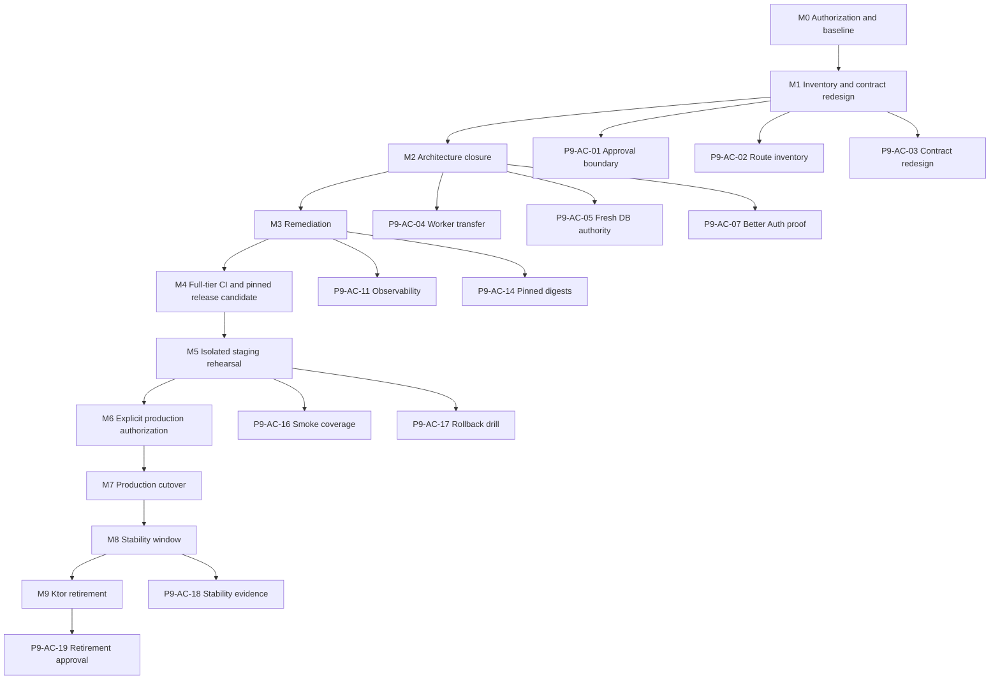

# PIZZORA Phase 9 — Ktor Retirement and Rust-Only Backend Implementation Plan

**Document type:** Authoritative Phase 9 implementation planning artifact
**Date:** 2026-11-27
**Branch:** `ui-ux-changes`
**Verified HEAD:** `9a9cf3810d212c44977ed7d39cb5feb0b19862f1`
**Phase 8 checkpoint:** `5c21fa4` (present; ancestor of HEAD; HEAD is one commit later)
**Planning boundary:** This document plans work only. It does not implement, deploy, migrate, roll back, modify canonical artifacts, access secrets, or authorize production change.
**Owner decisions applied:** `D9-01`–`D9-12` from `docs/PHASE9_SCOPE_DECISION.md` and the Phase 9 scope direction supplied for this task.

---

## 1. Document control and authority

This is the single authoritative planning document for Phase 9 as now selected: **complete retirement of Ktor and migration of PIZZORA to Rust as the sole backend**. It supersedes the ambiguity recorded in `docs/PHASE9_READINESS_ASSESSMENT.md` and `docs/PHASE9_SCOPE_DECISION.md` for planning purposes, but it does **not** edit `public/implementation_plan.md`, which remains the canonical plan and still ends at Phase 8 (`public/implementation_plan.md:L903-L922`; no `Phase 9` match found).

Evidence labels used throughout:

| Label | Meaning |
|---|---|
| `[VERIFIED]` | Directly inspected in the repository at the verified HEAD. |
| `[PRIOR EVIDENCE]` | Committed or working-tree artifact inspected, but not re-executed by this planning task. |
| `[OWNER DECISION]` | Explicit Phase 9 decision supplied by the owner / scope decision; not inferred from code. |
| `[ASSUMPTION]` | Planning estimate or sequencing judgment; not a repository fact. |
| `[UNVERIFIED]` | Required gate or evidence for which no executed proof was found. |
| `[PRODUCT INPUT REQUIRED]` | A business/operational decision the repository cannot supply. |

Change control for this task:

- Created only `docs/PHASE9_KTOR_RETIREMENT_IMPLEMENTATION_PLAN.md`.
- Did not modify `public/implementation_plan.md`, `docs/PHASE9_READINESS_ASSESSMENT.md`, `docs/PHASE9_SCOPE_DECISION.md`, application code, tests, schemas, migrations, DTOs, Docker/Railway configuration, workflows, or Better Auth configuration.
- Preserved the pre-existing ` M .opencode/opencode.jsonc`; it was not staged, edited, cleaned, or discarded.
- Performed no build, test, emulator, migration, backup/restore, Railway apply, deploy, rollback, production/staging access, secret read, commit, push, merge, tag, or destructive Git operation.

The single final verdict is stated only in Section 30.

---

## 2. Executive summary

Phase 9 is now defined as a **platform replacement**, not a feature phase: Ktor is retired completely and Rust becomes the sole authoritative backend `[OWNER DECISION]`. The target is one Rust Railway service that serves the Axum HTTP API, WebSocket/realtime handling, and all background worker loops in one Tokio supervisor `[OWNER DECISION]`. A separate worker deployment is prohibited unless a critical reason is documented and owner-approved.

The repository already contains substantial Rust implementation, migration, rollback, CI, and operational scaffolding. It also contains substantial gaps that are not solved by compiling code: no repository evidence of Better Auth integration and a current two-custom-auth-control-plane reality; no per-route signed redesign inventory; a fresh-DB strategy that resets app data/settings unless explicitly approved; worker-supervisor panic/restart and single-service health semantics not yet proven; an incomplete smoke harness; public `/metrics` registration without Railway-side blocking; no Railway observability stack; no complete Railway Ktor rollback worker topology; no pinned digests; no executed backup/restore proof; no rollback drill; exact-HEAD/full-tier evidence not bound to SHA/command/timestamp/env/exit; and no owner authorization for production change.

The plan is therefore structured as evidence gates and milestones, not as a deployment script. Staging must succeed first, but staging success does not authorize production cutover. Production cutover requires separate written approval naming the exact Railway project, services, window, rollback path, stability window, and retirement boundary. Ktor retirement is the last milestone and requires its own approval after a clean stability window.

Historical app data need not be preserved, but identity, session, provider, payment/refund, signing, secrets, outbox, audit, backup, and operational evidence may not be deleted or assumed disposable. A fresh Rust-owned database is authoritative for future writes; the legacy Ktor database remains frozen and retained for rollback and evidence until explicit retirement/data-disposition approval.

---

## 3. Binding Phase 9 decisions

| ID | Decision | Planning consequence |
|---|---|---|
| `D9-01` | Rust becomes the sole authoritative backend; Ktor is fully retired. | No dual-stack steady state; no Ktor route ownership after retirement. |
| `D9-02` | Staging-first migration; staging success does not authorize production cutover. | M6 staging gate and M8 production authorization are separate. |
| `D9-03` | Historical application DB data need not be preserved; do not assume auth/payment/secrets/signing/operational data may be deleted. | Fresh DB has no application-data copy; protected data classes require explicit disposition. |
| `D9-04` | Fresh Rust-owned production DB; SQLx authoritative; staging/production isolated; replacement requires explicit authorization. | No legacy Flyway adoption path for the new DB; SQLx `0001`–`0011` bootstrap and invariants are authoritative. |
| `D9-05` | Replace the existing Ktor Railway service with one Rust service; define env/domain/health/rollback/Ktor retirement timing. | Single-service Railway topology; no separate worker service by default. |
| `D9-06` | Move every existing Ktor background-worker responsibility into Rust; nothing silently omitted. | Worker responsibility matrix is mandatory (Section 10). |
| `D9-07` | Single Rust Railway service runs API + workers together; separately deployed workers require critical reason and owner approval. | Current two-service `.railway/railway.ts` is an input, not the target topology. |
| `D9-08` | Axum + Tokio + Tower; avoid unnecessary framework replacement. | Reuse existing Rust crates and middleware stack; no new web framework. |
| `D9-09` | Redesign API contracts, not legacy reproduction; document contracts and Android integration. | Route inventory is evidence, not a mandate to clone Ktor wire behavior. |
| `D9-10` | Direct breaking replacement; no compatibility layer. | No shims, aliases, dual serializers, or legacy endpoint adapters. |
| `D9-11` | Keep Better Auth as mandatory identity provider; investigate actual integration; no custom competing auth system. | Current custom Rust auth path is an unresolved P0 architectural gap. |
| `D9-12` | Do not delete Better Auth identity/session/provider data without explicit owner decision; define separate DB/schema implications if needed. | Identity store boundary must be documented before cutover. |
| `D9-13` | Inventory and recipes are explicitly out of Phase 9 feature scope. | Existing Rust inventory/recipe routes remain part of the backend surface only as cutover responsibilities, not new feature work. |

---

## 4. Scope, non-goals, and change boundary

### 4.1 In scope for planning

- Verify repository baseline, Git state, remotes, worktrees, checkpoint, and prior Phase 9 documents.
- Inventory Ktor route/worker/database/auth responsibilities and current Rust equivalents.
- Define the target single-service Rust architecture, API contract redesign process, worker consolidation, fresh DB strategy, Better Auth boundary, Android integration, Railway topology, observability, CI/CD, staging, cutover, rollback, stability window, and Ktor retirement criteria.
- Define stable acceptance IDs, a test matrix, milestone dependency graph, and risk register.
- Use independent read-only reviewers and record their status.

### 4.2 Out of scope / prohibited in this task

- Any implementation, build, test execution, emulator run, migration, deployment, rollback, backup/restore, Railway operation, secret access, or production/staging state change.
- Any edit to canonical or application artifacts listed in Section 1.
- Adding inventory/recipe features, new domain features, or new frameworks.
- Inventing better-auth implementation details, approvals, deadlines, business metrics, or operational authority.

### 4.3 Out of scope as Phase 9 feature work

Ingredient inventory and relational recipes are out of Phase 9 feature scope `[OWNER DECISION]`. However, the current Rust router already exposes inventory and recipe routes (`rust/crates/pizzora-api/src/router.rs:L275-L293`); those endpoints are part of the backend surface that must be owned, contracted, tested, and transferred for cutover. No new recipe/modifier demand, UI work, or Kotlin parity feature work is authorized here.

---

## 5. Baseline verification

### 5.1 Git and repository state `[VERIFIED]`

| Check | Result |
|---|---|
| Root | `/workspace/pizzabi` |
| Branch | `ui-ux-changes` |
| HEAD | `9a9cf3810d212c44977ed7d39cb5feb0b19862f1` |
| `origin/ui-ux-changes` | Same SHA; ahead/behind `0 0` |
| Remote URLs | `git@github.com:imanpr33trai/pizzabi.git` (fetch/push) |
| Checkpoint `5c21fa4` | Present; `git merge-base --is-ancestor 5c21fa4 HEAD` exit `0` |
| Recent history | `9a9cf38 chore(phase8): resolve clippy warnings` → `5c21fa4 feat(phase8): complete modifiers, reorder, runtime QA and review` |
| Working tree before this document | ` M .opencode/opencode.jsonc`; `?? docs/PHASE9_READINESS_ASSESSMENT.md`; `?? docs/PHASE9_SCOPE_DECISION.md` |
| Worktrees | Main workspace at HEAD; `steel-bell` at `415c17b` on `main`; `vivid-gate` at `6544440` on `mattpocock`; `glad-trout` detached at HEAD; prunable detached `/home/remote/.local/share/opencode/worktree/ea3529/mattpocock` at `4752c67` |
| OpenCode tooling | CLI `v2.4.2`; `opencode/big-pickle` available and used for new subagents |

No worktree was switched, pruned, cleaned, or modified. The pre-existing `.opencode/opencode.jsonc` modification was preserved.

### 5.2 Canonical scope status `[VERIFIED]`

- `public/implementation_plan.md:L1-L5` identifies the plan as planning/specification only.
- The plan ends at Phase 8 (`public/implementation_plan.md:L903-L922`).
- The mandatory four-part exit gate applies only to Phases 1–8 (`public/implementation_plan.md:L761-L766`).
- No `Phase 9` heading or Phase 9 acceptance criteria exist in the canonical file.
- Phase 9 scope for this plan therefore comes from the owner decisions recorded in Section 3, not from a silent rewrite of the canonical plan.

---

## 6. Evidence hierarchy and Phase 8 baseline

### 6.1 Hierarchy

1. Owner Phase 9 decisions in Section 3 and `docs/PHASE9_SCOPE_DECISION.md`.
2. Canonical plan boundary in `public/implementation_plan.md`.
3. Phase 8 binding contract and closure evidence: `docs/PHASE8_REVIEWED_CONTRACT_RESOLUTIONS.md`, `docs/PHASE8_IMPLEMENTATION_PROGRESS_REPORT.md`, `qa-artifacts/phase8/review/W9_FINAL_INDEPENDENT_REVIEW.md`.
4. Operational and infrastructure artifacts: `infra/RUNBOOK.md`, `.railway/*.ts`, `infra/scripts/*`, `.github/workflows/*`.
5. Current source at the verified HEAD.
6. Prior Phase 9 assessments.
7. Planning estimates in this document.

### 6.2 Phase 8 baseline preserved `[PRIOR EVIDENCE]`

- Phase 8 is reported complete at checkpoint `5c21fa4` (`docs/PHASE8_IMPLEMENTATION_PROGRESS_REPORT.md:L1-L8,L210`).
- Copied XML evidence records 230 app, 86 backend, and 40 shared-contract tests with zero failures/errors/skips (`qa-artifacts/phase8/unit-test-xml/README.md:L6-L10`).
- The independent review closes the server-backed runtime gate (`qa-artifacts/phase8/review/W9_FINAL_INDEPENDENT_REVIEW.md:L115-L130`).
- 33 pricing vectors are recorded in parity evidence referenced by the same review.
- These results were inspected, not re-executed by this planning task.

### 6.3 Baseline limitations carried into Phase 9

| Limitation | Evidence | Treatment |
|---|---|---|
| Exact-HEAD live PostgreSQL proof is unverified | Latest live-PG log predates `9a9cf38`; Clippy-fix log marks 21 live-PG tests ignored and lacks SHA/command/timestamp/exit code (`docs/PHASE9_READINESS_ASSESSMENT.md:L74`) | Re-run exact-HEAD live-PG suites before staging/cutover acceptance. |
| W4 UniFFI defects are conditional but real | Half-and-half helper uses prices instead of topping IDs, debug-name issue codes, strict reorder parsing, fail-open catalog defaults, and Android bridge does not wrap new exports (`docs/PHASE9_SCOPE_DECISION.md:L459`) | Fix or explicitly waive before any Phase 9 claim that depends on UniFFI/native bridge behavior. |
| Stale earlier-phase wording | Canonical plan still records Phase 4 gate as open in places; later reports treat later phases as complete (`docs/PHASE9_READINESS_ASSESSMENT.md:L76`) | Documentation debt; do not reopen earlier phases, but do not use stale wording as Phase 9 proof. |
| Documentation/schema count drift | Canonical text says 46 tables/13 indexes; current migrator verifies 51 tables/25 indexes (`rust/crates/pizzora-db/src/migrator.rs:L21-L74,L128-L157`) | Use current code constants as execution truth; reconcile docs before operational runbook use. |
| `/metrics` exposure | Public Axum route at `rust/crates/pizzora-api/src/router.rs:L58`; blocking only in Compose Caddy (`infra/caddy/Caddyfile:L23-L27`) | Treat as a blocking Railway observability/security gate. |

Phase 8 is not reopened by this plan. Phase 9 must preserve its pricing, reorder, DTO, SQLx V4–V11, migration, and server-backed runtime behavior unless a breaking contract is explicitly approved under `D9-09`/`D9-10`. Ktor retirement is not ready: independent Rust, DevOps, security, Android/UniFFI, QA, and critical-challenge reviews returned IMPLEMENTED/NO-GO, NO-GO, NO-GO, conditional NO-GO, HOLD, and NEEDS MORE EVIDENCE respectively.

---

## 7. Current Ktor backend inventory

### 7.1 Route surface `[VERIFIED]`

A source-level scan of `backend/src/main/kotlin/com/pizzora/backend/**/*Routes.kt` and `*Route.kt` found **22 route files** and **100 HTTP/WebSocket handler registrations**. `Application.kt` adds **4** operational handlers (`/api/v1/health/live`, `/api/v1/health/ready`, `/api/v1/openapi.json`, `/metrics` at `Application.kt:L305-L330`), for **104 source-level handlers total**. Ktor inventory review also found `OpenApiSpec.kt` drift (implemented routes omitted) and stale `docs/PHASE8_BACKEND_CONTRACT.md` “contract design — implementation NOT authorized / legacy SQLx verifyMigrated=false” language versus committed backend reality; no committed product/variant seed establishes a production minimum price.

Representative route families and evidence:

| Family | Evidence | Notes |
|---|---|---|
| Ops/discovery | `backend/src/main/kotlin/com/pizzora/backend/Application.kt:L305-L330` | `/metrics` served directly; no Railway proxy implied. |
| Auth/session | `backend/src/main/kotlin/com/pizzora/backend/auth/AuthRoutes.kt:L24-L95` | Register, verify, resend, login, refresh, forgot/reset, logout, ws-ticket. |
| Users/staff, addresses | `users/UsersRoutes.kt` | 9 handler registrations. |
| Catalog/categories/images | `catalog/`, `categories/`, `images/` | 13 + 5 + 3 handlers. |
| Cart/coupons/pricing/checkout | `cart/`, `coupons/`, `pricing/`, `checkout/` | 3 + 5 + 1 + 1 handlers. |
| Orders/payments/KDS | `orders/`, `payments/`, `kitchen/` | 5 + 6 + 7 handlers. |
| Notifications/realtime | `notifications/`, `realtime/` | 5 + 3 handlers; WebSocket plus replay. |
| Owner operations | `owner/`, `audit/`, `reporting/`, `slots/`, `zones/`, `inventory/`, `recipes/` | 2 + 1 + 2 + 5 + 5 + 5 + 2 handlers. |

These counts are source-level registrations, not a certified runtime route inventory. The signed per-route inventory required by `P9-AC-02` must record method, final path, auth requirement, permission, request/response DTOs, status codes, error codes, side effects, and target Rust owner.

### 7.2 Background responsibilities `[VERIFIED]`

The standalone Ktor worker is `backend/src/main/kotlin/com/pizzora/backend/worker/WorkerMain.kt`. It supervises four loops (`WorkerMain.kt:L77-L114`):

| Ktor loop | File | Responsibility |
|---|---|---|
| `sequencer_loop` | `worker/EventSequencerWorker.kt` | Monotonic gap-free `stream_seq` assignment for outbox events. |
| `dispatcher_loop` | `worker/OutboxDispatcherWorker.kt` | Payment/refund dispatch, encrypted email dispatch, Redis broadcast, notification inbox inserts. |
| `expiry_sweep` | `worker/ExpirySweepWorker.kt` | Expire unpaid orders; release inventory, coupon redemptions, slots, payment outbox rows; scrub/purge retained data. |
| `reconciler_loop` | `worker/RazorpayReconciliationWorker.kt` | Poll ambiguous payment attempts and pending/failed refunds. |

It also exposes `/health/worker` and `/metrics` on a separate Netty health server (`WorkerMain.kt:L125-L204`) and implements graceful cancellation/shutdown (`WorkerMain.kt:L143-L155`). The Ktor API additionally starts a Redis Pub/Sub listener (`Application.kt:L424-L429`) and owns WebSocket routing. All of these are transfer responsibilities under `D9-06`.

### 7.3 Ktor migration and deployment assumptions `[VERIFIED]`

- Ktor Flyway history is V1–V3 (`backend/src/main/resources/db/migration/V1__core_schema.sql`–`V3__hot_path_indexes.sql`).
- The runbook expects V1–V3 parity and `[1,2,3]` (`infra/RUNBOOK.md:L250,L280`), which conflicts with the Rust migrator’s `1..11` profile (`rust/crates/pizzora-db/src/migrator.rs:L842-L843,L1120-L1133`).
- `D9-04` supersedes legacy adoption for the fresh production DB; the old Flyway history remains evidence, not the new DB’s authority.
- Ktor rollback artifacts exist in Compose with API + worker (`infra/docker-compose.ktor-rollback.yml:L77-L115`) and Railway with API only (`.railway/railway.ktor-rollback.ts:L10-L23`).

---

## 8. Current Rust backend inventory

### 8.1 Workspace and route surface `[VERIFIED]`

The Rust workspace has 8 crates: `pizzora-api`, `pizzora-auth`, `pizzora-config`, `pizzora-core`, `pizzora-db`, `pizzora-payments`, `pizzora-uniffi`, and `pizzora-workers` (`rust/Cargo.toml:L3-L12`).

`rust/crates/pizzora-api/src/router.rs:L53-L322` registers **82 route calls** and **103 method handlers** (38 GET, 40 POST, 4 PUT, 14 PATCH, 7 DELETE). Route families cover ops/discovery, auth, users/staff, storefront, cart/coupons/pricing/checkout, orders/payments/webhooks, notifications, replay/WebSocket, KDS, and all owner surfaces including inventory/recipes/reports/audit.

Notable current facts:

- `/metrics` is registered publicly (`router.rs:L58`) and served directly (`routes/ops.rs:L26-L37`).
- The API starts a Redis Pub/Sub subscriber (`rust/crates/pizzora-api/src/main.rs:L175-L176`).
- The API does **not** currently spawn the four standalone worker loops; `main.rs` builds the Axum router and serves HTTP/WebSockets (`main.rs:L179-L203`).
- CLI modes exist for `--preflight-only`, `--migrate-only`, and `--bootstrap-owner` (`main.rs:L27-L33`).
- Persistent `BOOTSTRAP_OWNER_*` variables trigger automatic owner bootstrap at runtime (`main.rs:L122-L146`), contrary to the runbook’s one-shot bootstrap rule (`infra/RUNBOOK.md:L179`).

### 8.2 Worker surface `[VERIFIED]`

`rust/crates/pizzora-workers/src/runtime.rs` supervises the four Rust equivalents:

| Rust loop | File | Ktor responsibility covered |
|---|---|---|
| `EventSequencerWorker` | `pizzora-workers/src/sequencer.rs` | Ktor `sequencer_loop` |
| `OutboxDispatcherWorker` | `pizzora-workers/src/dispatcher.rs`, `email_dispatch.rs`, `broadcast.rs` | Ktor `dispatcher_loop` |
| `ExpirySweepWorker` | `pizzora-workers/src/expiry_sweep.rs` | Ktor `expiry_sweep` |
| `RazorpayReconciliationWorker` | `pizzora-workers/src/reconciler.rs` | Ktor `reconciler_loop` |

The standalone binary exposes `/health/worker` and `/metrics` (`pizzora-workers/src/main.rs`, `runtime.rs`, `http.rs`) and uses a cancellation token for graceful shutdown. These are implementation inputs; the Phase 9 target must run them under the single Rust service supervisor.

### 8.3 Migration surface `[VERIFIED]`

- SQLx migrator: `rust/crates/pizzora-db/src/migrator.rs:L14`.
- Canonical mirrors: `0001_core_schema.sql`, `0002_seed_rbac_and_settings.sql`, `0003_hot_path_indexes.sql`.
- Additive SQLx migrations: `0004_product_toppings.sql` through `0011_modifier_indexes.sql`.
- Expected schema profile: 51 tables (`migrator.rs:L21-L74`) and 25 indexes (13 V3 + 12 Phase 8; `migrator.rs:L128-L157`).
- Handoff modes include `AdoptedExistingFlyway`, `ResumedSqlx`, and `FreshBootstrap` (`migrator.rs:L159-L164`).
- `D9-04` selects `FreshBootstrap` semantics for the new production DB, with SQLx as the only authority.

---

## 9. API contract redesign and parity inventory

### 9.1 Design rule `[OWNER DECISION]`

Phase 9 redesigns contracts rather than reproducing Ktor byte-for-byte, and uses direct breaking replacement with no compatibility layer. Therefore:

- The Ktor route inventory is an input for responsibility discovery, not a frozen target.
- The Rust router is an implementation baseline, not automatically the final contract.
- New contracts must be documented in OpenAPI and Android integration matrices before staging.
- No compatibility shims, legacy aliases, dual serializers, or fallback routers are permitted.
- Android must be explicitly assigned to the new contract: preserve `https://api.pizzora.app` and the route surface, or ship a new build with a new base URL.

### 9.2 Required contract artifact set

For each route family, the implementation phase must produce a signed contract row containing:

| Field | Requirement |
|---|---|
| Contract ID | Stable ID reused by tests and Android integration matrix. |
| Method + final path | Must match the deployed Rust service. |
| Auth mode | Public, JWT session, ws-ticket, owner permission, webhook signature, or internal. |
| Request DTO | Required/optional fields, nullability, defaults, money units, timestamps. |
| Response DTO | Success body, status codes, headers, envelope shape. |
| Error codes | Nested `error.code/message/details`, correlation ID, timestamp. |
| Side effects | DB writes, outbox events, payment/refund calls, cache invalidation. |
| Android consumer | Screen/call site, model mapping, minimum app version. |
| Rust owner | Handler/service/crate and test IDs. |

### 9.3 Known wire hazards to resolve in the contract gate

| Hazard | Evidence | Required action |
|---|---|---|
| Smoke script expects `accessToken`/`refreshToken`; Rust/shared contracts emit `access_token`/`refresh_token` (`infra/scripts/verify-production-cutover.sh:L120-L121,L129-L132`; `rust/crates/pizzora-auth/src/service.rs:L74-L80`; `shared/contracts/.../AuthDto.kt:L70-L75`) | Confirmed source mismatch | Fix harness and assert the approved contract. |
| Smoke script asserts top-level `code`/`message`; error envelope nests `error` (`verify-production-cutover.sh:L79-L84`; `shared/contracts/.../ApiEnvelope.kt:L6-L18`) | Confirmed source mismatch | Fix harness and assert nested envelope. |
| `AdjustInventoryRequest.reason` defaults in Kotlin but is required in Rust (`docs/PHASE9_SCOPE_DECISION.md:L238`) | Cross-stack divergence | Decide contract explicitly; no compatibility layer means one canonical rule. |
| Kotlin recipe duplicates rejected, Rust merges (`docs/PHASE9_SCOPE_DECISION.md:L240`) | Cross-stack divergence | Decide canonical semantics before contract sign-off. |
| Kotlin `INSUFFICIENT_INVENTORY` includes `details`; Rust inventory error does not attach them (`docs/PHASE9_SCOPE_DECISION.md:L244`) | Wire divergence | Decide whether details are in the new contract. |
| W4 UniFFI issue codes/helpers and reorder parsing diverge (`docs/PHASE9_SCOPE_DECISION.md:L459`) | Conditional defect | Fix or waive; no native contract claim without proof. |
| Android hardcodes exact `/api/v1/**` paths, verbs, query names, snake_case fields, bearer format, `401` refresh, `422` cart fallback, `403/404` reorder mapping, `Idempotency-Key`, WS ticket/replay URL, and presigned upload semantics (`app/src/main/java/com/example/core/network/PizzoraApiClient.kt:266-1045`; `app/src/main/java/com/example/cart/CartRepository.kt:535-542`; `app/src/main/java/com/example/orders/OrdersViewModel.kt:124-132`) | Tight manual coupling; no runtime compatibility layer | Freeze these semantics or ship a coordinated Android release; record each preserved/changed item in the contract matrix. |
| Rust CORS currently allows any origin and `Authorization` (`rust/crates/pizzora-api/src/router.rs:45-51`) | Browser-origin trust broadening | Constrain to approved origins or document explicit acceptance before cutover. |

---

## 10. Background worker responsibility transfer

### 10.1 Transfer matrix `[VERIFIED source / UNVERIFIED execution]`

| Responsibility | Ktor owner | Rust implementation input | Phase 9 target | Acceptance |
|---|---|---|---|---|
| Event sequencing | `EventSequencerWorker.kt` | `pizzora-workers/src/sequencer.rs` | Task in single Rust service supervisor | `P9-AC-04`, `P9-T-08` |
| Outbox dispatch | `OutboxDispatcherWorker.kt` | `dispatcher.rs`, `email_dispatch.rs`, `broadcast.rs` | Same process, one dispatcher owner | `P9-AC-04`, `P9-T-08` |
| Expiry sweep | `ExpirySweepWorker.kt` | `expiry_sweep.rs` | Same process, guarded lease | `P9-AC-04`, `P9-T-08` |
| Payment/refund reconciliation | `RazorpayReconciliationWorker.kt` | `reconciler.rs` | Same process, no duplicate gateway calls | `P9-AC-04`, `P9-T-08` |
| Redis Pub/Sub listener | `Application.kt:L424-L429` | `pizzora-api/src/main.rs:L175-L176` | Single subscriber; no duplicate listeners | `P9-AC-04`, `P9-T-08` |
| WebSocket/replay | `RealtimeRoutes.kt`, `Application.kt` | `pizzora-api/src/router.rs:L158-L160` | Axum WebSocket + replay in same service | `P9-AC-03`, `P9-T-06` |
| Worker health/metrics | `WorkerMain.kt:L125-L204` | `pizzora-workers/src/http.rs` | Internal health + private metrics in single service | `P9-AC-11`, `P9-T-11` |
| Graceful shutdown | `WorkerMain.kt:L143-L155` | `CancellationToken` in Rust runtime | Stop accepting traffic, drain loops, close pools/subscribers | `P9-AC-04`, `P9-T-08` |
| Migration ownership | Flyway V1–V3 + runbook | `--migrate-only`, advisory lock `884210001` | One SQLx pre-deploy only; no runtime migration | `P9-AC-05`, `P9-T-04` |
| Email semantics | At-least-once outbox | At-least-once outbox with deterministic Message-ID | Preserve documented semantics; no exactly-once claim | `P9-AC-04`, `P9-T-08` |

Independent worker review (completed) confirms the D9-07 gap is real: current Rust API and worker are separate processes; Railway deploys two services; the API has no worker loop supervision and readiness checks only PG/Redis/storage, not worker backlog/dead letters. Rust loops catch internal errors and continue, but there is no per-loop panic restart supervisor; a panicked top-level `tokio::spawn` can remove processing capacity silently (`rust/crates/pizzora-workers/src/runtime.rs:134-188`). Dispatcher concurrency is hardcoded to `4` and not config-exposed (`runtime.rs:93`); claim semantics are `FOR UPDATE SKIP LOCKED` with leases, but processing is at-least-once (email post-send crash window) and there is no separate DLQ table — dead-letter is `outbox_events.dispatch_status='DEAD_LETTER'`. Sequencer uses advisory xact lock with `FOR UPDATE` (no `SKIP LOCKED`), safe but contended. Razorpay webhook handling is synchronous and idempotent by `payment_events.gateway_event_id`; provider retries are external.

Before consolidation, the single-service supervisor must define per-loop restart policy, panic blast radius, lease ownership after restart, pool/CPU partitioning, dispatcher concurrency config, and health representation for stopped/repeatedly failing loops. API liveness/readiness must not silently mask worker degradation, and public health must not expose internal worker details inappropriately.

### 10.2 Anti-duplication rules

- Exactly one worker supervisor exists in the production Rust service.
- Exactly one migration runner invocation exists per deploy; manual `--migrate-only` and Railway preDeploy must not both run.
- No Ktor worker, Rust standalone worker, or embedded worker loop may overlap against the same queue.
- Worker-stop must precede cutover and rollback route changes.
- Dead-letter rows must be zero or explicitly acknowledged with an owner-approved remediation plan.
- Separate deployment of workers is prohibited unless a critical reason and owner approval are recorded (`D9-07`).

---

## 11. Database and migration strategy

### 11.1 Fresh DB authority `[OWNER DECISION]`

The production target is a new, empty, Rust-owned PostgreSQL database. SQLx is authoritative. Historical application rows are not copied. The legacy Ktor database is frozen and retained through the stability window; it is not a source for app-data migration and is not deleted. This means users, sessions, orders, payments, refunds, restaurant settings, and domain profiles are reset unless an explicit preservation/re-provisioning path is approved; `0002_seed_rbac_and_settings.sql` seeds defaults rather than preserving live settings. The owner must accept those resets or define an export/import/adoption procedure before M7 (`[PRODUCT INPUT REQUIRED]`).

### 11.2 Required sequence

1. Provision an isolated production database with no Ktor/Flyway history.
2. Run one `pizzora-api --migrate-only` (or unified binary equivalent) using SQLx `0001`–`0011` under advisory lock `884210001`.
3. Verify fresh-bootstrap mode, applied versions `1..11`, 51 expected tables, 25 expected indexes, RBAC/settings seed, and zero drift.
4. Start the single Rust service with `RUN_MIGRATIONS_ON_STARTUP=false`; runtime only verifies invariants read-only.
5. Bootstrap owner one-shot only; no persistent `BOOTSTRAP_OWNER_*` variables in steady-state runtime.
6. Record migration log, command, SHA, timestamp, exit code, database identifier, and invariant report.

### 11.3 Migration authority details `[VERIFIED]`

- Kotlin/Flyway owns only `V1__core_schema.sql`, `V2__seed_rbac_and_settings.sql`, and `V3__hot_path_indexes.sql` through `Flyway.migrate()` (`backend/src/main/kotlin/com/pizzora/backend/core/db/DatabaseFactory.kt:51-59`).
- Rust SQLx embeds `0001`–`0011` via `sqlx::migrate!("./migrations")` and is the handoff/catalog authority (`rust/crates/pizzora-db/src/migrator.rs:14`). V1–V3 byte parity and Flyway 11.3.4 CRC32 checksums are enforced (`migrator.rs:188-254`; `backend/src/test/kotlin/com/pizzora/backend/Phase5FlywayChecksumOracleTest.kt:80-97`).
- Catalog invariants expect 51 tables and 25 indexes (13 V3 + 12 Phase 8); V2 seed includes fixed role/permission UUIDs, singleton `restaurant_settings(id=1, store_name='PIZZORA Artisanal Kitchen', is_accepting_orders TRUE, gst_bps=500, default_prep_mins=20, timezone='Asia/Kolkata')`, and singleton `event_stream_cursor(id=1,last_seq=0)` (`0002_seed_rbac_and_settings.sql:4-81`; `migrator.rs:21-157`).
- Handoff modes are `FreshBootstrap`, `AdoptedExistingFlyway`, and `ResumedSqlx`; preflight/readiness rejects failed, unexpected, duplicate/missing, checksum-mismatched, or unsafe non-empty DB states (`migrator.rs:159-164,255-392,401-581,801-837`).
- V4–V11 add product toppings, cheeses, sauces, standard toppings, half-and-half configs, cart/order modifier JSONB columns, and 12 Phase 8 indexes. `product_toppings` is seeded as all products × all toppings.

### 11.4 Operational safety and backup/restore `[VERIFIED]`

- Backup script creates custom `pg_dump` with checksum and optional S3 upload (`infra/scripts/backup-postgres.sh:1-61`), but S3 upload is warn-only if `aws` is missing or upload fails.
- Restore script verifies checksum, streams through awk line filtering, runs single-transaction restore, and verifies coarse counts/history rows (`infra/scripts/restore-postgres.sh:1-123`); this is useful but not sufficient as full invariant proof for a 51-table/25-index schema.
- `verify-backup-restore.sh` provides a drill, but no executed production drill evidence is attached.
- Railway/Compose configs set API pool 15, worker 5, preDeploy migrate 4 in runbook guidance; operators must verify PG `max_connections` and total runtime budget before cutover. Kotlin Hikari defaults to max 20/min 2/read committed; Rust SQLx uses configured max/min/connect timeout.
- Transaction patterns are real and must be preserved: Kotlin checkout takes advisory lock `pg_advisory_xact_lock(hashtext(customerId), hashtext(idempotencyKey))` and holds a long JDBC transaction; Rust auth/payments/outbox/workers use `FOR UPDATE`, `SKIP LOCKED`, and sequencer advisory lock `884_210_001`. A mixed Ktor/Rust runtime against the same DB is an operational hazard.

### 11.5 Protected data classes `[OWNER DECISION]`

| Data class | Default phase action | Required decision before disposition |
|---|---|---|
| Historical catalog/orders/cart/application rows | Not copied to fresh DB | None for non-preservation, but record acceptance. |
| Better Auth identity/session/provider data, if an external deployment exists | Preserve; do not assume disposable | Owner decision required before deletion/migration; repository currently proves no Better Auth deployment. |
| Local Kotlin/Rust users, sessions, refresh tokens, verification/reset tokens | Reset with fresh DB unless migration is explicitly approved | Owner/security decision required; forced re-login is the default consequence. |
| Restaurant settings/configuration | Seeded defaults replace live values | Owner decision required; do not assume preserved settings. |
| JWT/signing/outbox encryption keys/secrets | Preserve and control rotation | Owner/security decision required. |
| Payment/refund/order state needed for reconciliation | Preserve in legacy system/evidence until reconciliation sign-off | Finance/owner decision required. |
| Outbox, dead letters, audit logs, backups, cutover evidence | Preserve | Owner/retention decision required. |
| Operational logs/metrics/SLO evidence | Preserve through stability window and retention period | Owner decision required before pruning. |

### 11.6 Runbook reconciliation

Before any execution, the operational runbook must be reconciled with:

- Fresh DB/SQLx-authoritative strategy, replacing Flyway-adoption expectations for production.
- Actual `1..11` SQLx profile and 51-table/25-index invariants.
- Single migration invocation; no manual + preDeploy duplicate.
- No runtime migration on API/worker startup.
- Rollback data policy: rolling back to frozen Ktor + legacy DB does not replay post-cutover writes from the fresh DB. Owner must accept this or require a reconciliation procedure before cutover (`[PRODUCT INPUT REQUIRED]`).
- Single auth authority: Ktor and Rust must not both issue sessions/tokens against the same identity data. Rollback must not create a second active auth writer.
- Bootstrap hazard: both `--bootstrap-owner` using `OWNER_*` and automatic startup bootstrap using persistent `BOOTSTRAP_OWNER_*` can overwrite an existing owner password/role; the persistent automatic path must be removed or explicitly locked down before cutover.

---

## 12. Better Auth integration boundary

### 12.1 Current evidence `[VERIFIED / UNVERIFIED]`

- Repository-wide searches, including tracked, hidden, ignored, untracked, docs, manifests, runtime code, infrastructure, CI, and targeted history probes, found **no** `Better Auth`, `better-auth`, `betterauth`, or `better_auth` references.
- Both backends implement the same custom auth surface: `register`, `verify-email`, `resend-verification`, `login`, `refresh`, `forgot-password`, `reset-password`, `logout`, and `ws-ticket`.
- Both issue bearer JWTs with `iss`, `sub`, `sid`, `role`, `jti`, `iat`, `exp`, opaque refresh tokens, and `access_token`/`refresh_token` fields with 900-second access TTL, 30-day refresh TTL, 30-second WS ticket TTL, and issuer `pizzora-api` (`rust/crates/pizzora-auth/src/service.rs:L74-L94`; `rust/crates/pizzora-auth/src/jwt.rs:L47-L135`; `backend/src/main/kotlin/com/pizzora/backend/auth/`).
- Both persist auth state in application PostgreSQL tables: `users`, `user_sessions`, `refresh_tokens`, `email_verification_tokens`, `password_reset_tokens`, `roles`, `permissions`, `role_permissions` (`rust/crates/pizzora-db/migrations/0001_core_schema.sql:L24-L95`).
- Verified hardening includes Argon2id password hashing, SHA-256-hashed refresh/verification/reset tokens at rest, refresh rotation with reuse detection and family/session revocation, logout revocation, password-reset session revocation, JWT signature/issuer/expiry and active-session checks, DB-backed RBAC with 300-second cache, and customer ownership checks (`rust/crates/pizzora-auth/src/password.rs:L71-L104`; `rust/crates/pizzora-api/src/extractors.rs:L48-L90`).
- Independent security verdict: **NO-GO for claiming Better Auth is preserved.** At this HEAD the repository contains two custom auth control planes sharing a data model, not Better Auth. If Better Auth exists, it must be an external deployment unknown to this repository.

### 12.2 Decision consequence `[OWNER DECISION / PRODUCT INPUT REQUIRED]`

Better Auth is mandatory and no competing custom auth system may become the final authority. The repository cannot currently satisfy that decision. M2 closure requires one of two explicit paths:

**Path A — external Better Auth exists.** Owner must supply and prove: base URL and public issuer; token/refresh/logout/revocation endpoints; JWKS URL, signing algorithm, `kid` rotation and clock skew tolerance, or introspection endpoint; audience and token type claims; mobile callback scheme and allowed redirects; user-change webhook and verification secret; email/SMTP provider and templates; owner bootstrap API; role mapping source; and signing keys/state needed to survive an app DB reset. In this path Better Auth is the only identity/session authority; Ktor and Rust expose no password/session-creation endpoints; Rust validates Better Auth tokens using the supported Better Auth mechanism and enforces issuer, audience, expiry, signature/key ID, and token type; the app DB keeps only domain data plus a stable Better Auth user-ID mapping and staff roles; local password hashes, refresh tokens, and local sessions stop being authoritative; Android uses the Better Auth-supported mobile flow with Keystore-backed token storage; only one backend is active at a time.

**Path B — no external Better Auth exists.** Owner must either treat Better Auth adoption as a separate migration project with its own identity-mapping cutover, or explicitly amend `D9-11`. Phase 9 must not silently substitute the current Rust custom-auth path and then claim Better Auth preservation. The current Rust stack is coherent only as a single active auth authority; Ktor and Rust must not both issue sessions/tokens against the same data.

### 12.3 Required proof before cutover

| Gate | Required evidence |
|---|---|
| External existence/config | Confirm Path A or Path B; if A, attach the full endpoint/key/issuer/audience/introspection contract listed in 12.2. |
| Architecture proof | Documented Better Auth deployment/integration boundary with Axum/Rust and Android; no parallel custom authority. |
| Identity data boundary | Schema/store ownership for users, sessions, providers, accounts, and tokens; explicit preservation/migration or forced re-login decision. |
| Android flow | Login, refresh, logout, session expiry, ws-ticket, deep-link/notification auth, and account recovery verified against Better Auth or approved Path B authority. |
| Single auth writer | Only one backend can create sessions/tokens; rollback validates the same authority and cannot issue competing tokens. |
| Bootstrap safety | Persistent automatic `BOOTSTRAP_OWNER_*` startup removed or locked down; owner overwrite path proven harmless. |
| Secret boundary | Signing/provider secrets inventoried by name only; no dev defaults in production; no secret deletion. |
| SMTP delivery | Verification/reset delivery actually works in production; Rust does not fail fast on SMTP today, so test delivery explicitly. |
| CORS | Rust `Any` origin acceptance constrained or explicitly accepted by owner. |
| Rollback auth behavior | Ktor rollback auth remains valid against preserved legacy identity data or the external Better Auth authority during the stability window. |
| Acceptance ID | `P9-AC-07` and `P9-T-07` must pass before production cutover. |

If this proof cannot be produced, Phase 9 must stop at staging/planning. It must not substitute the current custom Rust auth path silently.

---

## 13. Security, secrets, and configuration

### 13.1 Production configuration requirements

The runbook defines runtime, PostgreSQL, Redis, auth, payment, SMTP, outbox encryption, S3, worker tuning, HTTP/WS limits, and one-shot bootstrap variables (`infra/RUNBOOK.md:L163-L179`). Phase 9 requires a documented environment inventory by **variable name only**; no values may be committed, pasted into evidence, or accessed during planning.

### 13.2 Required controls

| Control | Requirement | Evidence ID |
|---|---|---|
| Pinned digests | Rust release digest and Ktor rollback digest recorded; no `:latest` deploy | `P9-AC-14` |
| Secret isolation | Staging/prod never share DB, Redis, JWT, outbox keyring, Razorpay, SMTP, or S3 credentials | `P9-AC-12` |
| Fail-fast validation | Production rejects dev defaults and missing critical secrets | `P9-T-12` |
| One-shot bootstrap | `BOOTSTRAP_OWNER_*` absent from steady-state runtime; auto-bootstrap hazard removed or approved | `P9-AC-05` |
| Webhook safety | Raw-body HMAC verification, idempotent event handling, no duplicate refunds | `P9-T-06` |
| Metrics protection | Public `/metrics` blocked at Railway edge/proxy; private scrape only | `P9-AC-11` |
| Rate limits/body limits | Preserved through Tower middleware; verified by contract tests | `P9-T-05` |
| Outbox encryption | Keyring rotation and AAD semantics preserved; old keys not dropped inside grace window | `P9-T-08` |
| S3 disabled by default | Image routes fail closed with established unavailable error unless compatible storage is configured | `P9-T-06` |
| CORS | Rust `Any` origin constrained or explicitly accepted; `Authorization` exposure documented | `P9-AC-08` |
| SMTP delivery | Verification/reset delivery proven despite Rust not failing fast on SMTP config | `P9-T-07` |
| Deployment provenance | Pinned/attested image or explicit owner acceptance; `Cargo.lock --locked` is necessary but not sufficient | `P9-AC-14` |
| Audit preservation | Audit/cutover evidence retained permanently per runbook | `P9-AC-19` |

### 13.3 Documentation and configuration debt

- Example env templates referenced by the runbook are not all present in the repository; only `.env.example` was found by the DevOps reviewer.
- `.railway/package.json` pins the `railway` SDK version but has no lockfile, reducing reproducibility of IaC planning.
- CI uses mutable action refs in the main workflow; this is not itself a Phase 9 blocker but weakens provenance. Full-tier evidence must still be tied to exact commit SHA.

---

## 14. Android client and UniFFI integration

### 14.1 Build-time endpoint boundary `[VERIFIED]`

- Debug API base URL defaults to `http://10.0.2.2:8080` and is build-time overridable (`app/build.gradle.kts:L29-L34`).
- Release API base URL defaults to `https://api.pizzora.app` and is build-time overridable (`app/build.gradle.kts:L56-L62`).
- There is no runtime endpoint switch in the current evidence; transport policy permits cleartext only for loopback debug (`app/src/main/java/com/example/core/security/TransportSecurityPolicy.kt:L7-L34`; `app/src/debug/res/xml/network_security_config.xml:L3-L12`).
- Android mirrors the API contract manually: exact `/api/v1/**` paths and verbs, query names (`include_completed`, `subtotal_paise`, `since_seq`, `limit`), snake_case DTO fields, nested `error` envelope, bearer tokens, `401` refresh, `422` cart fallback, `403/404` reorder mapping, `Idempotency-Key`, WS ticket/replay URL, and presigned upload semantics (`app/src/main/java/com/example/core/network/PizzoraApiClient.kt:266-1045`; `CartRepository.kt:535-542`; `OrdersViewModel.kt:124-132`).

Phase 9 must either preserve the hostname and all consumed routes or release an APK with a new base URL. A direct breaking replacement means no server-side compatibility layer for old clients, and transport policy must be updated if the release origin changes to a non-allowed host or cleartext.

### 14.2 Android integration workstream

Auth is bearer-based, not cookie-based: tokens are stored with Android Keystore AES-GCM, cleared on user-scope transitions by `SessionTransitionCoordinator`, and refreshed with a single-flight mutex (`app/src/main/java/com/example/core/security/TokenManager.kt:46-194`; `SessionTransitionCoordinator.kt:21-166`; `PizzoraApiClient.kt:157-252`). This must remain compatible with the approved auth authority from Section 12.

1. Freeze the new contract matrix from Section 9.
2. Map every API call site in Android to the new contract and DTO names, including auth, catalog/pricing, cart, checkout/orders/payments, KDS, owner/reporting, notifications, media upload, config, and WS replay.
3. Decide whether release clients are upgraded in lockstep with cutover or a new hosted endpoint is introduced.
4. Verify customer, owner, KDS, notification, WebSocket, checkout, payment verification, and in-app update flows against staging.
5. Assert exact path/method, bearer presence/absence, idempotency header, nested envelope, status semantics, and upload URL policy in mock/HTTP tests.
6. Record APK SHA-256, version name/code, base URL, and build command in cutover evidence.

### 14.3 UniFFI boundary `[VERIFIED / CONDITIONAL]`

The native bridge is not required for the current server-backed Android path, but Phase 9 must not claim native Rust domain execution unless proven. Independent review returned **Conditional NO-GO** for W4/UniFFI closure. Current issues:

- `pricing_validate_half_and_half` uses price extras as if they were topping IDs (`rust/crates/pizzora-uniffi/src/lib.rs:424-435,861-904`), while the canonical core validates UUIDs and `cart_validate_with_modifiers` itself delegates to core ID validation (`rust/crates/pizzora-core/src/cart_validation.rs:601-654`; `pizzora-uniffi/src/lib.rs:927-958`). Two distinct toppings with equal price are wrongly treated as overlapping, and the same topping at different prices may be missed.
- FFI issue codes use Rust debug names (`format!("{:?}", i.code)` at `pizzora-uniffi/src/lib.rs:1037-1048`), producing `ToppingUnavailable` instead of contract `TOPPING_UNAVAILABLE` (`shared/contracts/src/main/kotlin/com/pizzora/contracts/CartDto.kt:6-55`).
- `reorder_validate_items` strictly parses IDs and treats missing historical variant/crust as unavailable (`pizzora-uniffi/src/lib.rs:1487-1543,1589-1646`), unlike server nil-UUID tolerance and size/name fallback (`rust/crates/pizzora-db/src/orders.rs:313-409`).
- Latent catalog defaults use `sort_order: 0` and fail-open `is_veg=true`, `is_taxable=true`, `price_paise=0` (`pizzora-uniffi/src/lib.rs:286-372,1157-1241`).
- Six new Phase 8 exports exist (`pizzora-uniffi/src/lib.rs:818,837,850,927,1346,1467`) and bindgen output exists, but `DomainBridge`, `RustDomainBridge`, and `UniffiRustDomainBridge` do not wrap them (`DomainBridge.kt:53-89`; `RustDomainBridge.kt:13-95`; `UniffiRustDomainBridge.kt:14-45,56-213`). Generated bindings prove bindgen, not Android integration.
- Runtime activation proof (`isNativeRustActive`, `bridgeImplementationName`) was not found for the final HEAD.

Required remediation: carry topping IDs for half-and-half validation while keeping price extras arithmetic-only; map all issue codes to contract `SCREAMING_SNAKE_CASE`; align reorder with server fallback semantics; preserve `sort_order` and make defaults fail-closed; extend both bridge implementations for all six exports; prove native-vs-Kotlin parity and activation; then record a formal fix-or-waiver decision. A waiver is defensible only while Android remains server-priced and server-reordered.

### 14.4 Release-quality observations

Prior review found two Android release-quality MAJORs: menu “From” price clipping at 2.0× font and update dialog version mismatch caused by default `versionName=1.0`/`versionCode=1` versus CI-computed release metadata (`docs/PHASE9_SCOPE_DECISION.md:L460`). They are not Phase 9 backend blockers by themselves, but must be fixed or waived before any release sign-off that depends on a new APK.

QA evidence review returned **HOLD** for regression acceptance. Historical artifacts record 356 Kotlin tests (230 app + 86 backend + 40 shared) and 67 Rust passed / 21 ignored, but are not bound to HEAD with SHA, command, timestamp, environment, and exit code. Named unproven or partial behaviors are: unavailable-price menu fallback (`CustomerMenuScreen.kt:560,672`), checkout sticky-dock IME visibility (`CheckoutScreen.kt:378-529`), update metadata-missing/ordering/malformed-semantic-`versionName` cases (`UpdateRepository.kt:201-205`; `UpdateChecker.kt:141-187`), and unavailable saved variant with an otherwise active product (`Phase4CartAndReEditRobolectricTest.kt:761-816`). These must be added/executed or explicitly scoped out before release sign-off; existing cart cap/undo/coupon/persistence coverage should not be duplicated.

---

## 15. Target architecture

### 15.1 Single Rust service `[OWNER DECISION]`

```text
Railway public service "pizzabi"
  └── one Rust process / one image
        ├── Axum HTTP router (/api/v1/**)
        ├── Axum WebSocket/realtime (/ws/v1/events)
        ├── Tokio supervisor for 4 worker loops
        ├── Redis Pub/Sub subscriber
        ├── one SQLx pool with split API/worker budgets
        ├── Tower middleware: auth extractors, security headers,
        │   rate limits, body limits, metrics/logging
        └── internal health + private Prometheus metrics
```

### 15.2 Framework constraints `[OWNER DECISION]`

- Use Axum, Tokio, and Tower; do not introduce a competing web framework.
- Reuse existing crates: `pizzora-api`, `pizzora-auth`, `pizzora-config`, `pizzora-core`, `pizzora-db`, `pizzora-payments`, `pizzora-uniffi` where applicable.
- Worker loops move under the single service supervisor; the standalone binary may remain a build/test entry point but is not a separate production deployment.
- One process owns all worker leases; one migration runner; one Redis subscriber; one metrics registry.

### 15.3 Required design decisions before implementation

| Decision | Required output |
|---|---|
| Unified binary vs start-command wrapper | Exact command and flags for production. |
| Supervisor model | Per-loop panic/restart policy, lease ownership after restart, and blast-radius analysis; current loop tasks are not independently supervised. |
| Health semantics | API readiness plus worker loop status; define `HEALTHY`/`DEGRADED`/`UNHEALTHY` and decide whether `DEGRADED` still returns HTTP 200. |
| Port/domain | Public HTTPS on existing hostname; internal worker/health path; no public worker domain. |
| Graceful shutdown | Stop traffic, drain workers, close pools/subscribers within timeout. |
| Pool budget | Verified Railway PG `max_connections`; API + worker + migrate headroom. |
| Metrics identity | One registry with worker-loop labels; no separate `worker:8081` assumption unless explicitly retained. |
| Auth boundary | Better Auth integration proof from Section 12; single auth writer. |
| Contract boundary | Signed matrix from Section 9. |

---

## 16. Railway topology, domains, health, and rollback exposure

### 16.1 Current repository topology `[VERIFIED]`

- `.railway/railway.ts:L19-L70` targets project `bubbly-peace` with two services: `pizzabi` API and `pizzabi-worker`.
- API uses `infra/Dockerfile.rust`, preDeploy `--migrate-only`, start `pizzora-api`, health `/api/v1/health/ready`.
- Worker uses the same Dockerfile, start `pizzora-workers`, health `/health/worker`, `PORT=8081`, `WORKER_HEALTH_PORT=8081`.
- `.railway/railway.template.ts:L39-L126` defines an isolated full stack for new projects and explicitly warns never to apply it to `bubbly-peace`.
- `.railway/railway.ktor-rollback.ts:L8-L23` defines only a Ktor API rollback service; no worker.
- No Railway domain, proxy, Prometheus, Alertmanager, Grafana, backup resource, pinned digest, or live deploy evidence is declared in the active config.

### 16.2 Target topology `[OWNER DECISION]`

| Item | Target |
|---|---|
| Project | Existing production project `bubbly-peace`, only after explicit approval. |
| Service | Replace `pizzabi` with one Rust service; remove/scale out `pizzabi-worker` from the steady-state target. |
| Database | New fresh Rust-owned PostgreSQL database; legacy DB frozen and retained. |
| Redis | Environment-isolated; private; no production/staging sharing. |
| Domain | Preserve `https://api.pizzora.app` unless a new APK and domain change are explicitly approved. |
| Health | Public readiness/live; internal worker-loop health; exact semantics documented. |
| Metrics | Private scrape only; public `/metrics` blocked at edge. |
| Rollback | Restore pinned Ktor service plus Ktor worker against frozen legacy DB; no duplicate workers. |
| Retirement | After stability window and explicit approval only. |

### 16.3 Required Railway evidence before cutover

- `railway config plan` / apply output tied to exact commit and intended environment.
- Deploy IDs for Rust service and rollback service.
- Pinned image digest for both Rust and Ktor.
- Domain/TLS verification and healthcheck result.
- Variable names, pool limits, and absence of persistent bootstrap secrets.
- Proof worker service is stopped or absent in the target steady state.
- Rollback drill with worker-stop and Ktor API+worker restoration.

---

## 17. Observability and metrics protection

### 17.1 Current gap `[VERIFIED]`

- Public `/metrics` route exists in Axum (`rust/crates/pizzora-api/src/router.rs:L58`).
- Public blocking exists in Compose Caddy (`infra/caddy/Caddyfile:L23-L27`) and Nginx (`infra/nginx/pizzora.conf:L47-L51`), not in Railway IaC.
- Prometheus targets are Compose service names (`infra/monitoring/prometheus.yml:L8-L21`).
- Grafana dashboard and alerts exist (`infra/monitoring/grafana-dashboard.json`, `infra/monitoring/alerts.yml`), but no Railway deployment of them was found.

### 17.2 Required Phase 9 observability gate

| Signal | Requirement |
|---|---|
| 5xx rate/latency | Dashboard and alert with owner-noted thresholds. |
| Readiness | `HEALTHY` baseline; `DEGRADED` only with explicit accepted dependency semantics. |
| Worker loops | Heartbeats for all four loops; loop errors alert. |
| Outbox | Unsequenced/pending backlog and dead-letter count. |
| DB pool | Saturation alerts with verified connection budget. |
| Payments | Failed refunds and reconciliation warnings. |
| Metrics access | Public request returns blocked status; private scrape succeeds. |
| Logs | Structured production logs with correlation IDs; no secrets. |
| Evidence window | Stability metrics retained for agreed window. |

All observability evidence must include command, timestamp, commit SHA, environment identifier, and exit/status where applicable.

---

## 18. CI/CD and release strategy

### 18.1 Current CI coverage `[VERIFIED]`

`.github/workflows/security-and-ci.yml` includes preflight, Rust quality, Rust/Kotlin parity, PostgreSQL/Redis integration, Kotlin backend, Android unit/Robolectric, API 36 instrumentation, Docker validation/publishing, and release APK publication. Publish workflows build and push images to GHCR.

### 18.2 Current CI gaps `[VERIFIED / PRIOR REVIEW]`

- Ordinary feature-branch pushes skip parity, integration, Android unit/instrumentation, and Docker stages (`security-and-ci.yml:L303,L397,L459,L520,L655,L672`).
- No Railway plan/apply, environment approval, deploy, post-deploy verification, or rollback workflow was found.
- Publish workflows emit tags, not pinned deployment digests.
- No dependency/CVE scanning was found in the main pipeline.
- No CI invocation of staging or production smoke scripts.
- `.railway` SDK has no lockfile.

### 18.3 Required Phase 9 CI gates

1. Full-tier run at exact candidate commit; feature-push results are insufficient.
2. All live-PG/migrator/worker tests executed with command, SHA, timestamp, exit code.
3. Contract/OpenAPI/Android integration diff gate.
4. Digest emission and propagation into deployment artifacts; no mutable tags.
5. Separate staging and production approval jobs; production job cannot be triggered by a plain push.
6. Post-deploy smoke and observability check recorded.
7. Rollback rehearsal recorded before production cutover.
8. Release APK, if required, tied to same contract version and SHA-256 evidence.

---

## 19. Staging migration rehearsal

### 19.1 Staging rules `[OWNER DECISION]`

- Staging uses a separate Railway project/environment, separate PostgreSQL, separate Redis, sandbox Razorpay, Mailpit or equivalent SMTP sink, and dedicated secrets.
- Never apply `.railway/railway.template.ts` against `bubbly-peace`.
- Staging artifact must be pinned to the exact candidate commit or digest; mutable `main` is not acceptable for evidence.
- Production Ktor services and production DB remain untouched.
- Staging success is necessary but not sufficient for production cutover.

### 19.2 Staging sequence

1. Freeze candidate commit and produce pinned image digest.
2. Apply isolated template; provision fresh DB and Redis.
3. Run one SQLx migration; verify fresh bootstrap, `1..11`, 51 tables, 25 indexes.
4. Start single Rust service with API + workers; verify health and all loops.
5. Verify private metrics and blocked public metrics.
6. Run fixed smoke harness with authenticated, checkout-safe, KDS WebSocket, owner, webhook, notification, and worker checks.
7. Run Android staging build/APK against staging URL; execute customer/owner/KDS flows.
8. Perform Redis restart, SIGTERM/drain, dead-letter, and rollback-to-Ktor rehearsals in staging.
9. Record zero unresolved P0/P1 and staging sign-off.

### 19.3 Staging exit evidence

- Plan/apply output, deploy IDs, pinned digest, env var names, health output, smoke log, worker health, metrics access proof, Android flow log, rollback drill log, P0/P1 sign-off.
- Every log includes commit SHA, command, timestamp, environment, and exit code.

---

## 20. Production cutover plan — conditional only

This section defines the sequence to be followed **only after** explicit written approval. It is not authorization to execute.

### 20.1 Pre-cutover gates

| Gate | Requirement |
|---|---|
| `G-01` | Written approval naming project `bubbly-peace`, services, window, owner, rollback path, and stability window. |
| `G-02` | Staging rehearsal passed; zero unresolved P0/P1. |
| `G-03` | Fresh production DB provisioned and isolated. |
| `G-04` | Pinned Rust digest and pinned Ktor rollback digest recorded. |
| `G-05` | Variable inventory verified; no secret values in docs/logs. |
| `G-06` | Better Auth proof passed. |
| `G-07` | Corrected smoke harness passed in staging and ready for production. |
| `G-08` | Private metrics/observability in place; public `/metrics` blocked. |
| `G-09` | Worker drain and zero dead-letter procedure rehearsed. |
| `G-10` | Rollback topology complete with Ktor API + worker. |
| `G-11` | Owner accepts rollback data policy (fresh DB writes are not replayed to legacy DB). |
| `G-12` | Android/domain contract decision finalized. |

### 20.2 Sequence

1. Freeze schema/contract changes; record commit SHA, digests, deploy IDs, and legacy DB identifier.
2. Freeze Ktor writes and stop Ktor worker; prove no active worker DB sessions.
3. Verify zero dead letters or owner-approved disposition.
4. Run read-only preflight against target DB; confirm fresh-DB expectations.
5. Run one SQLx migration under advisory lock; capture evidence.
6. Route/replace `pizzabi` with the single Rust service; keep `pizzabi-worker` stopped/out of the target topology.
7. Verify public domain/TLS, API readiness, worker-loop health, and private metrics.
8. Run corrected smoke suite; include auth, cart/order read paths, safe checkout, webhook rejection, KDS WebSocket sequence, owner read/mutation-safe checks, notifications, and worker health.
9. Monitor SLOs for the agreed stability window.
10. Keep Ktor source, image, rollback API+worker topology, legacy DB, and evidence warm until retirement approval.

### 20.3 Cutover stop conditions

Stop and roll back on sustained 5xx, readiness failure, auth/session failure, cart ownership regression, checkout/payment/refund inconsistency, duplicate dispatch/refund, unbounded outbox backlog, dead-letter spike, schema drift, loss of critical logs/metrics, or failure of public metrics blocking.

---

## 21. Rollback strategy

### 21.1 Direction

Rollback is a service/route replacement back to the preserved Ktor API + Ktor worker against the frozen legacy DB. It is not a database restore by default and not a compatibility layer.

### 21.2 Required order

1. Stop the Rust worker loops first; prove no active Rust worker transactions.
2. Drain/stop the Rust API service.
3. Restore pinned Ktor API and Ktor worker with migrations disabled and no Flyway preDeploy.
4. Verify Ktor readiness, metrics, login/catalog/checkout-safe path, WebSocket, and single-worker operation.
5. Do not restore a DB unless corruption is proven and owner-approved.
6. Record rollback trigger, decision owner, deploy IDs, health/smoke evidence, and data-disposition notes.

### 21.3 Required artifact fixes before drill

- Complete Railway Ktor rollback topology with both API and worker (`.railway/railway.ktor-rollback.ts` currently has API only).
- Pin both Ktor images by digest; no `:latest` and no apply-time rebuild.
- Set `RUN_MIGRATIONS_ON_STARTUP=false` explicitly on rollback services.
- Preserve domain/TLS binding.
- Rehearse worker-stop and Ktor worker startup before production cutover.
- Confirm no V4+ schema changes that break Ktor; with a fresh DB, rollback uses the separate legacy DB, so schema divergence is contained but post-cutover write divergence is not automatically reconciled.

---

## 22. Ktor retirement and archive criteria

Ktor retirement is a separate final milestone `[OWNER DECISION]` and requires:

1. Completion of the agreed stability window with clean SLO evidence.
2. Explicit written owner approval naming retirement scope and date/window.
3. Confirmation that rollback assets are no longer needed.
4. Data disposition decision for the legacy DB, Better Auth data, payment/audit evidence, backups, and logs.
5. Preservation of historical Flyway migrations V1–V3, backups, audit/cutover evidence, and decision records.
6. Replacement of any CI gate that still depends on Kotlin fixture generation before removing Kotlin generator code.
7. Archive/removal of Ktor runtime source (`backend/`), `infra/Dockerfile.backend`, `.github/workflows/publish-backend.yml`, `.railway/railway.ktor-rollback.ts`, and `infra/docker-compose.ktor-rollback.yml` only after approval.

Retirement is irreversible in practice. It must not be bundled into the cutover change.

---

## 23. Evidence and acceptance provenance

### 23.1 Required evidence package

Every Phase 9 gate must attach:

- Exact commit SHA and branch.
- Command line or workflow run URL.
- Timestamp with timezone.
- Exit code or explicit pass/fail result.
- Environment/project/service identifiers.
- Pinned artifact digest where deployment is involved.
- Log artifact path and checksum if stored.
- Named approver for sign-off gates.

### 23.2 Current evidence status

| Evidence class | Current status |
|---|---|
| Git baseline | `[VERIFIED]` at `9a9cf38`. |
| Phase 8 XML counts | `[PRIOR EVIDENCE]` 230/86/40, zero failures/errors/skips. |
| Phase 8 live PostgreSQL at exact HEAD | `[UNVERIFIED]`; needs rerun. |
| Full-tier CI at exact HEAD | `[UNVERIFIED]`; feature pushes skip critical tiers. |
| Better Auth integration | `[UNVERIFIED]`; no repository references found. |
| Backup/restore proof | `[UNVERIFIED]`; scripts exist, execution proof absent. |
| Pinned digests | `[UNVERIFIED]`; mutable tags/apply-time builds present. |
| Smoke execution | `[UNVERIFIED]`; script exists but is defective and no run log was found. |
| Rollback drill | `[UNVERIFIED]`. |
| Railway live topology | `[UNVERIFIED]`; desired-state IaC inspected only. |
| Ktor retirement approval | `[UNVERIFIED]`. |

No evidence in this document was generated by executing tests, builds, migrations, or deployments.

---

## 24. Milestone plan and dependency graph

### 24.1 Milestones

| Milestone | Name | Exit condition |
|---|---|---|
| M0 | Authorization and baseline | Decisions recorded; baseline verified; no production action. |
| M1 | Inventory and contract redesign | Signed route/worker/contract matrix; Android consumer map. |
| M2 | Architecture closure | Single-service design, fresh DB profile, Better Auth proof, data disposition. |
| M3 | Remediation | Smoke harness fixes, metrics protection, rollback topology, exact-HEAD evidence, W4 fix/waiver. |
| M4 | Full-tier CI/release candidate | Full-tier green at exact commit; pinned digest emitted. |
| M5 | Staging rehearsal | Isolated staging green; rollback drill; zero P0/P1. |
| M6 | Production authorization | Written approval with window/services/owners/rollback/stability. |
| M7 | Production cutover | Conditional sequence executed; smoke and monitoring green. |
| M8 | Stability window | SLO evidence clean; rollback assets warm. |
| M9 | Ktor retirement | Explicit approval; archive Ktor runtime; preserve evidence. |

Mermaid dependency graph:



### 24.2 Sequencing notes `[ASSUMPTION]`

- M3 remediation is a prerequisite, not a substitute for Phase 9 scope.
- M5 staging success never auto-promotes to M7.
- M6 is a hard manual gate; no CI push can satisfy it.
- M9 is hard-separated from M7 by M8.

---

## 25. Stable acceptance criteria IDs

These IDs are stable and must not be renumbered.

| ID | Criterion | Pass condition | Current status |
|---|---|---|---|
| `P9-AC-01` | Authorization boundary | Planning complete; production/retirement actions remain gated by explicit written approvals. | `[VERIFIED]` for planning; `[UNVERIFIED]` for production. |
| `P9-AC-02` | Route inventory | Every Ktor route/worker responsibility mapped to Rust owner or intentional removal. | `[UNVERIFIED]` |
| `P9-AC-03` | Contract redesign | Signed contract/OpenAPI/Android matrix; breaking changes documented; no compatibility layer. | `[UNVERIFIED]` |
| `P9-AC-04` | Worker transfer | Four loops + Pub/Sub + health/shutdown run in one Rust service; no duplicate workers. | `[UNVERIFIED]` |
| `P9-AC-05` | Fresh DB authority | SQLx `1..11`, 51 tables, 25 indexes, one migration runner, no runtime migration. | `[UNVERIFIED]` |
| `P9-AC-06` | Data disposition | Protected classes preserved; legacy DB frozen; app-data non-migration accepted. | `[UNVERIFIED]` |
| `P9-AC-07` | Better Auth proof | Mandatory provider integrated or explicit owner-amended exception; no competing authority; single auth writer; identity/session/provider data protected. | `[UNVERIFIED]` |
| `P9-AC-08` | Security config | Critical secrets validated; bootstrap one-shot; no dev defaults; webhook idempotence; CORS/SMTP decisions proven. | `[UNVERIFIED]` |
| `P9-AC-09` | Android integration | Build URL/domain decision; all consumed routes mapped; runtime flows green. | `[UNVERIFIED]` |
| `P9-AC-10` | UniFFI decision | Native bridge fixed and proven or explicitly waived without native claims. | `[UNVERIFIED]` |
| `P9-AC-11` | Observability | Private metrics, public block, alerts/dashboards, SLO capture. | `[UNVERIFIED]` |
| `P9-AC-12` | Staging isolation | Separate DB/Redis/secrets; no production changes; staging artifact pinned. | `[UNVERIFIED]` |
| `P9-AC-13` | Full-tier CI | Exact-commit full-tier run; command/SHA/timestamp/exit code attached. | `[UNVERIFIED]` |
| `P9-AC-14` | Pinned artifacts | Rust and Ktor rollback digests pinned and propagated. | `[UNVERIFIED]` |
| `P9-AC-15` | Backup/restore | Verified off-host backup and isolated restore proof. | `[UNVERIFIED]` |
| `P9-AC-16` | Smoke coverage | Corrected harness covers auth envelope/token casing, checkout-safe, KDS WS, owner, webhook, worker. | `[UNVERIFIED]` |
| `P9-AC-17` | Rollback drill | Ktor API+worker, pinned digest, migrations disabled, worker-stop rehearsed. | `[UNVERIFIED]` |
| `P9-AC-18` | Stability window | Agreed clean SLO window; rollback assets warm. | `[UNVERIFIED]` |
| `P9-AC-19` | Retirement approval | Explicit written approval and retention/archive evidence. | `[UNVERIFIED]` |
| `P9-AC-20` | Evidence provenance | All gates have SHA, command, timestamp, environment, exit code, approver. | `[VERIFIED]` for this planning doc; `[UNVERIFIED]` for execution. |

---

## 26. Test matrix

All execution columns below are future requirements. No row was executed by this planning task.

| ID | Scope | Environment | Required proof | Blocks | Current status |
|---|---|---|---|---|---|
| `P9-T-01` | Git/docs baseline | Planning workspace | SHA, branch, status, checkpoint, worktrees | M0 | `[VERIFIED]` |
| `P9-T-02` | Route inventory | Source at candidate SHA | Signed Ktor/Rust route matrix | M1 | `[UNVERIFIED]` |
| `P9-T-03` | Contract/OpenAPI | Full-tier CI | Contract diff, OpenAPI validity, Android mapping | M1/M4 | `[UNVERIFIED]` |
| `P9-T-04` | Migration fresh bootstrap | PostgreSQL 18 isolated | Exact-HEAD `1..11`, 51 tables, 25 indexes, lock evidence | M2/M5 | `[UNVERIFIED]` |
| `P9-T-05` | API integration | PostgreSQL/Redis integration CI | Health, auth, security headers, body/rate limits, errors | M4 | `[UNVERIFIED]` |
| `P9-T-06` | Critical flows | Staging | Checkout-safe, payment webhook, KDS WS, owner, notifications | M5 | `[UNVERIFIED]` |
| `P9-T-07` | Better Auth / auth authority | Staging | Login/refresh/logout/session/provider flow, single-writer auth, and SMTP delivery; data boundary | M2/M5 | `[UNVERIFIED]` |
| `P9-T-08` | Worker transfer | Integration + staging | Four loops, leases, dead-letter, SMTP crash window, SIGTERM, no dual workers | M2/M5 | `[UNVERIFIED]` |
| `P9-T-09` | Android unit/Robolectric | Full-tier CI | Exact-commit green suite | M4 | `[PRIOR EVIDENCE]` baseline only |
| `P9-T-10` | Android instrumentation/runtime | API 36 emulator/staging | Screens/XML, flows, version metadata, redaction | M5 | `[UNVERIFIED]` |
| `P9-T-11` | Observability/metrics | Staging + prod dry check | Private scrape, public block, alerts firing/silenced correctly | M3/M5 | `[UNVERIFIED]` |
| `P9-T-12` | Security/config | Staging/preflight | Critical secrets fail-fast, bootstrap absent, variable names only | M3/M5 | `[UNVERIFIED]` |
| `P9-T-13` | UniFFI | Unit/bridge tests | New exports tested+wired or waiver recorded | M3 | `[UNVERIFIED]` |
| `P9-T-14` | Backup/restore | Isolated restore target | Fresh dump, checksum, off-host copy, restore, parity/count proof | M5/M7 | `[UNVERIFIED]` |
| `P9-T-15` | Smoke harness | Staging + prod | Corrected keys/envelope, all required paths, executed log | M5/M7 | `[UNVERIFIED]` |
| `P9-T-16` | Rollback drill | Staging + rehearsal | Ktor API+worker, pinned digest, workers stopped, health/smoke | M5 | `[UNVERIFIED]` |
| `P9-T-17` | Full-tier CI | PR/manual/schedule at exact SHA | All jobs green; no skipped critical tier | M4 | `[UNVERIFIED]` |
| `P9-T-18` | Stability window | Production | SLO dashboard/alerts, no critical incident, evidence retained | M8 | `[UNVERIFIED]` |
| `P9-T-19` | Retirement readiness | Approval artifact | Written approval; archive list; evidence retention | M9 | `[UNVERIFIED]` |

---

## 27. Risk register

Severity reflects impact if the risk materializes; likelihood is a planning judgment `[ASSUMPTION]`.

| ID | Risk | Severity | Likelihood | Owner role | Mitigation / gate | Evidence |
|---|---|---|---|---|---|---|
| `P9-R-01` | Production change executed without written approval | Critical | Medium | Owner / release manager | M6 hard gate; approval names project, services, window, rollback | `infra/RUNBOOK.md:L240-L252` |
| `P9-R-02` | Better Auth integration absent or competing custom auth becomes authority | Critical | High until proven | Auth owner | `P9-AC-07`; stop at staging if unproven; require Path A/B decision | No Better Auth refs found |
| `P9-R-03` | Protected identity/payment/secrets data deleted via fresh-DB assumption | Critical | Medium | Data/security owner | Data disposition matrix; legacy DB frozen | `D9-03`, `D9-12` |
| `P9-R-04` | Rollback to frozen legacy DB loses post-cutover writes | High | High | Owner / operations | Explicit acceptance or reconciliation procedure before cutover | `P9-AC-06`, `P9-AC-15` |
| `P9-R-05` | Duplicate workers / duplicate payment or refund dispatch | Critical | Medium | Backend owner | Single supervisor; stop-drain proof; no dual deployment | `P9-AC-04` |
| `P9-R-21` | Worker supervisor tasks panic and do not restart | High | Medium | Backend owner | Define restart/blast-radius/lease policy; health must fail or degrade correctly | `runtime.rs:134-188` |
| `P9-R-22` | CORS `Any` origin with `Authorization` broadens browser-origin trust | Medium | Medium | Security owner | Constrain origins or record explicit acceptance | `router.rs:45-51` |
| `P9-R-23` | SMTP missing/misconfigured but Rust does not fail fast | High | Medium | Operations owner | Prove SMTP delivery in staging/prod preflight | `pizzora-config/src/lib.rs` + runbook |
| `P9-R-06` | SQLx migration profile misunderstood after runbook conflict | High | Medium | DB owner | Fresh-DB SQLx authority; one runner; evidence | `migrator.rs:L842-L843,L1120-L1133` |
| `P9-R-07` | Public `/metrics` leaks operational data on Railway | High | High | DevOps owner | Edge/proxy block; private scrape proof | `router.rs:L58`; `Caddyfile:L23-L27` |
| `P9-R-08` | Smoke harness falsely passes/fails due to token/envelope mismatches | High | High | QA owner | Fix `access_token`, `refresh_token`, nested `error`; full paths | `verify-production-cutover.sh:L79-L84,L120-L132` |
| `P9-R-09` | Incomplete Railway rollback topology (no Ktor worker) | Critical | Medium | DevOps owner | Complete API+worker rollback; drill | `.railway/railway.ktor-rollback.ts:L10-L23` |
| `P9-R-10` | Mutable `:latest`/apply-time builds make rollback non-deterministic | High | High | Release owner | Pinned digests propagated | `infra/RUNBOOK.md:L247-L248,L311` |
| `P9-R-11` | Android client incompatible with redesigned contract | High | Medium | Android owner | Contract matrix + APK/domain decision + runtime QA | `app/build.gradle.kts:L29-L34,L56-L62` |
| `P9-R-12` | Native UniFFI claims rely on latent W4 defects | Medium | Medium | Android/Rust owner | Fix or waive; no native activation claim without proof | `docs/PHASE9_SCOPE_DECISION.md:L459` |
| `P9-R-13` | Exact-HEAD evidence gap hides regression | High | Medium | QA owner | Re-run exact-HEAD live-PG/full-tier with provenance | `docs/PHASE9_READINESS_ASSESSMENT.md:L74` |
| `P9-R-14` | CI feature-push tier gives false confidence | High | High | CI owner | Full-tier exact-commit run required | `security-and-ci.yml:L303,L397,L459,L520,L655,L672` |
| `P9-R-15` | Backup/restore drill synthetic; off-host upload warn-only | High | Medium | Operations owner | Real dump, checksum, off-host, isolated restore proof | `backup-postgres.sh:L46-L53` |
| `P9-R-16` | Auto-bootstrap overwrites owner during cutover | High | Medium | Security/backend owner | Remove persistent bootstrap vars; one-shot only | `pizzora-api/src/main.rs:L122-L146` |
| `P9-R-17` | Ktor retirement removes fixture generator still needed by CI | Medium | Medium | CI owner | Replace parity gate or retain generator before archive | DevOps review |
| `P9-R-18` | Staging not isolated or pinned to mutable `main` | High | Medium | DevOps owner | New project, pinned commit/digest, dedicated secrets | `.railway/railway.template.ts:L86,L107` |
| `P9-R-19` | Observability absent during stability window | High | Medium | Operations owner | Railway metrics/alerts/dashboards before M7 | `.railway/railway.ts:L68-L70` |
| `P9-R-20` | Stale docs/runbooks mislead operators | Medium | High | Docs owner | Reconcile runbook, counts, migration profile before execution | `infra/RUNBOOK.md:L250,L280` |
| `P9-R-24` | Regression evidence is not HEAD-proven | High | High | QA owner | Require SHA, command, UTC timestamp, env, exit code, totals, artifacts | QA evidence review HOLD |

---

## 28. Open questions, required approvals, and stop conditions

### 28.1 Owner decisions required

| ID | Question | Required decision |
|---|---|---|
| `Q-01` | Exact production cutover window and services | Written approval naming `bubbly-peace`, `pizzabi`, and removal/stopping of `pizzabi-worker`. |
| `Q-02` | Domain strategy | Preserve `https://api.pizzora.app` or approve new APK/domain rollout. |
| `Q-03` | Rollback data policy | Accept loss of post-cutover fresh-DB writes on rollback, or define reconciliation. |
| `Q-04` | Better Auth integration boundary | Select Path A (external Better Auth) or Path B (separate migration / explicit decision amendment); supply required endpoints/keys/ownership. |
| `Q-05` | Protected data disposition | Identity/session/provider, payment/refund, secrets/signing, outbox/audit, backups/logs, and fresh-DB resets of users/sessions/orders/settings. |
| `Q-06` | Stability window length and SLO thresholds | Required for M8/M9. |
| `Q-07` | UniFFI scope | Fix and prove, or waive with no native claim. |
| `Q-08` | Android release readiness | Fix or waive 2.0× price clipping and version metadata mismatch. |
| `Q-09` | Separate worker exception | Only if a critical reason is documented; otherwise prohibited. |
| `Q-10` | Ktor retirement/archive date | Separate approval after stability window. |
| `Q-11` | Fresh-DB reset acceptance | Explicitly accept loss/reset of legacy app DB rows and defaulted settings, or approve migration/re-provisioning. |
| `Q-12` | CORS/SMTP policy | Constrain CORS origins and prove SMTP delivery, or explicitly accept residual risk. |

### 28.2 Stop conditions

Phase 9 must stop and remain in planning/staging if:

- Any approval in Section 28.1 is missing.
- Better Auth proof fails.
- Live DB, full-tier CI, or exact-HEAD evidence is absent and not explicitly waived.
- Staging has unresolved P0/P1.
- Smoke harness or rollback drill fails.
- Public `/metrics` is not blocked.
- Worker duplication cannot be ruled out.
- Pinned digests are unavailable.
- Protected data disposition is unresolved.

---

## 29. Independent review record

Ten independent read-only reviewers were launched with `opencode/big-pickle` per the no-invented-identifier constraint. All were instructed not to edit files, run builds/tests/migrations/deploys, or perform Git writes.

| # | Role | Session | Status at document freeze | Result used |
|---|---|---|---|---|
| 1 | Baseline / evidence audit | `ses_de2047c45ffeudw2z7ctvFz8OH` | Completed | Confirmed branch/HEAD/remote/checkpoint/status/worktrees; noted stale Phase 4 gate wording and extra `glad-trout` worktree. Used in Sections 1, 5, and 6. |
| 2 | Ktor inventory | `ses_de2047c43ffevUYocAmk5aXFm1` | Completed | Confirmed 104 API-process handlers + 2 worker health/metrics endpoints; OpenAPI drift, stale Phase 8 backend contract doc, and no committed product seed/min-price proof. Incorporated in Sections 7, 9, 23. |
| 3 | Rust inventory | `ses_de2047c40ffejxD3BDs8L3tkyQ` | Completed | `Axum integration: IMPLEMENTED`; `Ktor retirement: NOT READY / NO-GO`; findings incorporated in Sections 6, 8, 15, 17, 20, 21, 27. |
| 4 | Better Auth / security | `ses_de2047c2cffef8MMhzJc354wy6` | Completed | `NO-GO for claiming Better Auth is preserved`; no Better Auth refs, two custom auth control planes, bootstrap/CORS/SMTP/metrics/provenance gaps. Incorporated in Sections 11–13, 27, 28. |
| 5 | Database / migration | `ses_de2047c2affe7QNetxYYTFw6TX` | Completed | Flyway V1–V3 byte-identical/CRC32-pinned; Rust SQLx owns `0001`–`0011` adoption and 51-table/25-index invariants; backup/restore scripts are partial evidence and mixed migrator/connection-budget hazards remain. Incorporated in Sections 6, 11, 23, 27. |
| 6 | Android / UniFFI | `ses_de2047c22ffeXtAjcRDiAKb8Fe` | Completed | `Conditional NO-GO` for W4/native UniFFI closure; HTTP path aligned but tightly hardcoded. Incorporated in Sections 9, 14, 27. |
| 7 | Workers | `ses_de2047c20ffeEMxkSAKawnP9Kk` | Completed | Current Rust runtime split from API; no per-loop panic restart supervisor; dispatcher concurrency hardcoded; at-least-once/no separate DLQ; D9-07 single-service consolidation not ready as-is. Incorporated in Sections 10, 15, 27. |
| 8 | Railway / DevOps / CI | `ses_de2047c1effeb4BTZAXxeHbAJ4` | Completed | `NO-GO for Railway production replacement as written`; findings incorporated in Sections 8, 13, 16–21, 27. |
| 9 | QA / CI evidence | `ses_de2047c1bffej0N0j9L9W7Z3gq` | Completed | `HOLD / not acceptable as B9-04 regression evidence on current inspection`; coverage gaps and provenance gaps incorporated in Sections 14, 23, 26, 27. |
| 10 | Critical challenge | `ses_de2047c19ffeS3m0DET4DgHtA8` | Completed | `NEEDS MORE EVIDENCE`; no complete plan can be responsibly executed until blocking architecture and evidence gaps close. Incorporated in Sections 3, 11, 12, 15, 23, 27, 28, 30. |

Reviewer verdicts are evidence inputs only; none authorizes implementation. Prior review synthesis from `docs/PHASE9_SCOPE_DECISION.md:L450-L462` remains historical input and was reconciled with the owner decisions in Section 3.

---

## 30. Final verdict

This document completes Phase 9 planning, inventories the Ktor and Rust surfaces, defines the Rust-only target, and records stable acceptance, test, milestone, and risk gates. It does not authorize production change. Execution remains gated by explicit owner approvals, Better Auth proof, exact-HEAD evidence, corrected smoke/observability/rollback artifacts, staging success, and a separate retirement approval.

`PHASE 9 PLAN COMPLETE — EXECUTION AUTHORIZATION AND EVIDENCE GATES REQUIRED`
