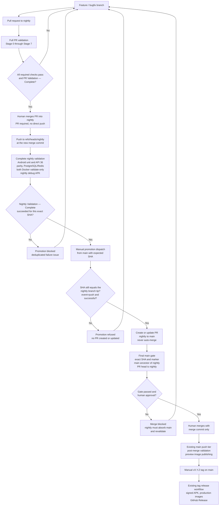

# PIZZORA — Nightly-to-Main Branch Promotion Workflow

**Existing CI/CD architecture audit and implementation proposal**

**Report only.** No source code, workflow, script, ruleset, repository setting, PR, branch, tag, workflow run, deployment, release, or image was created or modified during this audit.

| Item | Value at audit time |
|---|---|
| Audit date | 2026-11-19 |
| Repository | `imanpr33trai/pizzabi` (public, owner type `User`) |
| Default branch | `main` |
| `origin/main` | `f0da67a8f3d986b96867e789afbe5f9b8117c70b` |
| `origin/nightly` | `8e0451404f0829d8d83c70616fed2928bcdfd3fa` |
| PR #11 head | `74b681463f0be5c25b35b9f23be78005b969d984` (`feat/custom-pizza-builder` → `nightly`) |
| Canonical workflow on `main` / PR #11 | `.github/workflows/security-and-ci.yml` blob `ed47da5ceb52ac2c75f4b217a222e53e95037ebf` |
| Canonical workflow on `origin/nightly` | `.github/workflows/security-and-ci.yml` blob `7e54b144590e929932fd4516d980a506d532c59b` |
| Applied branch ruleset | `nightly-branch-protection`, id `27543117` |

Evidence note: all enforcement claims below were read from the remote refs and the GitHub API, not from the local working copy. The local branch `nightly` is at `0406d36`, contains an unpushed merge of PR #11's branch, and is **not** the canonical nightly state. Gates must always resolve `refs/heads/nightly` through the GitHub API or a fresh `git ls-remote`; a local branch is not evidence of validation.

---

## 1. Executive summary

### 1.1 What already works

- Feature branches can only enter `nightly` through a pull request. Ruleset `27543117` applies `pull_request`, `required_status_checks`, `non_fast_forward`, and `deletion` rules to `refs/heads/nightly`, with `bypass_actors: []` and `current_user_can_bypass: "never"`.
- Pull requests targeting `nightly` already receive the **full** validation tier. `pull_request:` has no branch filter (`.github/workflows/security-and-ci.yml:7`), and every expensive job's tier gate is written as "skip only on a branch push" (for example `android-prep` at `:241`, `test-rust-parity` at `:303`, `test-rust-integration` at `:397`, `test-android` at `:459`, `test-android-instrumented` at `:520`, `backend-docker` at `:655`, `rust-docker` at `:672`).
- PR #11's full-validation run `44462862157` (event `pull_request`, SHA `74b6814`) succeeded on 2026-11-19 and included Android build preparation, Android unit/Robolectric, API 36 instrumentation, the parity gate, PostgreSQL/Redis integration, both Docker **Validate Only** jobs, and the debug preview APK.
- The nightly ruleset requires the 12 expensive check contexts, uses `strict_required_status_checks_policy: true`, and has no bypass actor. Direct pushes to `nightly` are therefore blocked for every actor that is subject to the ruleset.
- Production isolation is already strong at the workflow level: Docker publication is gated to `main` and tags (`security-and-ci.yml:662-664`, `:679-681`), the release APK and GitHub Release jobs are tag-only (`:788`, `:1087`), and the preview APK uses a temporary debug keystore (`:721-733`), not production signing secrets (which are only referenced in `build-release-apk` at `:885-917`).
- The existing daily schedule, `17 2 * * *` UTC (`.github/workflows/security-and-ci.yml:13-14`), is a full main-branch regression with no publishing and no APK artifact. It has not been changed by this proposal.

### 1.2 The central gap

**The nightly branch is not re-validated after a merge.** The workflow triggers on every branch push (`:4-6`), but the tier gates only special-case `main` and tags. A push to `refs/heads/nightly` therefore runs the **fast feature tier**, not the full nightly suite.

This is not theoretical. Nightly push run `44292896208` (event `push`, SHA `8e04514`, conclusion `success`) ran only:

- `Stage 0 — Security & Repository Preflight`
- `Stage 1 — Kotlin Shared Contracts & Backend Tests`
- `Stage 1 — Rust Formatting, Clippy & Workspace Check`
- `Stage 3 — Rust Workspace Unit Tests`
- `CI Summary`

and **skipped** Android build preparation, the parity gate, PostgreSQL/Redis integration, Android unit/Robolectric, API 36 instrumentation, both Docker validations, the preview APK, the release APK, and the GitHub Release. The run still reports `success`, and `CI Summary` still draws a green checkmark, because skipped jobs are reported as `⏭️` and the summary job never fails (`.github/workflows/security-and-ci.yml:1196-1285`).

Consequently, after any feature PR is merged into `nightly`, there is no evidence that the merged nightly commit passes the extended regression suite, the Android tests, the integration suite, or either Docker build. A green feature PR run proves only that the pre-merge PR state was green; it does not prove that the merged nightly branch state is green.

### 1.3 Other material gaps

| Area | Current state |
|---|---|
| Nightly validation gate | Does not exist. No terminal job aggregates nightly results or fails on skipped jobs. |
| Nightly APK artifact | Does not exist. The preview APK job is PR/dispatch only (`:693`); retention is 14 days (`:784`). |
| Promotion workflow | Does not exist. No workflow creates or updates a `nightly` → `main` PR. |
| Exact-SHA promotion gate on `main` | Does not exist. `main` has no ruleset and `protected: false`. |
| `main` branch protection | None. `GET /repos/.../branches/main/protection` returns 404; `GET /repos/.../rules/branches/main` returns `[]`. |
| Release tag protection | None. No tag rulesets; legacy tag protection returns 404. Any `v*` tag from any commit triggers the production release jobs. |
| Failure reporting / issue dedup | None. No `gh issue` usage, no fingerprint, no `workflow_run` reporter. |
| Railway staging | Documentation only (`infra/RUNBOOK.md:151-159`); no workflow, no `staging` environment, no Railway secrets. Production Railway state is unverified. |
| Bot-created promotion PR | Blocked by the current setting `can_approve_pull_request_reviews: false` (verified). A `GITHUB_TOKEN` with `pull-requests: write` cannot create the PR until this is enabled or a PAT/App token is used. |
| Skipped-check enforcement | The 12 required contexts can be satisfied by `skipped` conclusions under GitHub's documented required-check semantics. There is no terminal gate that fails when a required job is skipped. |

### 1.4 Recommended end state

1. **Feature → nightly:** full PR validation plus a terminal `PR Validation — Complete` job that fails unless every required job concluded `success`.
2. **Nightly push:** full validation again on the merged nightly commit — Android unit/Robolectric, API 36 instrumentation, parity, PostgreSQL/Redis integration, both Docker **Validate Only** builds, and a nightly debug APK retained as a GitHub Actions artifact for **7 days** — plus a terminal `Nightly Validation — Complete` marker job.
3. **Promotion:** a **manual** `workflow_dispatch` from `main` with the expected nightly SHA. It verifies the exact-SHA nightly run and the current branch tip, then creates or updates a `nightly` → `main` PR. It never merges.
4. **Final main gate:** a required `Promotion Gate — Nightly Validation (Exact SHA)` check on the promotion PR. It requires the exact PR head SHA to have a successful `push` run on `refs/heads/nightly`, the terminal marker and all required jobs to be `success`, the PR head to be the `nightly` branch of the same repository, and `main` to be an ancestor of `nightly`.
5. **Merge and release:** a human approves and merges with a **merge commit only**. The existing `main` push tier runs post-merge validation and preview-image publishing. Production release remains a separate, manually created `v*` tag, now protected by a tag ruleset and a main-ancestry check.

No step in this design auto-merges, auto-approves, auto-tags, or publishes production artifacts from `nightly`.

### 1.5 Topology caveat discovered during the audit

`origin/nightly` (`8e04514`) is an **ancestor** of `origin/main` (`f0da67a`); nightly is one commit behind main. The difference is the release-note fetch fix in `security-and-ci.yml` (`f0da67a`). PR #11's head contains both commits (`git merge-base --is-ancestor origin/main 74b6814` succeeds), so merging PR #11 will bring nightly current. Until that happens:

- A `nightly` → `main` promotion PR would have nothing to promote (nightly is behind main).
- Nightly validation would run the older workflow blob `7e54b144`, not the current `main` blob `ed47da5c`.

This is an operational state, not a design flaw. The implementation plan includes an explicit pre-flight step to make `nightly` current and revalidate it before enabling promotion.

---

## 2. Current architecture

### 2.1 Workflow inventory

There are exactly three workflow files on every ref inspected:

| Workflow | Triggers | Purpose |
|---|---|---|
| `.github/workflows/security-and-ci.yml` (1,285 lines) | `push` to `**` and tags matching `v[0-9]*.[0-9]*.[0-9]*`; `pull_request` (all bases); `workflow_dispatch` (no inputs); `schedule` `17 2 * * *` | Tiered validation, preview APK, release APK, GitHub Release |
| `.github/workflows/publish-backend.yml` (284 lines) | `workflow_call`; `workflow_dispatch` with `publish_preview` (default `false`) | Kotlin backend Docker validation/preview/release |
| `.github/workflows/publish-rust-backend.yml` (285 lines) | `workflow_call`; `workflow_dispatch` with `publish_preview` (default `false`) | Rust backend Docker validation/preview/release |

There is no `nightly`-specific workflow, no promotion workflow, no `workflow_run` reporter, and no Railway workflow. A search for `refs/heads/nightly` across `.github/workflows` on every local and remote ref returned **zero** matches.

### 2.2 Main workflow trigger block

```yaml
# .github/workflows/security-and-ci.yml:3-14
on:
  push:
    branches: [ '**' ]
    tags: [ 'v[0-9]*.[0-9]*.[0-9]*' ]
  pull_request:
  workflow_dispatch:
  # Nightly full regression: runs the complete validation suite ...
  schedule:
    - cron: '17 2 * * *'
```

Important consequences:

- `push` matches **every** branch, including `nightly`. No trigger edit is needed to make nightly pushes start a workflow run; only the job-level tier gates need to change.
- `pull_request` has no branch filter, so PRs to `nightly` already run the full tier.
- `workflow_dispatch` has **no inputs**. It can be dispatched from any branch or tag. The release jobs still require `github.event_name == 'push'`, so a dispatch from a tag cannot release.
- `schedule` runs on the default branch (`main`) at `17 2 * * *` UTC. It is the only scheduled configuration and must be preserved.

### 2.3 Execution tiers

The workflow is one pipeline with job-level gates. The actual behavior by event/ref is:

| Event / ref | Tier label in `CI Summary` | Jobs that run | Jobs intentionally skipped | Publishes |
|---|---|---|---|---|
| `push` to a feature branch | Fast CI | `preflight`, `rust-quality`, `kotlin-contracts-and-backend`, `test-rust-unit` | `android-prep`, `test-rust-parity`, `test-rust-integration`, `test-android`, `test-android-instrumented`, `backend-docker`, `rust-docker`, `build-preview-apk` | Nothing |
| `push` to `nightly` (today) | Same fast tier | Same four jobs | The same extended jobs | Nothing |
| `pull_request` (any base) | Full validation | All test jobs, both Docker **Validate Only** jobs, `build-preview-apk` | `build-release-apk`, `publish-github-release` | Nothing |
| `push` to `main` | Post-merge validation & preview publishing | `preflight`, `rust-quality`, `kotlin-contracts-and-backend`, `test-rust-parity`, `test-rust-unit`, `test-rust-integration`, both Docker **Preview Push** jobs | All Android jobs, APK jobs, release jobs | Preview Docker tags |
| `push` of a `v*` tag | Production release | All test jobs, signed release APK, both Docker **Release** jobs, GitHub Release | Preview APK | Production APK, production images, GitHub Release |
| `schedule` on `main` | Nightly full regression | All test jobs, both Docker **Validate Only** jobs | Preview APK, release jobs | Nothing |
| `workflow_dispatch` on any ref | Manual full validation | All test jobs, both Docker **Validate Only** jobs, `build-preview-apk` | Release jobs (require `event_name == 'push'`) | Nothing |

### 2.4 Jobs, dependencies, and gates

| Job ID | Check name | `needs` | Gate (`if:`) | Timeout |
|---|---|---|---|---|
| `preflight` | `Stage 0 — Security & Repository Preflight` | — | none | 15 min |
| `rust-quality` | `Stage 1 — Rust Formatting, Clippy & Workspace Check` | `preflight` | none | 40 min |
| `kotlin-contracts-and-backend` | `Stage 1 — Kotlin Shared Contracts & Backend Tests` | `preflight` | none | 30 min |
| `android-prep` | `Stage 1 — Android Build Preparation (JDK, Rust, UniFFI Bindgen)` | `preflight` | `event != 'push' || ref_type == 'tag'` (`:241`) | 30 min |
| `test-rust-parity` | `Stage 2 — Rust/Kotlin Parity Gate (Golden Vectors & Wire Contracts)` | `preflight`, `rust-quality` | `event != 'push' || ref_type == 'tag' || ref == 'refs/heads/main'` (`:303`) | 30 min |
| `test-rust-unit` | `Stage 3 — Rust Workspace Unit Tests` | `preflight`, `rust-quality` | none (`:356-363`) | 40 min |
| `test-rust-integration` | `Stage 4 — PostgreSQL 18.6 & Redis Integration` | `preflight`, `rust-quality`, `test-rust-parity`, `test-rust-unit` | `event != 'push' || ref_type == 'tag' || ref == 'refs/heads/main'` (`:397`) | 60 min |
| `test-android` | `Stage 5 — Android Unit & Robolectric Tests` | `preflight`, `rust-quality`, `test-rust-parity`, `android-prep` | `event != 'push' || ref_type == 'tag'` (`:459`) | 45 min |
| `test-android-instrumented` | `Stage 5 — Android Instrumentation Tests (API 36 Emulator)` | `preflight`, `rust-quality`, `test-rust-parity`, `test-android` | `event != 'push' || ref_type == 'tag'` (`:520`) | 60 min |
| `backend-docker` | `Stage 6 — Kotlin Backend Docker (<mode>)` + nested job | `preflight`, `kotlin-contracts-and-backend` | `event != 'push' || ref_type == 'tag' || ref == 'refs/heads/main'` (`:655`) | 60 min (reusable) |
| `rust-docker` | `Stage 6 — Rust Backend Docker (<mode>)` + nested job | `preflight`, `rust-quality`, `test-rust-parity`, `test-rust-unit`, `test-rust-integration` | `event != 'push' || ref_type == 'tag' || ref == 'refs/heads/main'` (`:672`) | 60 min (reusable) |
| `build-preview-apk` | `Stage 7 — Build Android Debug Preview APK` | `preflight`, `kotlin-contracts-and-backend`, `android-prep`, `test-android`, `test-android-instrumented` | `event == 'pull_request' || event == 'workflow_dispatch'` (`:693`) | 60 min |
| `build-release-apk` | `Stage 7 — Build Signed Production Release APK` | `preflight`, `kotlin-contracts-and-backend`, `android-prep`, `test-android`, `test-android-instrumented`, `test-rust-parity`, `test-rust-unit` | `event == 'push' && ref_type == 'tag' && ref_name starts with 'v'` (`:788`) | 60 min |
| `publish-github-release` | `Stage 7 — Create GitHub Release` | `build-release-apk`, `backend-docker`, `rust-docker` | same tag-only condition (`:1087`) | 15 min |
| `ci-summary` | `CI Summary` | every job above | `always()` (`:1198`) | 5 min |

The `<mode>` suffix in the Docker check names is event-dependent:

- PR, schedule, dispatch: `Validate Only`
- `main` push: `Preview Push`
- tag push: `Release`

The reusable workflows produce additional nested check runs named, for example, `Stage 6 — Kotlin Backend Docker (Validate Only) / Build, Validate & Publish Backend Docker Image`. Those nested names are the contexts currently required by the nightly ruleset for Docker.

### 2.5 Docker mode and push expressions

The caller passes the mode and push flag explicitly:

```yaml
# backend-docker, .github/workflows/security-and-ci.yml:661-664
with:
  mode: ${{ (github.event_name == 'push' && github.ref_type == 'tag') && 'release' || ((github.event_name == 'push' && github.ref == 'refs/heads/main') && 'preview' || 'validate') }}
  push: ${{ github.event_name == 'push' && (github.ref == 'refs/heads/main' || github.ref_type == 'tag') }}
  tag_name: ${{ github.ref_type == 'tag' && github.ref_name || '' }}
```

The Rust caller is identical at `:678-681`.

For a nightly push, both expressions evaluate to `mode=validate` and `push=false`. The reusable workflows then enforce their own guards:

- PRs must never push: `publish-backend.yml:125-129`, `publish-rust-backend.yml:131-135`.
- Validate mode must never push: `publish-backend.yml:130-133`, `publish-rust-backend.yml:136-139`.
- Preview pushes only from `refs/heads/main`: `publish-backend.yml:134-137`, `publish-rust-backend.yml:140-143`.
- Release mode only from a semver tag and not a PR: `publish-backend.yml:139-147`, `publish-rust-backend.yml:145-153`.

Therefore extending the nightly gate to run these jobs cannot publish images, provided the `with:` expressions are not changed.

### 2.6 Concurrency

```yaml
# .github/workflows/security-and-ci.yml:19-25
group: pizzora-ci-${{ github.workflow }}-${{ github.event_name == 'pull_request' && format('pr-{0}', github.event.pull_request.number) || github.ref }}
cancel-in-progress: ${{ github.event_name == 'pull_request' || (github.event_name == 'push' && github.ref_type == 'branch' && github.ref != 'refs/heads/main') }}
```

Implications:

- A new push to `nightly` **cancels** an older in-progress nightly run. This is good for runner cost, but it means intermediate nightly commits may never finish validation. Only the final tip is guaranteed to be validated.
- PR runs use one group per PR number, so force-pushes replace the previous run.
- `main` pushes are never cancelled. Release tags, schedule runs, and dispatches are never cancelled.
- The reusable Docker workflows use their own groups (`publish-backend.yml:31-33`, `publish-rust-backend.yml:31-33`) and cancel only when the ref is not a tag. On `nightly`, a newer run can cancel an older Docker validate run.

### 2.7 Current enforcement snapshot (verified through the GitHub API)

| Control | State | Evidence |
|---|---|---|
| `nightly` ruleset | Active, branch target, include `refs/heads/nightly` | id `27543117` |
| `nightly` bypass actors | `[]` | `bypass_actors: []` |
| Current user can bypass `nightly` | `never` | `current_user_can_bypass: "never"` |
| `nightly` required checks | 12 contexts | listed in §2.8 |
| `nightly` strict up-to-date policy | `true` | `strict_required_status_checks_policy: true` |
| `nightly` PR approvals | `0` | `required_approving_review_count: 0` |
| `nightly` allowed merge methods | `merge`, `squash`, `rebase` | `allowed_merge_methods` |
| `nightly` force-push / deletion | Blocked | `non_fast_forward`, `deletion` |
| `main` rulesets | None | `GET /rules/branches/main` → `[]` |
| `main` legacy protection | None | `GET /branches/main/protection` → 404 |
| `main` `protected` flag | `false` | `GET /branches/main` |
| Tag rulesets | None | `GET /rulesets?targets=tag` → empty |
| Legacy tag protection | None | `GET /tags/protection` → 404 |
| Merge methods allowed by repo | merge commit, squash, rebase | repo settings |
| Auto-merge | Disabled | `allow_auto_merge: false` |
| Delete branch on merge | Disabled | `delete_branch_on_merge: false` |
| Default workflow permissions | Read | `default_workflow_permissions: "read"` |
| GitHub Actions may create/approve PRs | **Disabled** | `can_approve_pull_request_reviews: false` |
| Fork PR approval policy | First-time contributors | `approval_policy: "first_time_contributors"` |
| Collaborators | One admin (`imanpr33trai`, id `123877434`) | `GET /collaborators` |
| Environments | Only `bubbly-peace / production`, no protection rules, no branch policy | `GET /environments` |
| Repo secrets | `ANDROID_KEYSTORE_BASE64`, `ANDROID_KEY_PASSWORD`, `ANDROID_STORE_PASSWORD` | names only |
| Repo variables | `PIZZORA_API_BASE_URL` | names only |
| Railway secrets/variables | None | names only |
| `environment:` in workflows | None | grep of `.github/workflows` |
| `workflow_run` reporter | None | grep of `.github/workflows` |
| Issue/fingerprint reporting | None | grep for `gh issue`, `fingerprint` |

### 2.8 The 12 required contexts on `nightly`

```text
Stage 0 — Security & Repository Preflight
Stage 1 — Rust Formatting, Clippy & Workspace Check
Stage 1 — Kotlin Shared Contracts & Backend Tests
Stage 1 — Android Build Preparation (JDK, Rust, UniFFI Bindgen)
Stage 2 — Rust/Kotlin Parity Gate (Golden Vectors & Wire Contracts)
Stage 3 — Rust Workspace Unit Tests
Stage 4 — PostgreSQL 18.6 & Redis Integration
Stage 5 — Android Unit & Robolectric Tests
Stage 5 — Android Instrumentation Tests (API 36 Emulator)
Stage 6 — Kotlin Backend Docker (Validate Only) / Build, Validate & Publish Backend Docker Image
Stage 6 — Rust Backend Docker (Validate Only) / Build, Validate & Publish Rust Backend Docker Image
Stage 7 — Build Android Debug Preview APK
```

`CI Summary` is deliberately **not** a required context. It is a reporter (`if: always()`, no failing step; `:1196-1285`) and would not block a bad merge.

### 2.9 Artifact retention

| Artifact | Produced by | Retention | Notes |
|---|---|---|---|
| Kotlin reports | `kotlin-contracts-and-backend` on failure (`:225-234`) | 7 days | |
| Android unit reports | `test-android` on failure (`:507-514`) | 7 days | |
| Instrumentation diagnostics | `test-android-instrumented` always (`:637-644`) | 7 days | |
| Preview APK | `build-preview-apk` (`:779-784`) | 14 days | PR/dispatch only today |
| Release APK | `build-release-apk` (`:1075-1083`) | 30 days | Tag only |

There is **no nightly artifact**. The requirement that nightly artifacts remain GitHub Actions artifacts with seven-day retention is therefore not implemented.

### 2.10 Existing model of nightly validation

The schedule's comment (`.github/workflows/security-and-ci.yml:9-12`) describes a "Nightly full regression" that runs the complete suite without publishing or building APKs. That is accurate for the **scheduled run on `main`**, but it has been read as if it also covers the `nightly` branch. It does not:

- `schedule` always runs on the default branch (`main`), not on `nightly`.
- The `nightly` branch only receives the fast push tier.
- The schedule produces no APK artifact and no nightly validation marker.

This distinction is the source of most of the gaps in §3.

---

## 3. Current nightly workflow assessment

### 3.1 Implemented correctly

| Requirement | Evidence |
|---|---|
| Nightly branch exists and is manually maintained | `origin/nightly` = `8e04514`; no auto-sync workflow exists |
| Direct pushes to nightly are blocked | Ruleset `27543117`: `pull_request`, `non_fast_forward`, `deletion`, no bypass |
| Feature changes enter nightly through a PR | Same ruleset |
| PRs to nightly run the full suite | `pull_request:` has no branch filter; expensive gates are false only on branch pushes |
| Required checks are configured, not advisory | 12 contexts, strict policy |
| The required contexts match actual PR check names | PR #11 check list contains all 12 |
| Existing schedule preserved | `17 2 * * *`, unchanged |
| No nightly GitHub Release or Pages/external hosting | Release jobs are tag-only; no `pages:` trigger |
| No nightly production Docker publication | `mode=validate`, `push=false` for nightly; reusable guards |
| Preview APK does not use production signing secrets | Temporary debug keystore at `:721-733` |
| Test reports use 7-day retention | `:233`, `:513`, `:643` |
| Stale nightly runs are cancelled | Concurrency `cancel-in-progress: true` for non-main branch pushes |

### 3.2 Partially implemented

| Requirement | Current state | What is missing |
|---|---|---|
| Every push to nightly triggers the appropriate validation | The workflow runs, but only the fast tier | Nightly-specific tier gates and the full extended suite |
| Nightly validation includes Android, parity, integration, Docker | These run on PRs to nightly, not on nightly pushes | Add `refs/heads/nightly` to the job gates |
| Nightly artifacts are 7-day Actions artifacts | No nightly artifact exists; preview APK is 14 days and PR/dispatch only | Nightly APK job/condition with 7-day retention |
| Failed nightly validation blocks promotion | No promotion mechanism exists to block | A terminal marker + promotion gate |
| Production release isolation | Code-level guards are strong | Tag creation is unrestricted; no main-ancestry check; no tag ruleset |
| Production signing secret isolation | Secrets are repo-level and only used by a tag-only job | Environment-scoped secrets with required reviewers |
| Staging topology | Documented in `infra/RUNBOOK.md:151-159` | No workflow, no `staging` environment, no staging secrets; Railway state unverified |
| Branch protection | `nightly` is protected | `main` and release tags are not |
| Merge strategy integrity | Repo allows merge/squash/rebase; nightly allows all three | Main must be restricted to merge commits |

### 3.3 Missing

| Missing capability | Consequence |
|---|---|
| `refs/heads/nightly` in workflow conditions | Nightly pushes skip 10 jobs (evidence: run `44292896208`) |
| Terminal `Nightly Validation — Complete` job | A run can be "successful" while required jobs are skipped |
| Terminal `PR Validation — Complete` job | A skipped required check can satisfy the nightly ruleset |
| Nightly APK artifact with 7-day retention | No installable nightly build; no nightly evidence artifact |
| Promotion workflow | No manual, auditable `nightly` → `main` initiation |
| Exact-SHA promotion gate on `main` | An outdated or unvalidated nightly commit could be merged |
| `main` ruleset | Direct pushes, force-pushes, deletions, and squash/rebase merges are possible |
| Tag ruleset | Any `v*` tag from any commit triggers the production release |
| Failure issue reporter with stable fingerprint | Failures are only visible in the Actions UI; no deduplicated tracking |
| Railway staging workflow | The optional manual staging path is not implemented |
| `production` environment protection | Production signing secrets are available to any job on a non-fork branch |

### 3.4 Cannot verify

| Item | Why it cannot be verified |
|---|---|
| Railway project/resource state, service names, tokens, environment variables, and whether Railway auto-deploys on GitHub pushes | No Railway token or API access is present; `infra/RUNBOOK.md` describes the intended topology but does not prove the live state |
| Whether any external automation creates tags, merges PRs, or pushes to `nightly` | Only repository-local workflows and the API were inspected |
| Whether a repository admin would use the ruleset-edit bypass in practice | GitHub inherently allows admins to edit rulesets; `bypass_actors` is empty today, but governance is organizational |
| Whether the `bubbly-peace / production` environment is used by an external integration | No workflow references it; its purpose is undocumented |
| Effective repository rules from an organization | The owner is a `User`, so there are no organization-level rulesets to inspect |

---

## 4. Desired branch promotion architecture

### 4.1 Target flow



Solid arrows are automated steps. The nodes that say "Human", "Manual", or "never auto-merge" are deliberate human control points and must not be automated away.

### 4.2 Design principles

1. **One pipeline, extended tiers.** Extend the existing `security-and-ci.yml` gates for `refs/heads/nightly`. Do not create a second nightly pipeline that duplicates the same jobs.
2. **The nightly push is the validation event.** A `pull_request` run validates a merge preview; a `workflow_dispatch` run can be started from an arbitrary ref. Only a completed `push` run on `refs/heads/nightly` is accepted as promotion evidence.
3. **The marker is a check, not the run conclusion.** A workflow run can conclude `success` with skipped jobs. Promotion requires a terminal check job that only succeeds when every required job succeeded.
4. **The SHA is the identity.** Promotion evidence is keyed to `(head_sha, event, head_branch, workflow path, run_id, run_attempt, conclusion)`. A success for SHA A never authorizes SHA B.
5. **Main must be an ancestor of nightly.** This guarantees that merging nightly into main does not introduce unvalidated main-only changes. If main has diverged, the operator must merge main into nightly and revalidate.
6. **Main merges use merge commits only.** Squash and rebase create a new commit that is not the validated nightly SHA and destroy the audit chain. The nightly SHA must remain a parent in `main` history.
7. **No automatic merge, approval, or tag.** The promotion workflow creates/updates a PR and stops. A human reviews and merges. A human creates the release tag.
8. **Production remains tag-driven and protected.** Promotion to `main` only triggers the existing post-merge/preview tier. Production artifacts still require a `v*` tag on `main`, now protected by a ruleset and an ancestry check.

---

## 5. Gap analysis

Statuses are exactly: `Implemented`, `Partially implemented`, `Missing`, `Cannot verify`.

| Requirement | Current implementation | Status | Required change |
|---|---|---|---|
| Feature branches must not bypass checks before nightly | `nightly` ruleset has `pull_request`, 12 required contexts, `non_fast_forward`, `deletion`, no bypass | `Implemented` | Keep; add a terminal PR gate to close the skipped-check hole |
| Feature branch enters nightly through a PR | `pull_request` rule on `refs/heads/nightly` | `Implemented` | Keep |
| PR requires all relevant checks before merging | 12 contexts, strict policy, but `skipped` can satisfy a required check | `Partially implemented` | Add `PR Validation — Complete` and make it required |
| Merge into nightly triggers a fresh validation run | `push: branches: ['**']` triggers a run, but only the fast tier | `Partially implemented` | Add `refs/heads/nightly` to every expensive job gate |
| Nightly validation tests the actual merged nightly state | Run `44292896208` skipped 10 jobs | `Missing` | Full nightly tier on `refs/heads/nightly` |
| Feature-branch validation is never treated as nightly proof | No gate distinguishes the two; a green PR run is the only evidence today | `Missing` | Require `event=push`, `head_branch=nightly`, exact SHA, marker |
| Only a successfully validated nightly commit can be promoted | No promotion mechanism | `Missing` | Manual promotion workflow + exact-SHA main gate |
| Promotion is manually initiated | No promotion workflow | `Missing` | `workflow_dispatch` with expected SHA |
| Promotion happens through a PR | `main` is unprotected; direct pushes are possible | `Missing` | Main ruleset with `pull_request`, no direct push |
| Final merge remains under human control | No required reviews on `main` | `Missing` | ≥1 human approval, code owner review, stale-review dismissal |
| Production release follows existing main rules | Release jobs are tag-only, but tags are unrestricted and have no main-ancestry check | `Partially implemented` | Tag ruleset + tag ancestry check + protected production environment |
| Failed nightly validation blocks promotion | No gate, no marker | `Missing` | Terminal nightly marker; promotion gate requires `success` |
| Nightly runs extended regression and both Docker validations | These run only on PRs to nightly, not nightly pushes | `Missing` | Add nightly to the tier gates |
| Nightly does not publish production Docker images | `mode=validate`, `push=false`; reusable guards | `Implemented` | Keep expressions unchanged; verify logs in Phase 1 |
| Nightly produces GitHub Actions artifacts with 7-day retention | No nightly artifact; preview APK is 14 days and PR/dispatch only | `Missing` | Nightly debug APK with `retention-days: 7` |
| No GitHub Releases, Pages, or external APK hosting for nightly | Release jobs are tag-only; no Pages workflow | `Implemented` | Keep |
| Optional Railway staging is manual, disabled by default, isolated | Documentation only; no workflow, no `staging` environment | `Missing` | Separate dispatch-only staging workflow with protected environment and staging-only credentials |
| Railway production resources are not modified | No Railway workflow exists today | `Cannot verify` | Verify live Railway state before adding any staging automation; keep production token out of the repo |
| Failure issues are deduplicated by a stable fingerprint | No issue reporting | `Missing` | `workflow_run` reporter with a job-set fingerprint |
| Existing schedule is preserved | `17 2 * * *` on `main` | `Implemented` | Do not add another schedule |
| Nightly is manually maintained, no auto-sync from main | No sync workflow | `Implemented` | Keep; require a manual back-merge when main diverges |
| Production signing secrets are isolated | Repo-level secrets; tag-only job; no environment | `Partially implemented` | Protected `production` environment; move the three Android secrets |
| Release tag creation is protected | No tag rulesets; legacy protection 404 | `Missing` | Tag ruleset + main-ancestry check |
| Main prevents direct pushes and force-pushes | No main ruleset; `protected: false` | `Missing` | Main ruleset with `non_fast_forward` and `deletion` |
| Main prevents outdated PR commits | No main protection | `Missing` | `strict_required_status_checks_policy: true` |
| Bot can create a promotion PR | `can_approve_pull_request_reviews: false` | `Missing` | Enable the setting with CODEOWNERS, or use a protected PAT/App token |
| Promotion evidence is auditable | No promotion workflow, no PR body evidence | `Missing` | Record run ID, attempt, SHA, timestamp, job table in the PR body |

---

## 6. Workflow event and trigger design

### 6.1 Recommended trigger changes

Keep the existing trigger block unchanged:

```yaml
on:
  push:
    branches: [ '**' ]
    tags: [ 'v[0-9]*.[0-9]*.[0-9]*' ]
  pull_request:
  workflow_dispatch:
  schedule:
    - cron: '17 2 * * *'
```

Do **not** add `branches: [nightly]` to the scheduled trigger. The nightly validation is event-driven by the merge push, not by a second schedule.

### 6.2 Exact job-gate changes

The following predicates are the minimal change. Each adds `|| github.ref == 'refs/heads/nightly'` to the existing condition.

| Job | Current `if:` | Proposed `if:` |
|---|---|---|
| `android-prep` | `event != 'push' \|\| ref_type == 'tag'` (`:241`) | `event != 'push' \|\| ref_type == 'tag' \|\| ref == 'refs/heads/nightly'` |
| `test-rust-parity` | `event != 'push' \|\| ref_type == 'tag' \|\| ref == 'refs/heads/main'` (`:303`) | add `\|\| ref == 'refs/heads/nightly'` |
| `test-rust-integration` | `event != 'push' \|\| ref_type == 'tag' \|\| ref == 'refs/heads/main'` (`:397`) | add `\|\| ref == 'refs/heads/nightly'` |
| `test-android` | `event != 'push' \|\| ref_type == 'tag'` (`:459`) | add `\|\| ref == 'refs/heads/nightly'` |
| `test-android-instrumented` | `event != 'push' \|\| ref_type == 'tag'` (`:520`) | add `\|\| ref == 'refs/heads/nightly'` |
| `backend-docker` | `event != 'push' \|\| ref_type == 'tag' \|\| ref == 'refs/heads/main'` (`:655`) | add `\|\| ref == 'refs/heads/nightly'` |
| `rust-docker` | `event != 'push' \|\| ref_type == 'tag' \|\| ref == 'refs/heads/main'` (`:672`) | add `\|\| ref == 'refs/heads/nightly'` |
| `build-preview-apk` | `event == 'pull_request' \|\| event == 'workflow_dispatch'` (`:693`) | `event == 'pull_request' \|\| event == 'workflow_dispatch' \|\| ref == 'refs/heads/nightly'` |

**Do not change** the Docker `with:` expressions at `:661-664` and `:678-681`. They already yield `mode=validate` and `push=false` for nightly. Changing them would be the easiest way to accidentally publish an image.

The `build-preview-apk` step that computes the artifact ID (`:760-767`) currently falls through to `manual-${SHORT_SHA}` for any ref that is not a PR or `main`. Add a nightly branch:

```bash
elif [ "${{ github.ref }}" = "refs/heads/nightly" ]; then
  ARTIFACT_ID="nightly-${SHORT_SHA}"
```

and set retention conditionally:

```yaml
retention-days: ${{ github.ref == 'refs/heads/nightly' && 7 || 14 }}
```

The artifact name should remain `pizzora-preview-nightly-<short-sha>` or become `pizzora-nightly-<short-sha>`. The important properties are: GitHub Actions artifact only, 7-day retention, no release, no Pages, no external hosting.

### 6.3 New terminal gates

#### 6.3.1 `pr-validation-gate` (PRs to nightly)

```yaml
  pr-validation-gate:
    name: PR Validation — Complete
    if: always() && github.event_name == 'pull_request' && github.base_ref == 'nightly'
    needs:
      - preflight
      - rust-quality
      - kotlin-contracts-and-backend
      - android-prep
      - test-rust-parity
      - test-rust-unit
      - test-rust-integration
      - test-android
      - test-android-instrumented
      - backend-docker
      - rust-docker
      - build-preview-apk
    runs-on: ubuntu-latest
    timeout-minutes: 5
    permissions:
      contents: read
    steps:
      - name: Fail unless every required PR job succeeded
        env:
          PREFLIGHT: ${{ needs.preflight.result }}
          RUST_QUALITY: ${{ needs.rust-quality.result }}
          KOTLIN: ${{ needs.kotlin-contracts-and-backend.result }}
          ANDROID_PREP: ${{ needs.android-prep.result }}
          PARITY: ${{ needs.test-rust-parity.result }}
          RUST_UNIT: ${{ needs.test-rust-unit.result }}
          INTEGRATION: ${{ needs.test-rust-integration.result }}
          ANDROID_UNIT: ${{ needs.test-android.result }}
          ANDROID_INSTR: ${{ needs.test-android-instrumented.result }}
          KOTLIN_DOCKER: ${{ needs.backend-docker.result }}
          RUST_DOCKER: ${{ needs.rust-docker.result }}
          PREVIEW_APK: ${{ needs.build-preview-apk.result }}
        run: |
          set -euo pipefail
          failed=0
          check() {
            if [ "$2" != "success" ]; then
              echo "ERROR: $1 concluded '$2', expected 'success'." >&2
              failed=1
            fi
          }
          check preflight "$PREFLIGHT"
          check rust-quality "$RUST_QUALITY"
          check kotlin-contracts-and-backend "$KOTLIN"
          check android-prep "$ANDROID_PREP"
          check test-rust-parity "$PARITY"
          check test-rust-unit "$RUST_UNIT"
          check test-rust-integration "$INTEGRATION"
          check test-android "$ANDROID_UNIT"
          check test-android-instrumented "$ANDROID_INSTR"
          check backend-docker "$KOTLIN_DOCKER"
          check rust-docker "$RUST_DOCKER"
          check build-preview-apk "$PREVIEW_APK"
          exit "$failed"
```

Why this is needed: GitHub's required-status-check documentation accepts `success`, `skipped`, or `neutral` conclusions. A required job that is skipped because of a condition change, a dependency skip, or a future path filter can therefore satisfy the branch ruleset. This gate converts "all required jobs actually succeeded" into a single check.

#### 6.3.2 `nightly-validation-gate` (push to nightly)

```yaml
  nightly-validation-gate:
    name: Nightly Validation — Complete
    if: always() && github.event_name == 'push' && github.ref == 'refs/heads/nightly'
    needs:
      - preflight
      - rust-quality
      - kotlin-contracts-and-backend
      - android-prep
      - test-rust-parity
      - test-rust-unit
      - test-rust-integration
      - test-android
      - test-android-instrumented
      - backend-docker
      - rust-docker
      - build-preview-apk
    runs-on: ubuntu-latest
    timeout-minutes: 5
    permissions:
      contents: read
    steps:
      - name: Fail unless every required nightly job succeeded
        # Same check() pattern as pr-validation-gate.
      - name: Write validation evidence
        run: |
          set -euo pipefail
          mkdir -p nightly-evidence
          jq -n \
            --arg sha "$GITHUB_SHA" \
            --arg run_id "$GITHUB_RUN_ID" \
            --arg attempt "$GITHUB_RUN_ATTEMPT" \
            --arg ref "$GITHUB_REF" \
            --arg completed_at "$(date -u +%Y-%m-%dT%H:%M:%SZ)" \
            '{schemaVersion:1, ref:$ref, sha:$sha, runId:$run_id, runAttempt:$attempt, completedAt:$completed_at}' \
            > "nightly-evidence/nightly-validation-${GITHUB_SHA}.json"
      - name: Upload nightly validation evidence
        uses: actions/upload-artifact@v4
        with:
          name: nightly-validation-${{ github.sha }}
          path: nightly-evidence/
          retention-days: 7
```

The job name `Nightly Validation — Complete` is the stable marker consumed by the promotion workflow and the main gate. It must not be renamed without updating both consumers in the same change.

#### 6.3.3 `promotion-gate` (PRs to main)

```yaml
  promotion-gate:
    name: Promotion Gate — Nightly Validation (Exact SHA)
    if: github.event_name == 'pull_request' && github.base_ref == 'main'
    runs-on: ubuntu-latest
    timeout-minutes: 10
    permissions:
      contents: read
      actions: read
    steps:
      - name: Verify this is a same-repository nightly -> main PR
        env:
          HEAD_REPO: ${{ github.event.pull_request.head.repo.full_name }}
          HEAD_REF: ${{ github.event.pull_request.head.ref }}
        run: |
          set -euo pipefail
          test "$HEAD_REPO" = "$GITHUB_REPOSITORY" || {
            echo "ERROR: promotion PR head must be in this repository." >&2; exit 1; }
          test "$HEAD_REF" = "nightly" || {
            echo "ERROR: promotion PR head must be the nightly branch." >&2; exit 1; }
      - name: Verify the exact-SHA nightly validation
        env:
          GH_TOKEN: ${{ secrets.GITHUB_TOKEN }}
          HEAD_SHA: ${{ github.event.pull_request.head.sha }}
        run: |
          set -euo pipefail
          # The current nightly tip must equal the PR head.
          TIP="$(gh api "repos/$GITHUB_REPOSITORY/git/ref/heads/nightly" --jq '.object.sha')"
          test "$TIP" = "$HEAD_SHA" || {
            echo "ERROR: nightly tip is $TIP, PR head is $HEAD_SHA." >&2; exit 1; }
          # Find the completed push run for this exact SHA.
          RUN_ID="$(gh api \
            "repos/$GITHUB_REPOSITORY/actions/workflows/security-and-ci.yml/runs?branch=nightly&event=push&head_sha=$HEAD_SHA&per_page=100" \
            --jq '[.workflow_runs[] | select(.status=="completed" and .conclusion=="success")] | sort_by(.created_at) | last | .id // empty')"
          test -n "$RUN_ID" || {
            echo "ERROR: no successful push run on nightly for $HEAD_SHA." >&2; exit 1; }
          # The run's check suite must contain the terminal marker and every required context.
          SUITE_ID="$(gh api "repos/$GITHUB_REPOSITORY/actions/runs/$RUN_ID" --jq '.check_suite_id')"
          gh api "repos/$GITHUB_REPOSITORY/check-suites/$SUITE_ID/check-runs?per_page=100" \
            --jq '.check_runs[] | "\(.conclusion)\t\(.name)"' > /tmp/checks.txt
          # Required caller contexts on a nightly push:
          # Stage 0, Stage 1 x3, Stage 2, Stage 3, Stage 4, Stage 5 x2,
          # Stage 6 Kotlin Docker (Validate Only), Stage 6 Rust Docker (Validate Only),
          # Stage 7 preview APK, and Nightly Validation — Complete.
          # Fail if any is missing or not "success".
      - name: Verify main is an ancestor of nightly
        env:
          GH_TOKEN: ${{ secrets.GITHUB_TOKEN }}
        run: |
          set -euo pipefail
          RESULT="$(gh api "repos/$GITHUB_REPOSITORY/compare/main...nightly" \
            --jq '{status,ahead_by,behind_by}')"
          echo "$RESULT"
          BEHIND="$(jq -r '.behind_by' <<<"$RESULT")"
          STATUS="$(jq -r '.status' <<<"$RESULT")"
          test "$BEHIND" = "0" || {
            echo "ERROR: main has $BEHIND commit(s) not in nightly; merge main into nightly and revalidate." >&2
            exit 1; }
          test "$STATUS" = "ahead" || test "$STATUS" = "identical" || {
            echo "ERROR: unexpected compare status '$STATUS'." >&2; exit 1; }
```

Notes:

- The gate uses the check suite of the **push run**, whose check runs are the top-level caller jobs. The nested reusable-workflow check runs live in a different check suite, so the gate checks the caller Docker jobs, not the nested names. This is correct: a caller job can only be `success` if its reusable workflow succeeded.
- The gate deliberately does not use `actions/checkout`. It reads git state through the compare API, so no PR code is executed.
- If the marker is missing, the gate fails. This prevents a nightly workflow that forgets to run the gate from authorizing promotion.

### 6.4 Promotion dispatch workflow

`.github/workflows/promote-nightly.yml`:

```yaml
name: Promote Nightly to Main

on:
  workflow_dispatch:
    inputs:
      expected_nightly_sha:
        description: "Current refs/heads/nightly SHA to promote"
        required: true
        type: string

permissions:
  contents: read
  actions: read
  pull-requests: write

concurrency:
  group: promote-nightly-to-main
  cancel-in-progress: false

jobs:
  promote:
    name: Verify and open nightly -> main PR
    runs-on: ubuntu-latest
    timeout-minutes: 10
    steps:
      - name: Refuse dispatch from anything but main
        run: |
          set -euo pipefail
          test "$GITHUB_REF" = "refs/heads/main" || {
            echo "ERROR: dispatch this workflow from main, not $GITHUB_REF." >&2
            exit 1; }
      - name: Verify the expected SHA is still the nightly tip
        env:
          GH_TOKEN: ${{ secrets.GITHUB_TOKEN }}
          EXPECTED: ${{ inputs.expected_nightly_sha }}
        run: |
          set -euo pipefail
          TIP="$(gh api "repos/$GITHUB_REPOSITORY/git/ref/heads/nightly" --jq '.object.sha')"
          test "$TIP" = "$EXPECTED" || {
            echo "ERROR: nightly moved: expected $EXPECTED, tip is $TIP." >&2
            exit 1; }
      - name: Verify exact-SHA nightly validation and main ancestry
        # Same API queries as promotion-gate. Fail without creating a PR.
      - name: Create or update the promotion PR
        env:
          GH_TOKEN: ${{ secrets.GITHUB_TOKEN }}
        run: |
          set -euo pipefail
          # Refuse to create a PR when the validation is not green.
          # If an open PR exists, update its body and comment with the new evidence.
          # If none exists, gh pr create --base main --head nightly ...
          # Never run gh pr merge, gh pr review --approve, or git push.
```

Design requirements for this workflow:

- **Must be dispatched from `main`.** A `workflow_dispatch` run takes its workflow definition from the selected ref. If it were dispatched from `nightly`, a modified nightly workflow could bypass the verification. The first step enforces `refs/heads/main`.
- **Must not check out or execute nightly code.** It uses the GitHub API only. `actions/checkout` is unnecessary.
- **Must not merge or approve.** No `gh pr merge`, no `gh pr review --approve`, no auto-merge enablement.
- **Must be idempotent.** If an open `nightly` → `main` PR exists, update the body and add a comment with the new evidence. Do not create a duplicate. Do not reopen a closed PR; create a new one.
- **Must fail closed.** If the SHA moved, the run is not successful, a required job is skipped, or main is not an ancestor of nightly, exit non-zero and create no PR.
- **Must record evidence in the PR body:** nightly SHA, run ID, run attempt, run URL, completion timestamp, marker conclusion, 12/12 required jobs, ancestry result, and a reminder that the merge method is merge commit only.
- **PR creation credential:** the current setting `can_approve_pull_request_reviews` is `false`, so `GITHUB_TOKEN` cannot create the PR. Choose one of:
  1. Enable the setting and add CODEOWNERS + `require_code_owner_review: true` on `main`, so the bot cannot satisfy the human review.
  2. Use a fine-grained PAT (`Contents: read`, `Pull requests: write`) stored as an environment secret in a protected `promotion` environment. This avoids enabling the broad setting.
  3. Do not create the PR automatically; print a compare URL and let the human open it. The main gate still enforces the exact SHA.

Option 2 is the strongest if the setting must remain disabled. Option 1 is acceptable only with CODEOWNERS. Option 3 is the simplest and most conservative.

### 6.5 Failure reporter

`.github/workflows/nightly-failure-report.yml`:

```yaml
name: Nightly Failure Report

on:
  workflow_run:
    workflows: ["PIZZORA Security, CI & Release"]
    types: [completed]
    branches: [nightly]

permissions:
  contents: read
  actions: read
  issues: write

jobs:
  report:
    name: Deduplicated nightly failure issue
    if: github.event.workflow_run.head_branch == 'nightly'
    runs-on: ubuntu-latest
    timeout-minutes: 5
    steps:
      - name: Report failure or close recovered issues
        env:
          GH_TOKEN: ${{ secrets.GITHUB_TOKEN }}
          RUN_ID: ${{ github.event.workflow_run.id }}
          RUN_SHA: ${{ github.event.workflow_run.head_sha }}
          CONCLUSION: ${{ github.event.workflow_run.conclusion }}
          RUN_URL: ${{ github.event.workflow_run.html_url }}
        run: |
          set -euo pipefail
          # 1. If CONCLUSION == "cancelled", exit 0: a newer nightly push cancelled it.
          # 2. If CONCLUSION == "success", close open ci/nightly-failure issues and comment.
          # 3. Otherwise, fetch jobs, collect failed job names, compute:
          #      FP="$(printf '%s\n' "${FAILED[@]}" | sort | sha256sum | cut -c1-16)"
          #    Search for an open issue labelled ci/nightly-failure whose body contains
          #      <!-- nightly-failure-fingerprint: $FP -->
          #    If found, comment with the new SHA/run URL.
          #    If not, create it with the marker, run URL, SHA, attempt, and job table.
```

Design requirements:

- **Ignore `cancelled` runs.** Nightly concurrency intentionally cancels older runs. A cancelled run is not a failure and must not create an issue.
- **Do not check out or execute the triggering SHA.** Use `gh api` against the run ID only. `workflow_run` workflows run the default-branch version, which is trusted if `main` is protected.
- **Stable fingerprint.** Hash the sorted set of failed job names (for example, `nightly-validation:sha256(sorted(failed job names))[:16]`). Repeated failures of the same job set update one issue; a different failure shape creates a new issue.
- **Auto-close on recovery.** A successful nightly validation closes open `ci/nightly-failure` issues and comments with the successful run URL. This prevents stale failure issues.
- **Label.** Create `ci/nightly-failure` in repository settings (or with `gh label create --force` in the workflow).
- **No secrets beyond `GITHUB_TOKEN`.** The reporter needs `issues: write` only.

### 6.6 Alternative designs considered

| Alternative | Advantages | Disadvantages | Verdict |
|---|---|---|---|
| Separate `nightly-validation.yml` that calls a reusable `security-and-ci.yml` | Clear separation | Requires converting the existing workflow to `workflow_call`, moving triggers, and avoiding double runs; large refactor of a working pipeline | Not recommended |
| `workflow_run`-triggered nightly validation after the fast-tier push | No tier-gate edits | Runs the default-branch workflow definition; must checkout `workflow_run.head_sha` manually; adds latency and a second pipeline; easier to validate the wrong SHA | Not recommended |
| Extend the existing tier gates | Minimal change, one pipeline, same job names and artifacts, preserves all existing behavior | Adds `refs/heads/nightly` to seven conditions | **Recommended** |
| Freeze the validated nightly SHA into a `promotion/<sha>` branch/tag and PR from it | The PR head cannot move; the exact SHA is frozen | Requires ref lifecycle/cleanup; the main gate's "head is nightly" rule changes; nightly movement no longer automatically invalidates the PR | Not recommended for this repository |
| Auto-merge when the nightly gate is green | Less manual work | Violates the human-control requirement; a compromised nightly run could reach `main` without review | **Rejected** |

---

## 7. Commit SHA and validation guarantees

### 7.1 The validation identity tuple

A nightly validation is identified by all of:

```text
repository        imanpr33trai/pizzabi
workflow path     .github/workflows/security-and-ci.yml
event             push
head_branch       nightly
head_sha          <exact 40-character commit SHA>
run_id            <GitHub Actions run database ID>
run_attempt       <attempt number>
check_suite_id    <suite containing the job check runs>
conclusion        success
marker check      Nightly Validation — Complete = success
required jobs     all 12 top-level jobs = success
completed_at      <UTC timestamp>
```

The promotion workflow and the main gate must verify every field. A query such as "latest green run on nightly" is **not** sufficient: it can return a run for a different SHA, a cancelled run, a `workflow_dispatch` run, or a run whose extended jobs were skipped.

### 7.2 Why `event=push` and `head_branch=nightly`

- A `pull_request` run validates GitHub's merge preview, not the branch tip.
- A `workflow_dispatch` run can be started from an arbitrary ref and does not prove that the nightly branch moved through the protected PR path.
- Only a `push` run on `refs/heads/nightly` proves that the protected branch received the commit and that the workflow executed in the nightly context.

### 7.3 Why the marker check is required

The Actions API reports a workflow run as `success` even when jobs are skipped. Run `44292896208` is the proof: five jobs succeeded, ten were skipped, and the run conclusion is `success`.

The `Nightly Validation — Complete` job is the only signal that all required jobs actually succeeded. It:

- has `if: always()`, so it runs even when a dependency fails;
- uses `needs.<job>.result`, so a `skipped` or `cancelled` dependency fails the gate;
- is itself a check run on the nightly SHA, so it can be queried by SHA;
- fails if any required job is missing from `needs` or concluded anything other than `success`.

The main gate requires both the marker and the individual caller contexts. The marker is authoritative; the individual contexts are defense in depth and produce a useful failure message.

### 7.4 Why `main` must be an ancestor of `nightly`

If `main` has commits that `nightly` does not have, then merging `nightly` into `main` produces a tree that contains main-only changes. That tree was never validated as the nightly SHA. The exact-SHA guarantee would be false even if the nightly run was green.

The gate therefore requires:

```text
GET /repos/{owner}/{repo}/compare/main...nightly
status   = ahead or identical
behind_by = 0
```

If `behind_by > 0`, the operator must merge `main` into `nightly` (a normal merge, never a force-push), wait for the new nightly validation, and promote again. This is the correct behavior when a hotfix lands on `main` while nightly is in flight.

### 7.5 Why the merge method must be a merge commit

With `main` as an ancestor of `nightly`:

- A **merge commit** has parents `main_tip` and `nightly_tip`; the validated nightly SHA remains in `main`'s history, and the merge tree equals the nightly tree.
- A **fast-forward** also preserves the nightly SHA, but GitHub's "merge commit" method is the explicit, auditable choice.
- A **squash** creates a new commit with no parent link to the nightly SHA. The exact validated commit is no longer in history, and the audit chain is broken.
- A **rebase** rewrites the commits and also loses the validated SHA.

The `main` ruleset must set `allowed_merge_methods: ["merge"]`. This is enforceable per ruleset even though the repository-level setting also allows squash and rebase.

### 7.6 What invalidates a validation

A nightly success must be rejected if any of the following is true:

- `head_sha` is not the current `refs/heads/nightly` tip.
- The event is not `push`.
- `head_branch` is not `nightly`.
- The workflow path is not `.github/workflows/security-and-ci.yml`.
- The run is not `completed` or not `conclusion=success`.
- The check suite lacks `Nightly Validation — Complete` or its conclusion is not `success`.
- Any of the 12 required caller contexts is missing or not `success`.
- The run belongs to a different repository or a fork.
- `main` is not an ancestor of `nightly`.
- The PR head is not `nightly` in the same repository.
- The PR head SHA differs from the nightly tip at gate time.

### 7.7 Reruns and older commits

- A rerun of an older run keeps the original `head_sha`. It cannot mark a newer nightly SHA.
- `non_fast_forward` on `nightly` prevents rewinding the branch to an older SHA. Therefore an old successful SHA cannot become the nightly tip again.
- If the nightly tip is unchanged and the operator reruns the exact-SHA run, the result is still exact-SHA evidence. The promotion evidence should record `run_attempt`; a success on a later attempt is acceptable, but the PR body should show the attempt number.
- A rerun does not change the workflow definition used by the original run; GitHub reruns with the workflow file associated with that run's SHA. This is still the code being promoted.

### 7.8 `strict_required_status_checks_policy` and PR freshness

The main ruleset must set `strict_required_status_checks_policy: true`. This requires the promotion PR to be up to date with `main` before merging. Combined with the ancestry check, it means:

- If `main` moves, the PR becomes behind; the gate fails the ancestry check; the operator must back-merge `main` into `nightly` and revalidate.
- If `nightly` moves, the PR head updates automatically; the old checks are stale; the gate re-runs on the new SHA; the approval is dismissed if configured.

The nightly ruleset already has `strict: true`, which provides the same protection for feature PRs.

---

## 8. Failure and race-condition scenarios

| # | Scenario | Outcome under the proposed design | Mechanism |
|---|---|---|---|
| 1 | Nightly receives another commit after validation, before promotion dispatch | Promotion refuses; no PR is created | `expected_nightly_sha` ≠ current tip |
| 2 | Nightly receives another commit after the promotion PR is open | PR head updates; old checks stale; gate re-runs; approval dismissed; merge blocked until the new SHA validates | GitHub PR head semantics + `dismiss_stale_reviews_on_push` + `require_last_push_approval` + exact-SHA gate |
| 3 | Nightly validation fails | Promotion blocked; failure issue created/updated with a stable fingerprint | Missing/failed marker; `workflow_run` reporter |
| 4 | Nightly validation is cancelled by a newer push | Older run is ignored; no failure issue; only the new tip can validate | `conclusion == cancelled` is ignored; exact-SHA gate |
| 5 | Main receives a new commit while the promotion PR is open | Gate fails ancestry; merge blocked; operator must merge main into nightly and revalidate | `behind_by > 0`; `strict` policy |
| 6 | Promotion PR has conflicts | Gate fails; no merge; resolve by manual `main` → `nightly` merge and revalidation | Ancestry check + GitHub `mergeable_state` |
| 7 | A new nightly merge happens while promotion awaits approval | New head, new checks, dismissed approval, new marker required | PR head update + stale review dismissal |
| 8 | A workflow is rerun against an older commit | The older SHA's success cannot authorize the current tip | Exact-SHA keying + `non_fast_forward` |
| 9 | Two nightly runs overlap | The older run may finish, but its SHA is not the tip; only the tip's marker is accepted | Per-SHA check suites + concurrency cancellation |
| 10 | A green `pull_request` run is mistaken for nightly validation | Rejected; the gate requires `event=push`, `head_branch=nightly`, and the marker | API filters + check-suite verification |
| 11 | A green scheduled run on `main` is mistaken for nightly validation | Rejected; the schedule runs on `main`, not `nightly` | Branch/SHA mismatch |
| 12 | A required nightly job is skipped | Gate fails; promotion blocked | `needs.<job>.result == skipped` fails the marker |
| 13 | The marker job itself is skipped or removed | Gate finds no marker and fails | Required marker name in the check suite |
| 14 | A feature/fork PR to `main` is opened | Gate fails: head is not `nightly` in the same repository | PR shape check |
| 15 | Nightly is force-pushed back to an older SHA | Blocked by the nightly ruleset | `non_fast_forward` |
| 16 | A promotion PR is merged with squash/rebase | Blocked by the main ruleset | `allowed_merge_methods: ["merge"]` |
| 17 | An admin bypasses `main` protection | Technically possible for a repository admin; must be audited | Governance limitation, not a workflow bug |
| 18 | A `v*` tag is created from an unmerged commit | Release job fails the main-ancestry check | Tag ruleset + release ancestry guard |
| 19 | A nightly run publishes a production image | Prevented by `mode=validate`, `push=false`, and reusable-workflow guards | Caller expressions unchanged + guard checks |
| 20 | A nightly run creates a GitHub Release | Impossible: the release job requires `event=push && ref_type=tag` | Tag-only condition |
| 21 | Two promotion dispatches run at once | Serialized; the second sees the same tip and updates the same PR | `concurrency: promote-nightly-to-main`, `cancel-in-progress: false` |
| 22 | The promotion workflow is dispatched from `nightly` instead of `main` | Refused before any API mutation | `GITHUB_REF == refs/heads/main` guard |
| 23 | Nightly moves between the promotion verification and PR creation | The PR head is the branch, so it reflects the new tip; the main gate will require a new marker; if the workflow re-checks the tip, it fails closed | Branch-tip check + exact-SHA gate |
| 24 | A check run is spoofed by a non-GitHub-App actor | Required checks are matched by name; the repository should restrict installed Apps | Governance/verification; check `app.slug == github-actions` in the gate |

### 8.1 The most important race

The dangerous race is not "an old run finishes after a new commit arrives." The old run is tied to the old SHA and cannot mark the new SHA. The dangerous race is "the branch tip and the PR head diverge from the validated SHA." The design closes it with three independent checks:

1. The promotion workflow compares the expected SHA to the current tip before creating/updating the PR.
2. The main gate compares the PR head to the current tip at gate time.
3. `non_fast_forward` prevents the tip from being rewound to an older validated SHA.

All three must agree; any mismatch fails closed.

---

## 9. Security and production isolation

### 9.1 Permissions

| Workflow/job | Effective permissions | Assessment |
|---|---|---|
| `security-and-ci.yml` top level | `contents: read` (`:16-17`) | Good least privilege |
| `backend-docker` / `rust-docker` callers | `contents: read`, `packages: write` (`:657-659`, `:674-676`) | `packages: write` is unnecessary on nightly but guarded by `push=false`; residual risk |
| `build-preview-apk` | `contents: read` (`:697-698`) | Good; debug keystore only |
| `build-release-apk` | `contents: read` (`:792-793`) | Good; signing secrets are the sensitive asset |
| `publish-github-release` | `contents: write` (`:1091-1092`) | Necessary for release creation; tag-only |
| Proposed `pr-validation-gate` / `nightly-validation-gate` | `contents: read` | No write access |
| Proposed `promotion-gate` | `contents: read`, `actions: read` | Read-only API queries |
| Proposed `promote-nightly.yml` | `contents: read`, `actions: read`, `pull-requests: write` | Must never merge or approve |
| Proposed `nightly-failure-report.yml` | `contents: read`, `actions: read`, `issues: write` | No code checkout |

### 9.2 Secrets

| Secret | Current scope | Used by | Recommendation |
|---|---|---|---|
| `ANDROID_KEYSTORE_BASE64` | Repository | `build-release-apk` only (`:889`) | Move to a protected `production` environment |
| `ANDROID_STORE_PASSWORD` | Repository | `build-release-apk` only (`:890`, `:941`) | Move to `production` |
| `ANDROID_KEY_PASSWORD` | Repository | `build-release-apk` only (`:891`, `:942`) | Move to `production` |
| `GITHUB_TOKEN` | Per-run | Various | Keep; use minimal permissions per job |
| `PIZZORA_API_BASE_URL` (variable) | Repository | Release APK build (`:939`) | Non-secret; keep |

Important: repository secrets are available to any workflow run on a non-fork branch. A collaborator who can push a branch could add a step that exfiltrates the signing keystore. Environment-scoped secrets with required reviewers and a tag-only deployment policy materially reduce this risk.

### 9.3 Fork PR handling

- `pull_request` workflows from forks do not receive repository secrets, and the `GITHUB_TOKEN` is read-only. The workflows do not use `pull_request_target` anywhere.
- The preview APK uses a temporary debug keystore generated in the job (`:721-733`), so no production signing material is exposed to a PR.
- The current fork approval policy is `first_time_contributors`. For a public repository that accepts outside PRs, `all` outside collaborators is safer, especially because a fork can modify the workflow file in its head. The workflow definition used for a `pull_request` run comes from the merge ref, so a modified workflow can skip jobs or spoof check names.
- Mitigations:
  1. Set the fork approval policy to `all` outside collaborators.
  2. Add `CODEOWNERS` for `.github/**` and `*`, and require code owner review on `main`.
  3. Require maintainers to review any workflow change explicitly.
  4. Never check out or execute head code in a `workflow_run` or promotion workflow.
  5. Optionally, use a `pull_request_target` workflow that runs only base-branch code to label or reject workflow changes; do not check out the head in it.

### 9.4 Publishing and signing isolation

| Production action | Trigger | Nightly reachable? | Evidence |
|---|---|---|---|
| Push production Docker image | `push` tag, `mode=release`, `push=true` | No | `security-and-ci.yml:662-664`, `:679-681`; `publish-backend.yml:139-147`; `publish-rust-backend.yml:145-153` |
| Push preview Docker image | `push` main, `mode=preview`, `push=true` | No | `publish-backend.yml:134-137`; `publish-rust-backend.yml:140-143` |
| Build signed production APK | `push` tag starting with `v` | No | `security-and-ci.yml:788` |
| Create GitHub Release | `push` tag starting with `v` | No | `security-and-ci.yml:1087` |
| Deploy to Railway production | No workflow exists | No (currently) | grep of `.github/workflows` |
| Create a `v*` tag | Any actor with write access | Yes, today | No tag ruleset; `git push origin vX.Y.Z` triggers release |

The only current production-isolation hole that a nightly commit can reach is **tag creation**. A nightly SHA that is not on `main` can be tagged `v0.7.0`, and the tag push triggers the full release workflow. The release job checks monotonic `versionCode`, but not main ancestry. This is why the tag ruleset and the ancestry check are required before the next production release.

### 9.5 Railway staging and production separation

Current state:

- No Railway workflow exists.
- No `RAILWAY_*` secrets or variables exist in the repository.
- `infra/RUNBOOK.md:151-159` documents the intended isolated topology:
  - production service `pizzabi` (Ktor), production PostgreSQL 18.6, production Redis: untouched;
  - staging services `pizzora-rust-staging-pg18`, `pizzora-rust-staging-redis`, `pizzabi-staging-api`, `pizzabi-staging-worker`;
  - no shared DB credentials, Redis, `JWT_SECRET`, `OUTBOX_EMAIL_KEYS`, SMTP credentials, or live Razorpay keys.
- The live Railway project/resource state cannot be verified without a Railway token.

Recommendation for the optional staging workflow (Phase 6, not a prerequisite for promotion):

- Trigger: `workflow_dispatch` only. No `push`, no `pull_request`, no schedule.
- Inputs: `expected_nightly_sha` (required) and `confirm` (boolean, default `false`, or a required string `DEPLOY`).
- Environment: `staging`, with required reviewers and a deployment branch policy restricted to `nightly`.
- Credentials: `RAILWAY_TOKEN_STAGING` as an **environment** secret, plus staging-only project/environment/service IDs as environment variables. Never use a production Railway token.
- Guards:
  - assert the selected SHA equals the current nightly tip;
  - assert the target environment name is not `production`;
  - allowlist the service names (`pizzabi-staging-api`, `pizzabi-staging-worker`, `pizzora-rust-staging-pg18`, `pizzora-rust-staging-redis`);
  - deny any name matching the production service, production database, or production Redis;
  - print a dry-run plan and require the explicit confirmation input.
- Do not push production images. If the staging deployment needs an image, build and push a staging-only tag from this workflow, or use Railway's source deploy. The exact Railway mechanism is unverified.
- Acceptance: the workflow cannot be triggered by a push or PR; the default is disabled; the staging environment requires a human reviewer; no production resource identifier appears in the workflow or logs.

Given the lack of a Railway token and the requirement not to modify production resources, this phase should remain optional and disabled until the live topology is verified.

### 9.6 Residual security risks

1. **Workflow definition from the PR merge ref.** A PR can modify `.github/workflows/**`. Required check names can be spoofed by a modified workflow. CODEOWNERS review, fork approval, and human review of workflow diffs are the mitigations. A GitHub App or `pull_request_target` base-context gate would be stronger but is a larger change.
2. **Single maintainer.** With one admin, a required human approval is only meaningful for bot-created PRs. If the admin creates the PR manually, they cannot approve their own PR. Use the promotion workflow (bot-authored) or add a second reviewer.
3. **Admin ruleset bypass.** GitHub administrators can edit or disable rulesets. `bypass_actors: []` prevents ordinary bypass, but not administrative action. Audit rule changes.
4. **Mutable action tags.** The workflows use `actions/checkout@v4`, `actions/upload-artifact@v4`, `dtolnay/rust-toolchain@master`, and similar mutable tags. This is an existing supply-chain risk. Pinning third-party actions to commit SHAs is a separate hardening task.
5. **`packages: write` on nightly Docker jobs.** The jobs do not push, but the permission is present. The reusable guards prevent pushes; a modified workflow could abuse the permission. Least privilege would require splitting the caller jobs by event, which is a larger refactor.
6. **Tag creation.** Until the tag ruleset is applied, any writer can create a release tag from any commit. Apply the tag ruleset and the main-ancestry check before the next release.

---

## 10. Proposed implementation plan

Each phase is independently reviewable and reversible. Do not start Phase 3 until Phase 1's acceptance criteria are met on the real nightly branch. Do not enable promotion until Phases 1–4 are complete.

### Phase 0 — Baseline and pre-flight (no changes)

**Goal:** Confirm the repository is in the expected state and make `nightly` current.

**Files:** none.

**Exact actions:**

1. Record the remote SHAs:
   - `main` = `f0da67a8f3d986b96867e789afbe5f9b8117c70b`
   - `nightly` = `8e0451404f0829d8d83c70616fed2928bcdfd3fa`
2. Verify `origin/nightly` is an ancestor of `origin/main`; it is today. Merge PR #11 into `nightly` (through the protected PR flow) to bring nightly current and to exercise the new feature→nightly path.
3. Do **not** push the local `nightly` branch (`0406d36`). It is an unpushed local merge and must not become the canonical remote by accident.
4. If PR #11 is not the intended first change, manually merge `main` into `nightly` through a PR instead. Never force-push.

**Dependencies:** none.

**Security implications:** none; read-only verification plus the existing PR flow.

**Tests/verification:** confirm `git ls-remote origin refs/heads/nightly refs/heads/main` matches the recorded SHAs; confirm the nightly ruleset still reports `current_user_can_bypass: never`.

**Acceptance criteria:** nightly contains main's tip; the next nightly push will use the current workflow blob.

**Rollback:** not applicable; the merge is a normal forward-only change.

---

### Phase 1 — Complete nightly validation and add the terminal gates

**Goal:** A nightly push runs the full extended suite and produces a `Nightly Validation — Complete` marker.

**Files likely to change:**

- `.github/workflows/security-and-ci.yml`

**Exact changes:**

1. Add `|| github.ref == 'refs/heads/nightly'` to the `if:` of `android-prep`, `test-rust-parity`, `test-rust-integration`, `test-android`, `test-android-instrumented`, `backend-docker`, and `rust-docker`.
2. Add `|| github.ref == 'refs/heads/nightly'` to `build-preview-apk`; add the `nightly-<short-sha>` artifact ID branch and conditional 7-day retention.
3. Add `pr-validation-gate` (`PR Validation — Complete`) for PRs to `nightly`.
4. Add `nightly-validation-gate` (`Nightly Validation — Complete`) for pushes to `nightly`, with the evidence artifact.
5. Add the new jobs to `ci-summary`'s `needs` and update the tier label:
   - `push` to `refs/heads/nightly` → `nightly branch validation (full suite, no publishing)`.
6. Do **not** change the Docker `with:` expressions, the schedule, the trigger block, or the release job conditions.

**Dependencies:** Phase 0.

**Security implications:** no new secrets; the new jobs use `contents: read`. Nightly Docker jobs remain `validate`/`push=false`. The nightly APK uses the temporary debug keystore.

**Tests and verification:**

1. Open a trivial PR to `nightly` from a scratch branch. Confirm the PR run executes all 12 required jobs and `PR Validation — Complete` succeeds.
2. Add a temporary job failure on the scratch branch (do not merge) and confirm `PR Validation — Complete` fails while the individual failed job also fails.
3. Merge the trivial PR. Confirm the nightly push run executes:
   - Android build preparation;
   - Android unit/Robolectric;
   - API 36 instrumentation;
   - parity;
   - PostgreSQL/Redis integration;
   - both Docker **Validate Only** jobs;
   - `build-preview-apk` with a `nightly-*` artifact and 7-day retention;
   - `Nightly Validation — Complete` success.
4. Inspect the Docker logs for "validate" and confirm no `docker push` step ran.
5. Inspect the nightly artifact list and confirm the retention is 7 days.
6. Negative test on a scratch branch: temporarily remove one required job from the gate's `needs` or force it to skip; confirm the marker fails. Do not merge the negative test.

**Acceptance criteria:**

- A full nightly push run has 12/12 required caller jobs `success`.
- `Nightly Validation — Complete` is `success` and appears in the run's check suite.
- The nightly artifact exists and is retained for 7 days.
- No image is pushed and no release is created.
- A run with any skipped/failed required job has a failing marker.

**Rollback:** revert the workflow commit on `main` and merge `main` into `nightly`. No settings were changed. Nightly returns to the fast tier.

---

### Phase 2 — Enforce the PR gate and add failure reporting

**Goal:** A skipped check cannot satisfy the nightly ruleset, and nightly failures are tracked in one deduplicated issue.

**Files likely to change:**

- `.github/rulesets/nightly-branch-protection.json` (desired-state payload; applying it is a manual settings action)
- `.github/workflows/nightly-failure-report.yml` (new)
- Repository label `ci/nightly-failure`

**Exact changes:**

1. Add `PR Validation — Complete` to the nightly ruleset's required contexts. Keep the existing 12 contexts.
2. Verify `strict_required_status_checks_policy` remains `true`; keep `bypass_actors: []`.
3. Create the `ci/nightly-failure` label.
4. Add the `workflow_run` reporter with the fingerprint/dedup logic from §6.5.
5. On success, close open `ci/nightly-failure` issues and comment with the successful run URL.

**Dependencies:** Phase 1 (the `PR Validation — Complete` job must exist before it is required).

**Security implications:** the reporter has `issues: write` and `actions: read` only; it does not check out or execute the triggering SHA. The `workflow_run` definition is taken from `main`, which should be protected (Phase 3) before relying on this as a trusted reporter.

**Tests and verification:**

1. Open a PR to nightly with a deliberately failing job on a scratch branch; confirm `PR Validation — Complete` fails and the PR cannot merge.
2. Test the reporter without bypassing the nightly protection. Preferred: give the reporter a `workflow_dispatch` test input that replays a known failed run ID, so the reporter logic can be exercised without putting broken code on nightly. Alternative: in a controlled maintenance window, merge a PR that deliberately fails one job, observe the issue, then revert it through a PR. Confirm:
   - one issue is created with the fingerprint marker;
   - a second failure with the same job set comments on the same issue;
   - a different failing job set creates a different issue;
   - a cancelled run creates no issue;
   - a successful nightly run closes the open issues.
3. Revert the test commit through a PR; confirm the next nightly run is green and the issue closes.

**Acceptance criteria:** a skipped required job blocks the PR; repeated nightly failures update one issue per failure fingerprint; recovery closes the issue.

**Rollback:** remove `PR Validation — Complete` from the ruleset and disable/delete the reporter workflow. The 12 original contexts remain.

---

### Phase 3 — Protect `main` and add the exact-SHA promotion gate

**Goal:** `main` accepts changes only through a reviewed PR whose head is the validated nightly tip.

**Files likely to change:**

- `.github/workflows/security-and-ci.yml` (add `promotion-gate`; optionally skip the duplicate full suite on `nightly -> main` PRs)
- `.github/rulesets/main-branch-protection.json` (new desired-state payload)
- `.github/CODEOWNERS` (new, recommended)

**Exact changes:**

1. Add the `promotion-gate` job from §6.3.3. It runs on `pull_request` to `main`.
2. Make `promotion-gate` a required context on `main`.
3. Create the `main` ruleset:
   - `pull_request`: 1 approval, dismiss stale reviews, require code owner review, require last push approval, require thread resolution, `allowed_merge_methods: ["merge"]`.
   - `required_status_checks`: strict; contexts `Promotion Gate — Nightly Validation (Exact SHA)` and `Stage 0 — Security & Repository Preflight`.
   - `non_fast_forward`, `deletion`.
   - `bypass_actors: []`.
4. Add `CODEOWNERS`:
   ```text
   * @imanpr33trai
   /.github/ @imanpr33trai
   ```
5. Recommended: skip the duplicated heavy jobs on `nightly -> main` PRs (`github.base_ref == 'main'`), because the exact tree was already validated on nightly. Keep `preflight` running. If the team prefers defense in depth, leave the heavy jobs running and add the same 12 contexts to the main ruleset; the cost is a second full validation.

**Dependencies:** Phase 1 (marker), Phase 2 (optional but recommended).

**Security implications:** this is the primary control that prevents direct pushes and unvalidated merges. `bypass_actors: []` is essential. The single-maintainer review constraint must be resolved with a bot-created PR (see Phase 4) or a second reviewer.

**Tests and verification:**

1. Verify a direct push to `main` is rejected (`git push origin HEAD:main` in a scratch clone must fail).
2. Verify a force-push to `main` is rejected.
3. Open a promotion PR from nightly with an unvalidated SHA; confirm `Promotion Gate — Nightly Validation (Exact SHA)` fails.
4. With a validated SHA, confirm the gate passes and the merge button is blocked until the human approval.
5. Push a new commit to nightly while the PR is open; confirm the PR head updates, the gate re-runs, the old approval is dismissed, and the merge is blocked until the new marker succeeds.
6. Add a commit to `main` (on a scratch clone, not the real `main`); confirm the gate's ancestry check fails for the promotion PR.
7. Confirm the merge UI offers only "Create a merge commit".
8. Merge a test promotion and verify the nightly SHA is a parent of the main merge commit (`git log --format='%H %P' -1 main`).

**Acceptance criteria:** direct pushes, force-pushes, deletions, and squash/rebase merges are blocked; the exact-SHA gate is required; a human approval is required; the validated nightly SHA is in `main` history.

**Rollback:** disable or delete the main ruleset (admin action) and revert the `promotion-gate` job. Document that `main` becomes unprotected until the ruleset is restored.

---

### Phase 4 — Add the manual promotion workflow

**Goal:** A human can initiate a verified promotion in one dispatch, and the workflow creates/updates a PR without merging.

**Files likely to change:**

- `.github/workflows/promote-nightly.yml` (new)
- `.github/scripts/verify-nightly-validation.sh` (new, optional but recommended for shared logic)
- Repository settings or a protected `promotion` environment (credential choice)

**Exact changes:**

1. Add the workflow from §6.4 with `workflow_dispatch`, `expected_nightly_sha`, `concurrency`, read-only checkout, and `pull-requests: write`.
2. Factor the exact-SHA verification into a script used by both the promotion workflow and the gate, or duplicate the small query block. The script must not execute nightly code; it only calls the API.
3. Decide the PR creation credential:
   - enable `can_approve_pull_request_reviews` **with** CODEOWNERS + `require_code_owner_review: true`; or
   - use a fine-grained PAT in a protected `promotion` environment; or
   - print a compare URL for manual PR creation.
4. Add a PR body template with the evidence fields from §7.1.

**Dependencies:** Phases 1 and 3.

**Security implications:** the workflow must refuse dispatch from any ref other than `main`; it must never merge, approve, push, or tag. The PAT option must use an environment secret, not a repository secret. The workflow must not check out nightly.

**Tests and verification:**

1. Dispatch with a wrong `expected_nightly_sha`: fail, no PR.
2. Dispatch with the current tip but a SHA whose nightly run failed or was skipped: fail, no PR.
3. Dispatch with the current validated tip: create the PR; verify the body contains the run URL, SHA, attempt, timestamp, marker, and 12/12 jobs.
4. Dispatch again with the same tip: update/comment on the same PR; no duplicate.
5. Dispatch from a feature branch: fail immediately.
6. Move nightly after the PR is open: confirm the main gate fails until the new SHA is validated.
7. Verify the workflow never calls `gh pr merge`, `gh pr review --approve`, or `git push`.

**Acceptance criteria:** promotion is manual, verified, idempotent, and non-merging; the PR body is an auditable record.

**Rollback:** disable/delete the workflow. Promotion can still be done by opening a PR manually; the main gate still enforces the exact SHA.

---

### Phase 5 — Protect release tags and production secrets

**Goal:** A production release can only be created from a commit on `main`, by an authorized actor, after human approval.

**Files likely to change:**

- `.github/rulesets/release-tag-protection.json` (new desired-state payload)
- `.github/workflows/security-and-ci.yml` (release ancestry guard; `environment: production` on `build-release-apk`)

**Exact changes:**

1. Create a tag ruleset for `refs/tags/v*` with `creation`, `update`, `deletion`, and `non_fast_forward`; allow only the repository admin (user `123877434`) to bypass creation.
2. Add an ancestry guard to `build-release-apk` (or to `preflight` for tag events):
   ```bash
   git fetch --no-tags origin +refs/heads/main:refs/remotes/origin/main
   git merge-base --is-ancestor HEAD origin/main || {
     echo "ERROR: release tag must point to a commit on main." >&2
     exit 1; }
   ```
   Add this guard to `build-release-apk`, which already uses `fetch-depth: 0` (`:803-806`). If it is added to `preflight` instead, that job must also check out with `fetch-depth: 0`.
3. Create a `production` environment with required reviewers and a tag deployment policy for `v*`.
4. Add `environment: production` to `build-release-apk` and move the three Android secrets to the environment.
5. Keep `publish-github-release` tag-only; it does not need the signing secrets.

**Dependencies:** Phase 3 (main protection).

**Security implications:** this closes the tag-creation hole and protects the signing keystore. Moving secrets requires a coordinated settings change; test a non-production tag in a scratch repository or with a dry-run release before removing the repository-level secrets.

**Tests and verification:**

1. Attempt to create a `v*` tag from a feature branch commit: the ruleset rejects non-admin creation; an admin-created tag passes the ruleset but the release ancestry guard fails the job.
2. Create a `v*` tag from `main`: the release job waits for environment approval and then succeeds.
3. Attempt to move or delete an existing `v*` tag: rejected.
4. Confirm the release job cannot read the Android secrets without the `production` environment.
5. Confirm `publish-github-release` still creates the release with the expected assets.

**Acceptance criteria:** only main-ancestor tags can release; only the protected environment can access the signing secrets; tag movement/deletion is blocked.

**Rollback:** remove the tag ruleset (admin) and the `environment:` keyword; restore repository-level secrets from a secure backup. Re-run a controlled release test.

---

### Phase 6 — Optional Railway staging workflow (disabled by default)

**Goal:** A human can deploy the validated nightly SHA to isolated staging resources without touching production.

**Files likely to change:**

- `.github/workflows/deploy-staging.yml` (new)
- GitHub environment `staging` and its secrets/variables

**Exact changes:** implement §9.5.

**Dependencies:** Phase 1 (nightly validation). Not required for promotion; this phase can be deferred indefinitely.

**Security implications:** staging-only token, staging-only service allowlist, protected environment, default disabled. No production resource identifiers in the workflow.

**Tests and verification:** dry-run first; verify the target names; verify push/PR cannot trigger it; verify the production token is not referenced; verify a wrong service name fails before any deploy.

**Acceptance criteria:** manual-only, default-disabled, staging-isolated, production-untouched.

**Rollback:** disable/delete the workflow and the staging environment secrets. No production impact.

---

## 11. Required GitHub repository settings

This section separates what was verified from what must be configured manually. Settings changes are **not** part of this report and must be reviewed before applying.

### 11.1 Rulesets

| Setting | Current verified state | Required setting | Verification |
|---|---|---|---|
| `nightly` ruleset | Active, id `27543117`, 12 contexts, strict, no bypass, non-fast-forward, deletion | Keep; add `PR Validation — Complete` to required contexts | `gh api repos/.../rulesets/27543117` |
| `main` ruleset | None | New: PR required, 1 approval, code owner review, stale dismissal, last-push approval, thread resolution, merge-commit only, strict, 2 required contexts, non-fast-forward, deletion, no bypass | `gh api repos/.../rules/branches/main` |
| Tag ruleset `refs/tags/v*` | None | New: creation/update/deletion/non-fast-forward; admin-only creation bypass | `gh api 'repos/.../rulesets?targets=tag'` |
| Organization rulesets | None (owner is a User) | No action | N/A |

### 11.2 Required check contexts

**Nightly ruleset (13 after Phase 2):**

```text
Stage 0 — Security & Repository Preflight
Stage 1 — Rust Formatting, Clippy & Workspace Check
Stage 1 — Kotlin Shared Contracts & Backend Tests
Stage 1 — Android Build Preparation (JDK, Rust, UniFFI Bindgen)
Stage 2 — Rust/Kotlin Parity Gate (Golden Vectors & Wire Contracts)
Stage 3 — Rust Workspace Unit Tests
Stage 4 — PostgreSQL 18.6 & Redis Integration
Stage 5 — Android Unit & Robolectric Tests
Stage 5 — Android Instrumentation Tests (API 36 Emulator)
Stage 6 — Kotlin Backend Docker (Validate Only) / Build, Validate & Publish Backend Docker Image
Stage 6 — Rust Backend Docker (Validate Only) / Build, Validate & Publish Rust Backend Docker Image
Stage 7 — Build Android Debug Preview APK
PR Validation — Complete
```

**Main ruleset (2):**

```text
Promotion Gate — Nightly Validation (Exact SHA)
Stage 0 — Security & Repository Preflight
```

If the team chooses to re-run the full suite on promotion PRs, add the same 12 nightly contexts (with the `Validate Only` Docker names) plus `Promotion Gate`.

### 11.3 Main ruleset payload

```json
{
  "name": "main-branch-protection",
  "target": "branch",
  "enforcement": "active",
  "conditions": {
    "ref_name": {
      "include": ["refs/heads/main"],
      "exclude": []
    }
  },
  "bypass_actors": [],
  "rules": [
    {
      "type": "pull_request",
      "parameters": {
        "required_approving_review_count": 1,
        "dismiss_stale_reviews_on_push": true,
        "require_code_owner_review": true,
        "require_last_push_approval": true,
        "required_review_thread_resolution": true,
        "allowed_merge_methods": ["merge"]
      }
    },
    {
      "type": "required_status_checks",
      "parameters": {
        "strict_required_status_checks_policy": true,
        "do_not_enforce_on_create": false,
        "required_status_checks": [
          { "context": "Promotion Gate — Nightly Validation (Exact SHA)" },
          { "context": "Stage 0 — Security & Repository Preflight" }
        ]
      }
    },
    { "type": "non_fast_forward" },
    { "type": "deletion" }
  ]
}
```

**Single-maintainer caveat:** the only collaborator is `imanpr33trai` (admin). GitHub does not let a PR author approve their own PR. If the admin creates the promotion PR manually, `required_approving_review_count: 1` deadlocks. The promotion workflow creates the PR as `github-actions[bot]`, which the admin can approve. Alternatively, add a second reviewer. Do not set the count to 0 on `main`.

### 11.4 Tag ruleset payload

```json
{
  "name": "release-tag-protection",
  "target": "tag",
  "enforcement": "active",
  "conditions": {
    "ref_name": {
      "include": ["refs/tags/v*"],
      "exclude": []
    }
  },
  "bypass_actors": [
    {
      "actor_id": 123877434,
      "actor_type": "User",
      "bypass_mode": "always"
    }
  ],
  "rules": [
    { "type": "creation" },
    { "type": "update" },
    { "type": "deletion" },
    { "type": "non_fast_forward" }
  ]
}
```

The admin bypass is a pragmatic single-maintainer choice. A stricter alternative is a GitHub App or a release bot with tag-creation permission, with the admin having no bypass.

### 11.5 Environments

| Environment | Current state | Required setting |
|---|---|---|
| `production` | Does not exist under that name; only `bubbly-peace / production` exists, with no protection rules and no branch policy | Create `production` with required reviewers, prevent self-review if a second reviewer exists, and a tag deployment policy for `v*`; move the three Android secrets there; add `environment: production` to `build-release-apk` |
| `staging` | Does not exist | Optional: create with required reviewers and a branch policy for `nightly`; add `RAILWAY_TOKEN_STAGING` as an environment secret |
| `promotion` | Does not exist | Optional: if using a fine-grained PAT for PR creation, create with required reviewers and store `PROMOTION_TOKEN` there |

Do not delete or repurpose `bubbly-peace / production` without confirming whether an external integration uses it.

### 11.6 Actions and repository settings

| Setting | Current verified state | Required setting | Why |
|---|---|---|---|
| Default workflow permissions | `read` | Keep `read` | Least privilege |
| GitHub Actions may create/approve PRs | `false` | Enable only with CODEOWNERS + `require_code_owner_review: true`, or use a PAT/App, or create the PR manually | Required for a bot-created promotion PR |
| Fork PR approval policy | `first_time_contributors` | Recommended: `all` outside collaborators | Workflow files come from the PR merge ref; review every external workflow change |
| Allowed actions | All | Consider allowlisting verified actions | Supply-chain hardening (separate task) |
| SHA pinning required | `false` | Consider requiring SHA pinning | Supply-chain hardening (separate task) |
| Merge methods | merge, squash, rebase allowed | Keep repo-level; restrict `main` via ruleset to merge only | Preserve the validated SHA |
| Auto-merge | `false` | Keep `false` | No automatic merging |
| Delete branch on merge | `false` | Keep `false` | Never delete `nightly` |
| Collaborators | One admin | At least two reviewers, or use bot-created PRs | Satisfy the human approval requirement |
| Label `ci/nightly-failure` | Does not exist | Create | Failure reporter dedup |
| Variable `PIZZORA_API_BASE_URL` | Exists | Keep | Release APK build |
| Secrets | 3 Android secrets at repo level | Move to `production` environment | Protect signing material |
| Railway secrets | None | Add only staging-scoped secrets if Phase 6 is implemented | Production isolation |

### 11.7 Verification commands (read-only)

```bash
# Rulesets
gh api repos/imanpr33trai/pizzabi/rulesets
gh api repos/imanpr33trai/pizzabi/rulesets/27543117
gh api repos/imanpr33trai/pizzabi/rules/branches/main
gh api repos/imanpr33trai/pizzabi/rules/branches/nightly
gh api 'repos/imanpr33trai/pizzabi/rulesets?targets=tag'

# Legacy protection
gh api repos/imanpr33trai/pizzabi/branches/main/protection
gh api repos/imanpr33trai/pizzabi/tags/protection

# Actions settings
gh api repos/imanpr33trai/pizzabi/actions/permissions
gh api repos/imanpr33trai/pizzabi/actions/permissions/workflow
gh api repos/imanpr33trai/pizzabi/actions/permissions/fork-pr-contributor-approval

# Environments, secrets, variables (names only)
gh api repos/imanpr33trai/pizzabi/environments
gh api repos/imanpr33trai/pizzabi/actions/secrets --jq '.secrets[].name'
gh api repos/imanpr33trai/pizzabi/actions/variables --jq '.variables[].name'

# Remote refs
git ls-remote origin refs/heads/main refs/heads/nightly 'refs/tags/v*'
```

---

## 12. Final recommendation

### 12.1 The safest design

Adopt the following, in this order:

1. **Phase 1:** Extend the existing tier gates so every nightly push runs the full extended suite, and add the `Nightly Validation — Complete` marker. This alone fixes the central defect: nightly is currently "validated" by a run that skips ten jobs.
2. **Phase 2:** Add `PR Validation — Complete` to the nightly ruleset and add the deduplicated failure reporter. This closes the skipped-check hole and makes failures visible and trackable.
3. **Phase 3:** Protect `main` with a ruleset that requires the exact-SHA promotion gate, a human approval, code owner review, strict up-to-date checks, and merge commits only.
4. **Phase 4:** Add the manual promotion workflow. It verifies the exact SHA and the branch tip, creates or updates the PR, and never merges.
5. **Phase 5:** Protect release tags and move production signing secrets into a protected `production` environment before the next release.
6. **Phase 6:** Optional, disabled-by-default Railway staging, only after the live Railway topology is verified.

Do not enable promotion after Phase 1 alone. A green nightly run without main protection and the exact-SHA gate can still be bypassed by a direct push, a squash merge, or an outdated PR. The controls are complementary:

- the nightly marker proves **what** was validated;
- the promotion workflow proves **when** and **which SHA** is being promoted;
- the main gate proves **the PR head is still that SHA** and **main has not diverged**;
- the merge-commit rule preserves **the validated SHA in history**;
- the human approval provides **accountability**;
- the tag ruleset and ancestry check prevent **unvalidated production releases**.

### 12.2 Why this is better than the current implementation

| Current weakness | Proposed control |
|---|---|
| Nightly push runs the fast tier and skips 10 jobs | Full nightly tier on `refs/heads/nightly` |
| A `success` run can contain skipped required jobs | Terminal marker fails on any non-success |
| A skipped required check can satisfy the ruleset | `PR Validation — Complete` required |
| No promotion mechanism | Manual, verified, idempotent dispatch workflow |
| No exact-SHA association | Run ID + attempt + SHA + marker + check suite |
| `main` is unprotected | Main ruleset with PR, review, strict checks, no bypass |
| Squash/rebase can discard the validated SHA | Merge-commit-only rule |
| Tags can be created from any commit | Tag ruleset + main-ancestry guard |
| Production secrets are repo-wide | Protected `production` environment |
| Nightly failures are invisible outside Actions | Deduplicated fingerprint issue |
| No nightly artifact | 7-day GitHub Actions debug APK |

### 12.3 Answers to the five required questions

1. **How do feature branches enter nightly safely?**
   Through a PR to `nightly`. The PR runs the full suite. The 12 required contexts plus `PR Validation — Complete` must succeed. The nightly ruleset blocks direct pushes, force-pushes, and deletion. The merge is performed by a human.

2. **How is nightly validated again after each merge?**
   The push to `refs/heads/nightly` triggers the same workflow. The tier gates now include `refs/heads/nightly`, so Android unit/Robolectric, API 36 instrumentation, parity, PostgreSQL/Redis integration, both Docker **Validate Only** builds, and the nightly debug APK run. `Nightly Validation — Complete` fails unless every required job concluded `success`.

3. **How does a green nightly commit become eligible for promotion?**
   A human dispatches `promote-nightly.yml` from `main` with the current nightly SHA. The workflow verifies the SHA is still the tip, finds the exact `push` run, verifies the marker and all required checks, verifies `main` is an ancestor of `nightly`, and creates or updates the `nightly` → `main` PR. Eligibility is not inferred from "the latest green run"; it is proven from the exact identity tuple.

4. **How is promotion manually initiated and approved?**
   The dispatch is manual and requires the expected SHA. The workflow never merges. A human reviews the PR and approves it. The main ruleset requires at least one approval, code owner review, stale-review dismissal, last-push approval, and thread resolution. The merge method is restricted to a merge commit.

5. **How does the system prevent an unvalidated or outdated nightly commit from entering main?**
   The main gate requires the PR head to equal the current `refs/heads/nightly` tip, the exact-SHA push run to be successful, the marker and all required checks to be `success`, the PR head to be `nightly` in the same repository, and `main` to be an ancestor of `nightly`. If nightly moves, the PR head changes and the gate re-runs. If main moves, the ancestry check fails. A success for SHA A cannot authorize SHA B. `non_fast_forward` prevents rewinding nightly to an older validated SHA. The merge-commit-only rule keeps the validated SHA in `main` history.

### 12.4 Go/no-go criteria

**Go for promotion only when all of the following are true:**

- [ ] Phase 1 is merged and a real nightly push run has 12/12 required jobs `success` and a successful `Nightly Validation — Complete`.
- [ ] The nightly APK artifact exists with 7-day retention; Docker logs show validate-only; no image push; no release.
- [ ] Phase 2 is applied; `PR Validation — Complete` is required on `nightly`; the failure reporter creates one deduplicated issue and closes it on recovery.
- [ ] Phase 3 is applied; `main` rejects direct pushes, force-pushes, deletions, and squash/rebase; the exact-SHA gate is required; a human approval is required.
- [ ] Phase 4 is merged; the promotion workflow refuses wrong/stale SHAs and never merges.
- [ ] Phase 5 is applied before the next production release; a tag from a non-main commit fails the ancestry guard; a tag from main waits for environment approval.
- [ ] `nightly` contains `main`'s tip; a promotion PR has a non-empty, validated diff.
- [ ] The local unpushed `nightly` (`0406d36`) has not been pushed; the canonical remote is still verified through the API.

**No-go if any of the following is true:**

- Nightly push runs still skip Android, parity, integration, Docker, or the APK.
- `main` has no ruleset or has a bypass actor.
- The promotion workflow can merge or approve.
- The main gate can pass without the exact-SHA marker.
- A `v*` tag can be created from a non-main commit.
- The production signing secrets remain available to arbitrary branch workflows.

### 12.5 Residual risks and follow-ups

1. **Workflow-file trust.** Required checks can be spoofed by a modified workflow in a PR. CODEOWNERS, fork approval, and human review are mandatory. A base-context gate or GitHub App is a stronger future hardening.
2. **Single maintainer.** The bot-created PR plus the admin's approval is the only workable one-person review model. A second reviewer is strongly recommended for production releases.
3. **Admin bypass.** A repository admin can edit rulesets. Changes to `.github/rulesets/**` must be reviewed and audited.
4. **Action pinning.** The workflows use mutable action tags. SHA pinning is a separate supply-chain task.
5. **Railway state.** The live project/resource state, staging services, and deployment mechanism remain unverified. Do not add a Railway workflow until they are confirmed, and never store a production Railway token in repository secrets.
6. **Schedule semantics.** The existing `17 2 * * *` schedule validates `main`, not `nightly`. Do not mistake it for nightly validation. The proposal deliberately adds no second schedule, per the requirements.

### 12.6 Bottom line

The repository already has a strong feature→nightly PR pipeline and a protected integration branch. It does **not** yet have a nightly re-validation, a promotion gate, or main/tag protection. The safest path is not a new pipeline; it is to make the existing tiered pipeline treat `refs/heads/nightly` as a full-validation tier, add a terminal marker, and put the exact-SHA and ancestry checks on `main` before any promotion is allowed.

**Do not auto-merge. Do not let nightly publish production artifacts. Do not promote a nightly SHA that is not the current tip and does not have a successful `Nightly Validation — Complete` check.**

---

## Appendix A — Evidence index

| Evidence | Value |
|---|---|
| Nightly push run (current) | `44292896208`, event `push`, SHA `8e0451404f0829d8d83c70616fed2928bcdfd3fa`, conclusion `success`, attempt 1, check suite `119897796788` |
| Nightly push job results | 5 success: preflight, Kotlin tests, Rust quality, Rust unit, CI Summary; 10 skipped: Android prep, parity, integration, Android unit, instrumentation, Kotlin Docker, Rust Docker, preview APK, release APK, GitHub Release |
| PR #11 full run | `44462862157`, event `pull_request`, SHA `74b681463f0be5c25b35b9f23be78005b969d984`, conclusion `success` |
| PR #11 metadata | base `nightly`, head `feat/custom-pizza-builder`, mergeable `CLEAN`, merge state `CLEAN` |
| Nightly ruleset | `27543117`, active, include `refs/heads/nightly`, bypass `[]`, `current_user_can_bypass: never`, 12 contexts, strict, 0 approvals, merge/squash/rebase |
| Main protection | No ruleset, no legacy protection, `protected: false` |
| Tag protection | No rulesets, legacy 404 |
| Actions can create/approve PRs | `can_approve_pull_request_reviews: false` |
| Fork approval | `first_time_contributors` |
| Default workflow permissions | `read` |
| Environments | `bubbly-peace / production` only, no protection |
| Secrets | Android keystore/store/key only; no Railway |
| Variables | `PIZZORA_API_BASE_URL` |
| Workflow files | Three; no nightly/promotion/failure/Railway workflow |
| `refs/heads/nightly` in workflows | Zero matches on every ref |
| `workflow_run` / `pages` / `release` triggers | Zero matches |
| `gh issue` / fingerprint usage | Zero matches |
| Artifact retention | 7 days reports, 14 days preview APK, 30 days release APK |

## Appendix B — Exact current-vs-proposed run matrix for nightly

| Job | Current nightly push | Proposed nightly push |
|---|---|---|
| `preflight` | Runs | Runs |
| `rust-quality` | Runs | Runs |
| `kotlin-contracts-and-backend` | Runs | Runs |
| `android-prep` | **Skipped** | Runs |
| `test-rust-parity` | **Skipped** | Runs |
| `test-rust-unit` | Runs | Runs |
| `test-rust-integration` | **Skipped** | Runs |
| `test-android` | **Skipped** | Runs |
| `test-android-instrumented` | **Skipped** | Runs |
| `backend-docker` | **Skipped** | Runs, `Validate Only`, no push |
| `rust-docker` | **Skipped** | Runs, `Validate Only`, no push |
| `build-preview-apk` | **Skipped** | Runs as nightly artifact, 7-day retention |
| `build-release-apk` | Skipped | Skipped |
| `publish-github-release` | Skipped | Skipped |
| `nightly-validation-gate` | Does not exist | Runs and is the promotion marker |

## Appendix C — Reconciliation with the earlier foundation document

`docs/CI_NIGHTLY_FOUNDATION.md` exists on the `ci/nightly-foundation` branch, not on `main` or the current feature branch. Its status section says the `nightly` branch has not been created and no ruleset has been applied. That is now stale:

- `nightly` exists at `8e04514`.
- Ruleset `27543117` is active.
- PR #11 has exercised the full PR tier on `74b6814`.

The foundation document's analysis of the tier gates and the missing `refs/heads/nightly` condition remains accurate and is consistent with this report. Do not treat the foundation document's "not yet applied" statements as current.
